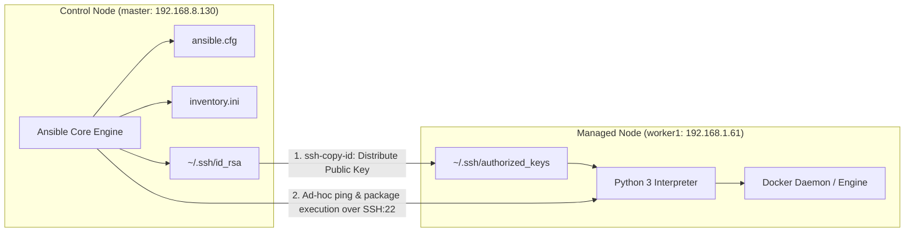
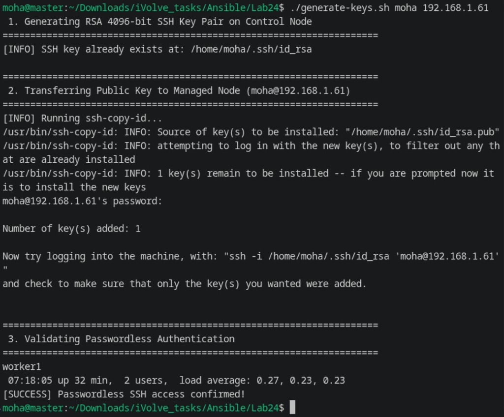
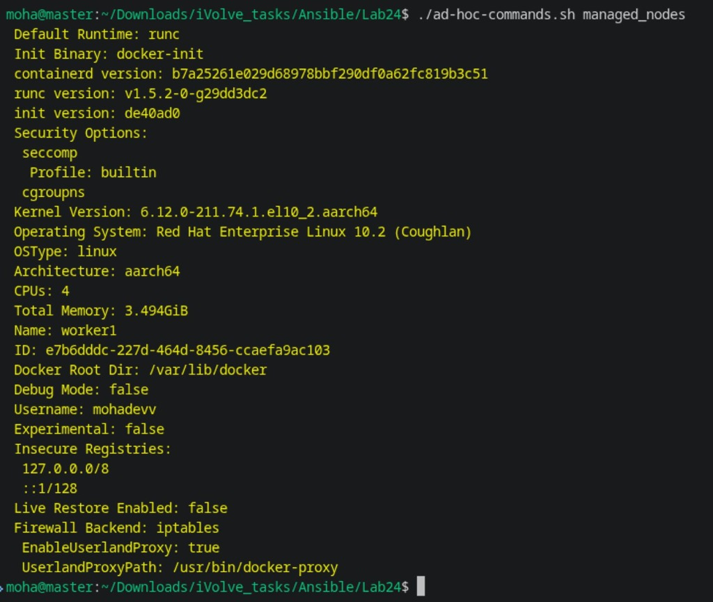

# Lab 24: Initial Ansible Configuration and Ad-Hoc Execution

## 1. Overview & Architecture

This lab establishes the foundational Ansible automation architecture. The control node (`master`) manages remote host infrastructure (`worker1`) over secure, passwordless SSH, executing targeted ad-hoc commands without requiring permanent playbooks.

### Architecture Diagram



---

## 2. Lab Requirements Checklist

- [x] **Install and configure Ansible on control node**.
- [x] **Generate new SSH key pair on control node**.
- [x] **Transfer the public key into managed node using `ssh-copy-id` command**.
- [x] **Create inventory defining the managed node**.
- [x] **Perform ad-hoc commands to install and verify Docker**.

---

## 3. Environment Specifications

| Parameter | Control Node (`master`) | Managed Node (`worker1`) |
| :--- | :--- | :--- |
| **Hostname** | `master` | `worker1` |
| **IP Address** | `192.168.8.130` / `127.0.0.1` | `192.168.1.61` |
| **Operating System** | Red Hat Enterprise Linux 10.2 | Red Hat Enterprise Linux 10.2 |
| **Ansible Role** | Controller / Automation Hub | Target Managed Host |
| **SSH User** | `moha` | `moha` |
| **Authentication** | RSA 4096-bit Key (`~/.ssh/id_rsa`) | Authorized Key (`~/.ssh/authorized_keys`) |
| **Ansible Engine** | `ansible-core 2.21+` / Python 3.12 | Python 3.12 target runtime |

---

## 4. Step-by-Step Implementation

### Step 1: Install and Configure Ansible on Control Node

1. Install Ansible and prerequisites on the control node:
   ```bash
   python3 -m pip install ansible ansible-core
   ```
2. Verify the installed version:
   ```bash
   ansible --version
   ```
3. Create the centralized configuration file [`ansible.cfg`](ansible.cfg):
   ```ini
   [defaults]
   inventory = inventory.ini
   remote_user = moha
   private_key_file = ~/.ssh/id_rsa
   host_key_checking = False
   retry_files_enabled = False
   timeout = 30

   [privilege_escalation]
   become = False
   become_method = sudo
   become_user = root
   become_ask_pass = False
   ```

### Step 2: Generate SSH Key Pair on Control Node

Generate an RSA 4096-bit SSH key pair without a passphrase for automated tasks:

```bash
ssh-keygen -t rsa -b 4096 -f ~/.ssh/id_rsa -N "" -C "ansible-control-node"
```

Verify that both the private key (`~/.ssh/id_rsa`) and public key (`~/.ssh/id_rsa.pub`) exist with correct permissions (`0600` and `0644`).

### Step 3: Transfer Public Key to Managed Node via `ssh-copy-id`

Distribute the public key to the target managed node:

```bash
ssh-copy-id -i ~/.ssh/id_rsa.pub moha@192.168.1.61
```

Validate passwordless SSH access:
```bash
ssh -i ~/.ssh/id_rsa -o BatchMode=yes moha@192.168.1.61 "hostname && uptime"
```

Or execute the automated key generation & transfer script [`generate-keys.sh`](generate-keys.sh):
```bash
./generate-keys.sh moha 192.168.1.61
```



### Step 4: Create Inventory of Managed Node

Create [`inventory.ini`](inventory.ini) defining host groups and connection variables:

```ini
[control_node]
master ansible_host=127.0.0.1 ansible_connection=local

[managed_nodes]
worker1 ansible_host=192.168.1.61 ansible_user=moha ansible_ssh_private_key_file=~/.ssh/id_rsa

[all:vars]
ansible_python_interpreter=/usr/bin/python3
```

Validate inventory resolution:
```bash
ansible-inventory -i inventory.ini --list
ansible-inventory -i inventory.ini --graph
```

### Step 5: Perform Ad-Hoc Commands to Install Docker

Execute targeted Ansible ad-hoc commands using built-in modules:

1. **Verify host connectivity with `ping` module**:
   ```bash
   ansible managed_nodes -m ping
   ```

2. **Add Docker official package repository with `get_url` module**:
   ```bash
   ansible managed_nodes -b -m get_url -a \
     "url=https://download.docker.com/linux/rhel/docker-ce.repo dest=/etc/yum.repos.d/docker-ce.repo mode=0644" \
     -K
   ```

3. **Install Docker Engine packages with `package` module**:
   ```bash
   ansible managed_nodes -b -m package -a \
     "name=docker-ce,docker-ce-cli,containerd.io,docker-buildx-plugin,docker-compose-plugin state=present" \
     -K
   ```

4. **Enable and start Docker daemon with `service` module**:
   ```bash
   ansible managed_nodes -b -m service -a \
     "name=docker state=started enabled=yes" \
     -K
   ```

5. **Verify Docker version with `command` module**:
   ```bash
   ansible managed_nodes -m command -a "docker --version"
   ansible managed_nodes -m command -a "docker info"
   ```

Or execute the complete ad-hoc sequence via [`ad-hoc-commands.sh`](ad-hoc-commands.sh):
```bash
./ad-hoc-commands.sh managed_nodes
```



---

## 5. Artifacts Summary

| File | Purpose |
| :--- | :--- |
| [`ansible.cfg`](ansible.cfg) | Centralized Ansible configuration setting defaults, timeout, and privilege escalation rules. |
| [`inventory.ini`](inventory.ini) | Static inventory defining `control_node` and `managed_nodes` with SSH parameters. |
| [`generate-keys.sh`](generate-keys.sh) | Automated script to generate RSA 4096-bit key pair and transfer to managed node. |
| [`ad-hoc-commands.sh`](ad-hoc-commands.sh) | Script automating the execution of all ad-hoc commands from ping to Docker installation. |
