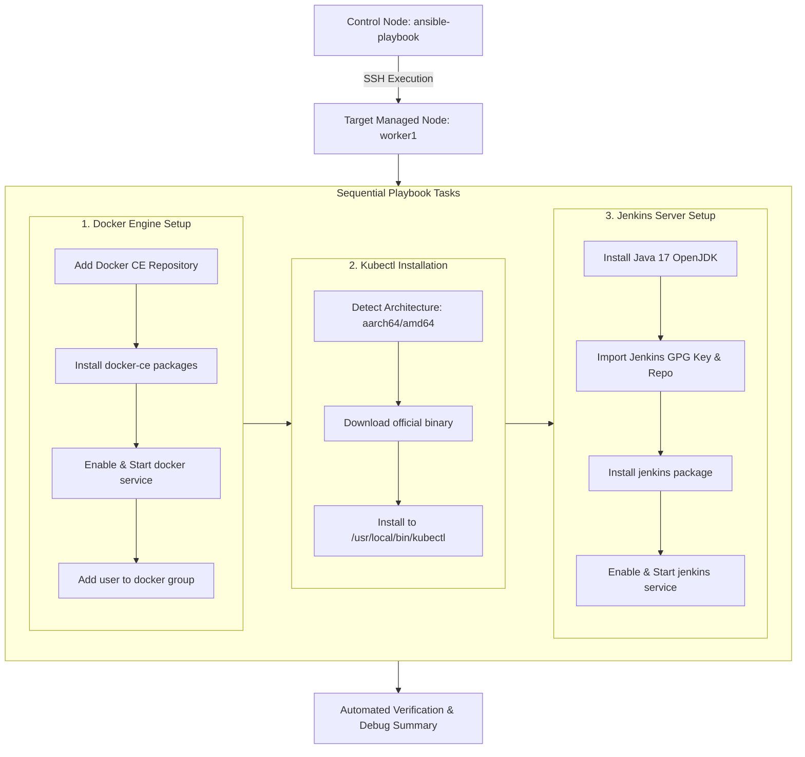
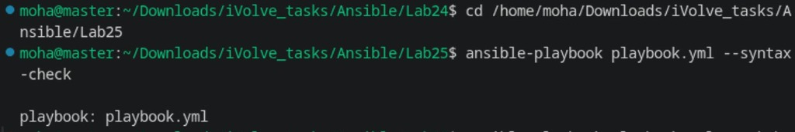
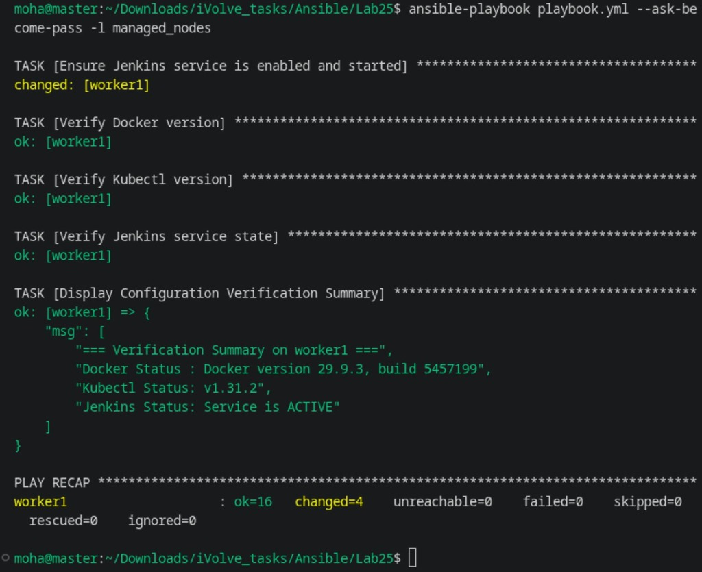
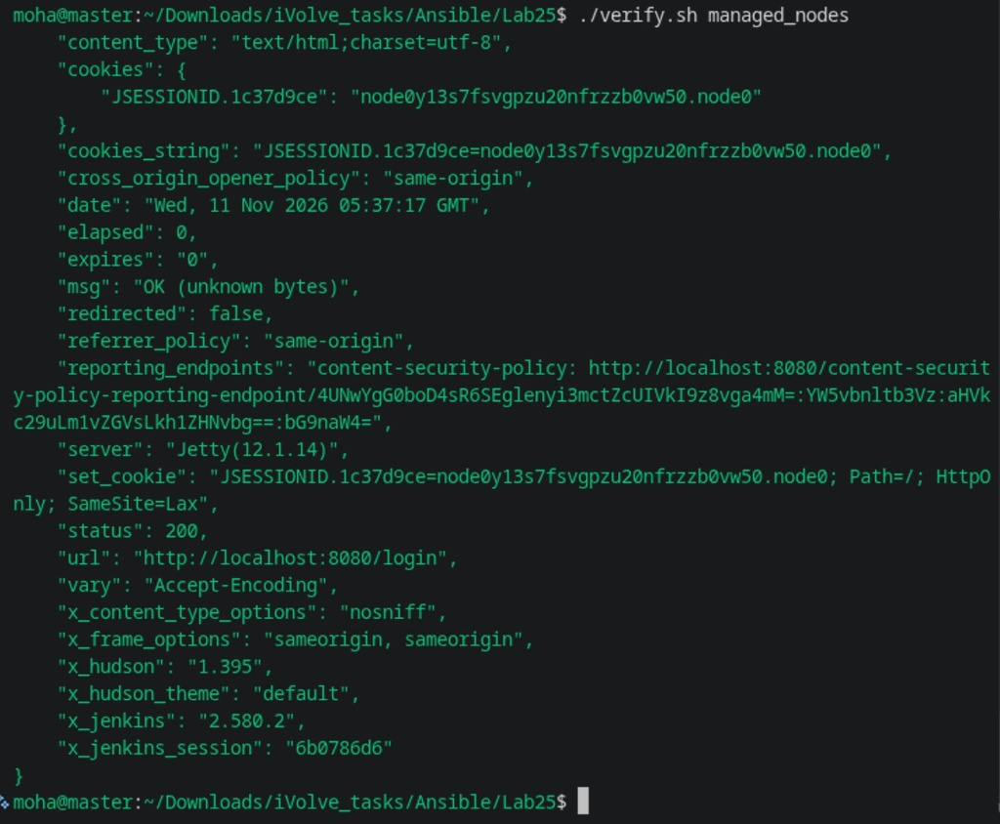

# Lab 25: Automated Web Server Configuration Using Ansible Playbooks

## 1. Overview & Architecture

This lab automates the complete provisioning of a DevOps engineer workstation and CI/CD node using a modular Ansible Playbook. The playbook idempotently configures **Docker CE**, installs **Kubectl CLI**, and sets up the **Jenkins automation server** along with its Java 17 prerequisite.

### Automation Workflow Architecture



---

## 2. Lab Requirements Checklist

- [x] **Write an Ansible playbook to automate the following tasks**:
  - [x] **Install Docker** (repositories, packages, daemon management, group configuration).
  - [x] **Install Kubectl** (architecture-aware binary download, permissions, system path placement).
  - [x] **Install Jenkins** (Java 17 prerequisite, GPG key import, RPM repo, systemd service).
- [x] **Verify the configuration on managed node** (status checks, CLI outputs, service validations).

---

## 3. Playbook Variables & Defaults

| Variable | Default Value | Description |
| :--- | :--- | :--- |
| `docker_packages` | `docker-ce, docker-ce-cli, containerd.io, ...` | List of Docker CE packages to install. |
| `docker_user` | `moha` | Remote user granted non-root Docker socket permissions. |
| `kubectl_version` | `v1.31.2` | Target Kubernetes client version. |
| `target_arch` | `{{ arch_map[ansible_architecture] }}` | Resolves `aarch64` to `arm64` and `x86_64` to `amd64`. |
| `kubectl_bin_path`| `/usr/local/bin/kubectl` | Target installation path with `0755` permissions. |
| `java_package` | `java-17-openjdk-devel` | LTS Java Development Kit required by Jenkins. |
| `jenkins_repo_url` | `https://pkg.jenkins.io/redhat-stable/jenkins.repo` | Official Jenkins Red Hat package repository. |

---

## 4. Step-by-Step Implementation

### Step 1: Centralized Configuration & Inventory

Ensure [`ansible.cfg`](ansible.cfg) points to [`inventory.ini`](inventory.ini):

```ini
[defaults]
inventory = inventory.ini
remote_user = moha
private_key_file = ~/.ssh/id_rsa
host_key_checking = False
retry_files_enabled = False
timeout = 30
```

### Step 2: Validate Playbook Syntax

Verify the YAML syntax and module parameters before execution:

```bash
ansible-playbook playbook.yml --syntax-check
```



### Step 3: Execute the Automated Playbook

Run the playbook against target hosts with sudo privilege escalation:

```bash
ansible-playbook playbook.yml --ask-become-pass -l managed_nodes
```



### Step 4: Verify Components on Managed Node

Run [`verify.sh`](verify.sh) to execute end-to-end status validations:

```bash
./verify.sh managed_nodes
```



Individual ad-hoc verification commands:
```bash
# 1. Verify Docker Engine
ansible managed_nodes -m command -a "docker --version"
ansible managed_nodes -m command -a "docker info"

# 2. Verify Kubectl Client
ansible managed_nodes -m command -a "kubectl version --client"

# 3. Verify Jenkins Service
ansible managed_nodes -m command -a "systemctl status jenkins"
```

---

## 5. Artifacts Summary

| File | Purpose |
| :--- | :--- |
| [`ansible.cfg`](ansible.cfg) | Configuration file for Ansible runtime and privilege escalation options. |
| [`inventory.ini`](inventory.ini) | Static inventory containing `control_node` and `managed_nodes`. |
| [`playbook.yml`](playbook.yml) | Complete Ansible Playbook provisioning Docker, Kubectl, and Jenkins. |
| [`verify.sh`](verify.sh) | Executable verification script testing syntax, playbook execution, and live service health. |
