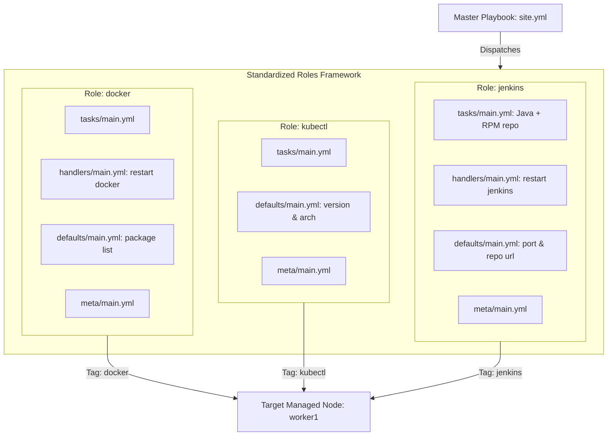
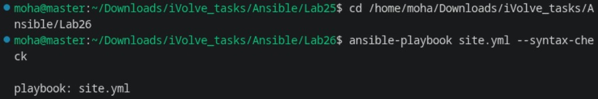
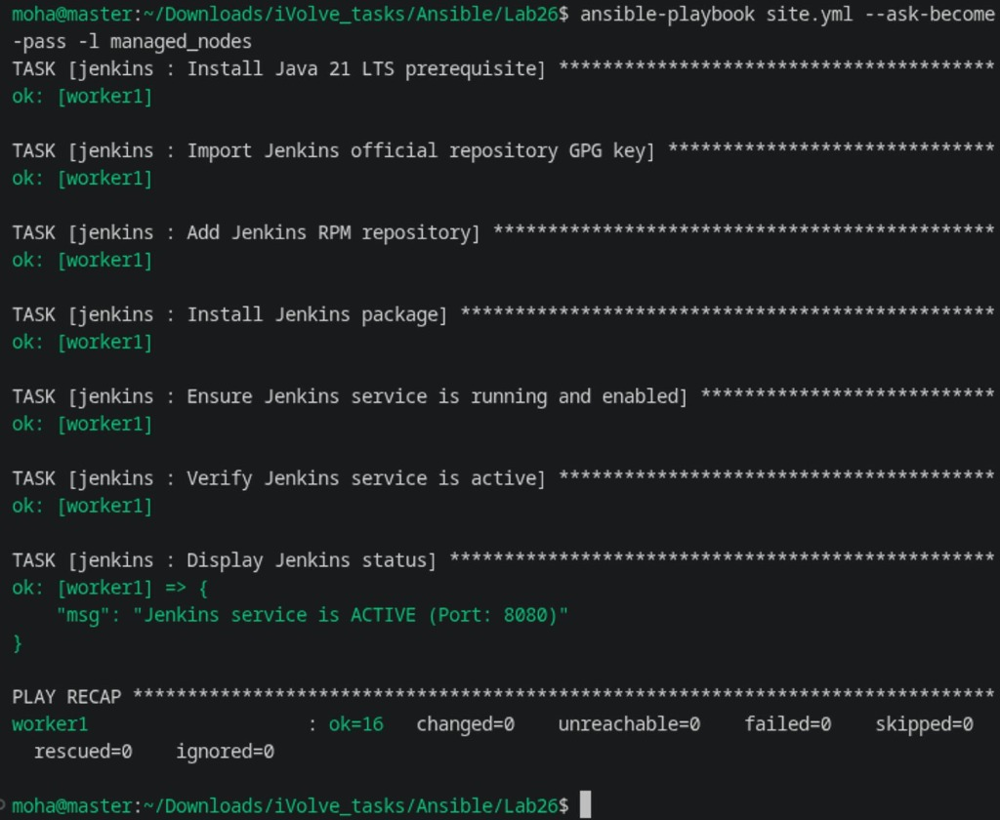
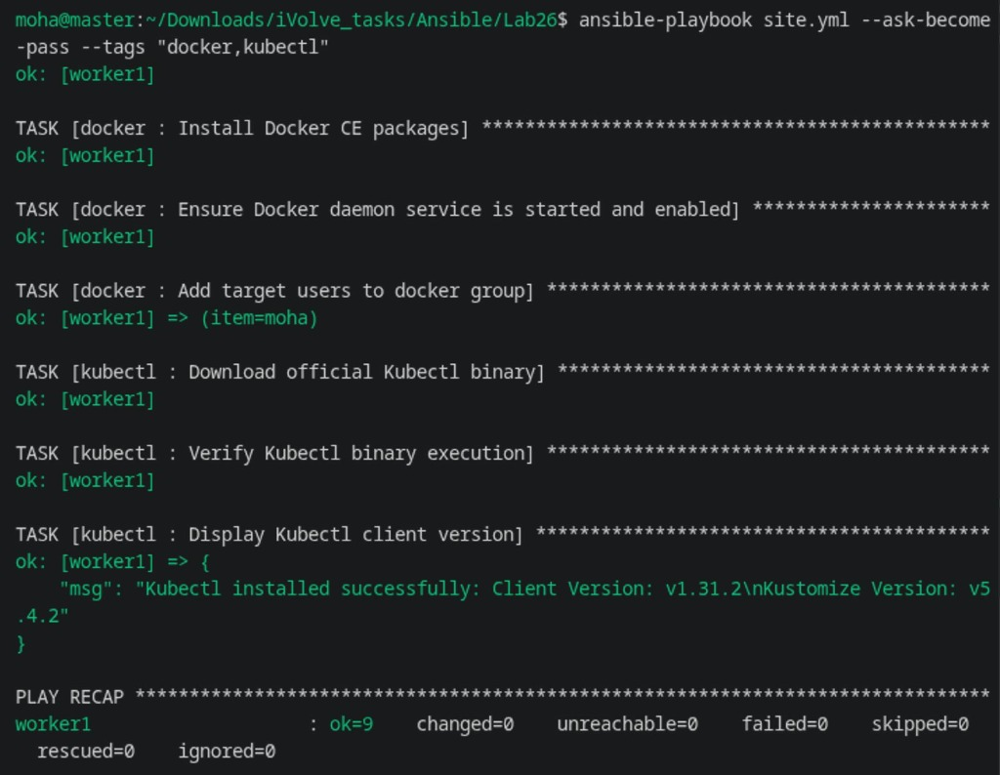
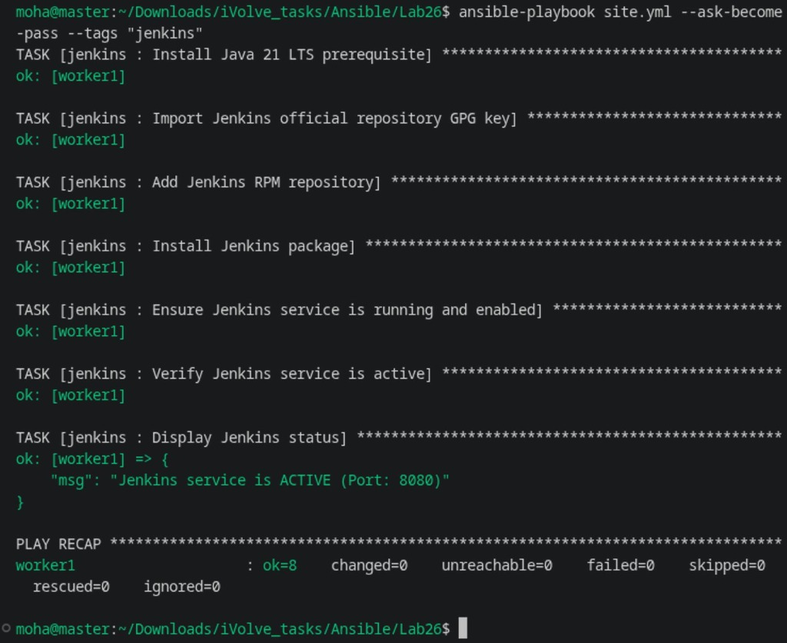

# Lab 26: Structured Configuration Management with Ansible Roles

## 1. Overview & Architecture

This lab refactors the monolithic DevOps provisioning workflow into **reusable, modular Ansible Roles**. Roles promote enterprise-grade infrastructure-as-code principles: separation of concerns, DRY (Don't Repeat Yourself), independent variable scoping, and automated handler triggers.

### Roles Architecture Diagram



---

## 2. Lab Requirements Checklist

- [x] **Create separate Ansible roles for Docker, kubectl, and Jenkins**.
  - [x] `roles/docker/`: Tasks, handlers, defaults, and metadata.
  - [x] `roles/kubectl/`: Binary download, architecture mapping, version verification.
  - [x] `roles/jenkins/`: Java 17 prerequisite, GPG key import, package install, and service management.
- [x] **Write Ansible playbook (`site.yml`) to run the created roles**.
- [x] Support selective execution via Ansible tags.

---

## 3. Directory Structure

```text
Ansible/Lab26/
├── ansible.cfg
├── inventory.ini
├── site.yml
├── run-roles.sh
├── README.md
└── roles/
    ├── docker/
    │   ├── defaults/main.yml
    │   ├── handlers/main.yml
    │   ├── meta/main.yml
    │   └── tasks/main.yml
    ├── kubectl/
    │   ├── defaults/main.yml
    │   ├── meta/main.yml
    │   └── tasks/main.yml
    └── jenkins/
        ├── defaults/main.yml
        ├── handlers/main.yml
        ├── meta/main.yml
        └── tasks/main.yml
```

---

## 4. Role Specifications

### 1. `docker` Role
* **Tasks**: Installs `curl`, `ca-certificates`, adds Docker CE repository, installs container runtime packages (`docker-ce`, `docker-ce-cli`, `containerd.io`), and appends the target user to the `docker` system group.
* **Handler**: Notifies `restart docker` on configuration change.
* **Tags**: `docker`, `container_runtime`.

### 2. `kubectl` Role
* **Tasks**: Dynamically resolves hardware architecture (`aarch64` ➔ `arm64`, `x86_64` ➔ `amd64`), downloads the official Kubernetes release binary, installs to `/usr/local/bin/kubectl` (`0755`), and validates the client version.
* **Tags**: `kubectl`, `kubernetes_tools`.

### 3. `jenkins` Role
* **Tasks**: Installs `java-21-openjdk-devel` LTS, imports the official Jenkins GPG key, defines the RPM repository, installs package `jenkins`, and ensures the systemd service is active.
* **Handler**: Notifies `restart jenkins` on configuration updates.
* **Tags**: `jenkins`, `ci_server`.

---

## 5. Execution & Verification

### Step 1: Validate Syntax of All Roles

```bash
ansible-playbook site.yml --syntax-check
```



### Step 2: Run All Roles

Execute all three roles sequentially across managed hosts:

```bash
ansible-playbook site.yml --ask-become-pass -l managed_nodes
```



### Step 3: Run Specific Roles Using Tags

Execute only the Docker and Kubectl roles:
```bash
ansible-playbook site.yml --ask-become-pass --tags "docker,kubectl"
```



Execute only the Jenkins role:
```bash
ansible-playbook site.yml --ask-become-pass --tags "jenkins"
```



### Step 4: Using the Convenience Runner Script

```bash
# Run all roles
./run-roles.sh managed_nodes all

# Run specific tag
./run-roles.sh managed_nodes docker
```

---

## 6. Artifacts Summary

| Artifact | File Path | Description |
| :--- | :--- | :--- |
| **Ansible Config** | [`ansible.cfg`](ansible.cfg) | Sets `roles_path = roles` and connection defaults. |
| **Inventory** | [`inventory.ini`](inventory.ini) | Static inventory defining managed nodes. |
| **Master Playbook** | [`site.yml`](site.yml) | Orchestrates `docker`, `kubectl`, and `jenkins` roles with tags. |
| **Docker Role** | [`roles/docker/`](roles/docker/) | Standalone role provisioning Docker Engine and daemon handlers. |
| **Kubectl Role** | [`roles/kubectl/`](roles/kubectl/) | Standalone role fetching and installing `kubectl` binary. |
| **Jenkins Role** | [`roles/jenkins/`](roles/jenkins/) | Standalone role managing Java 17 and Jenkins CI server. |
| **Execution Script** | [`run-roles.sh`](run-roles.sh) | Shell runner supporting host targeting and tag filters. |
