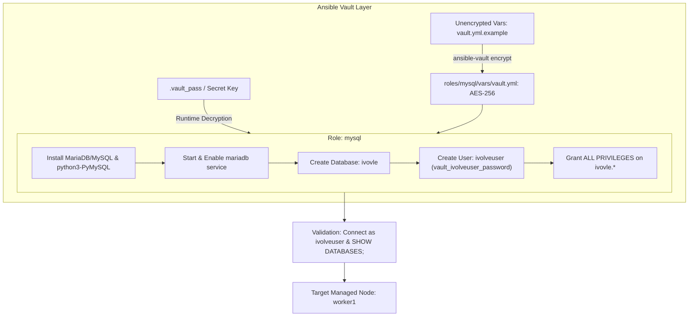
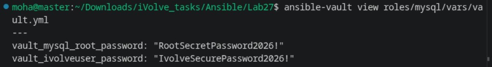
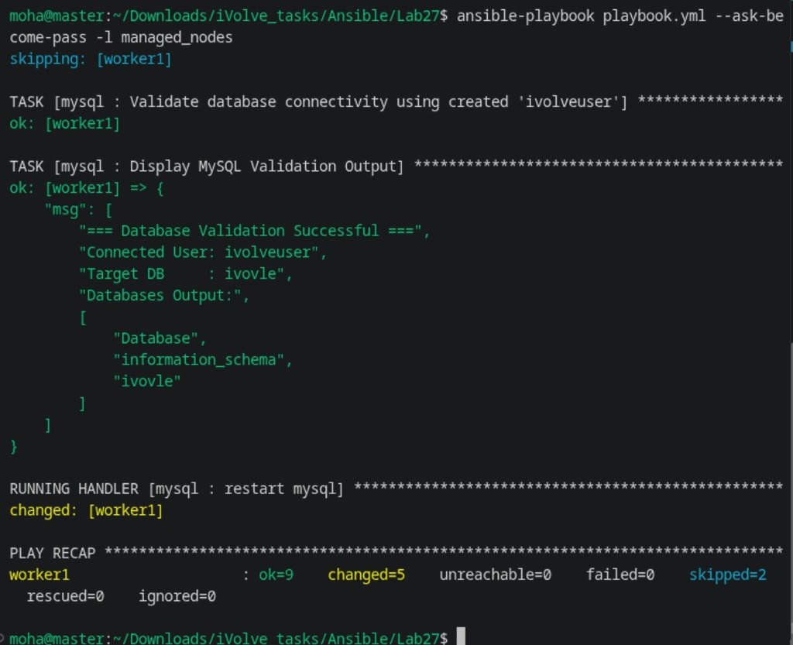
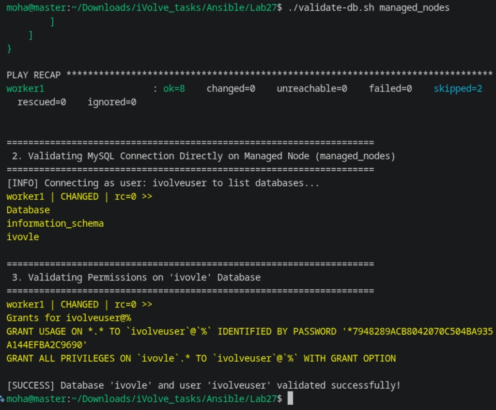

# Lab 27: Securing Sensitive Data with Ansible Vault

## 1. Overview & Architecture

This lab implements enterprise-grade secret management using **Ansible Vault** to protect sensitive database credentials. An automated `mysql` role deploys a relational database server, creates an isolated database named `ivovle`, provisions user `ivolveuser` with full privileges, and validates the connection without exposing passwords in plain text.

### Architecture & Security Workflow



---

## 2. Lab Requirements Checklist

- [x] **Create MySQL Role to automate the following tasks**:
  - [x] Install MySQL / MariaDB server and Python connector.
  - [x] Create `ivovle` database.
  - [x] Create `ivolveuser` user with all privileges on `ivovle` DB.
- [x] **Use Ansible Vault to encrypt sensitive information such as database user password**.
- [x] **Validate DB on managed node by connecting to database using the created user and listing databases**.

---

## 3. Directory Structure

```text
Ansible/Lab27/
├── ansible.cfg
├── inventory.ini
├── playbook.yml
├── validate-db.sh
├── .vault_pass
├── README.md
└── roles/
    └── mysql/
        ├── defaults/main.yml
        ├── handlers/main.yml
        ├── meta/main.yml
        ├── tasks/main.yml
        └── vars/
            ├── vault.yml           # AES-256 Encrypted via Ansible Vault
            └── vault.yml.example   # Cleartext reference template
```

---

## 4. Step-by-Step Implementation

### Step 1: Manage Secrets with Ansible Vault

1. Define the vault password in `.vault_pass` (with permissions `0600`):
   ```bash
   echo "ivolve2026" > .vault_pass
   chmod 600 .vault_pass
   ```

2. Create the variable file `roles/mysql/vars/vault.yml`:
   ```yaml
   ---
   vault_mysql_root_password: "RootSecretPassword2026!"
   vault_ivolveuser_password: "IvolveSecurePassword2026!"
   ```

3. Encrypt the file using AES-256 encryption:
   ```bash
   ansible-vault encrypt roles/mysql/vars/vault.yml
   ```

4. View or edit encrypted variables securely:
   ```bash
   # View encrypted content
   ansible-vault view roles/mysql/vars/vault.yml

   # Edit encrypted content in editor
   ansible-vault edit roles/mysql/vars/vault.yml
   ```



### Step 2: Implement the `mysql` Role

The role defines:
- **Defaults** ([`roles/mysql/defaults/main.yml`](roles/mysql/defaults/main.yml)):
  `mysql_database_name: "ivovle"`, `mysql_user_name: "ivolveuser"`.
- **Tasks** ([`roles/mysql/tasks/main.yml`](roles/mysql/tasks/main.yml)):
  - Loads vaulted credentials dynamically via `include_vars: vars/vault.yml`.
  - Installs packages: `mariadb-server`, `mariadb`, `python3-PyMySQL`.
  - Ensures service is started and enabled.
  - Creates database `ivovle` via `ansible.mysql.mysql_db`.
  - Creates user `ivolveuser` with privileges `ivovle.*:ALL,GRANT` using `ansible.mysql.mysql_user`.
  - Validates connectivity by querying `SHOW DATABASES;` using the newly created user credentials.

### Step 3: Execute Playbook with Vault Decryption

Verify playbook syntax:
```bash
ansible-playbook playbook.yml --syntax-check
```

Execute the playbook:
```bash
ansible-playbook playbook.yml --ask-become-pass -l managed_nodes
```
*(Ansible automatically decrypts `vars/vault.yml` using `.vault_pass` configured in [`ansible.cfg`](ansible.cfg) or via `--ask-vault-pass`).*



### Step 4: Validate Database Access on Managed Node

Run the automated validation script:
```bash
./validate-db.sh managed_nodes
```



Or execute direct ad-hoc validation on the managed host:
```bash
ansible managed_nodes -m command -a \
  "mysql -u ivolveuser -p'IvolveSecurePassword2026!' -h 127.0.0.1 -e 'SHOW DATABASES;'"
```

Expected output confirms that `ivovle` database is listed and accessible to `ivolveuser`.

---

## 5. Artifacts Summary

| Artifact | File Path | Description |
| :--- | :--- | :--- |
| **Ansible Config** | [`ansible.cfg`](ansible.cfg) | Sets `roles_path` and links `vault_password_file = .vault_pass`. |
| **Inventory** | [`inventory.ini`](inventory.ini) | Static inventory defining managed node. |
| **Playbook** | [`playbook.yml`](playbook.yml) | Master playbook invoking role `mysql`. |
| **Encrypted Vault** | [`roles/mysql/vars/vault.yml`](roles/mysql/vars/vault.yml) | AES-256 encrypted credentials for MySQL root and `ivolveuser`. |
| **Vault Example** | [`roles/mysql/vars/vault.yml.example`](roles/mysql/vars/vault.yml.example) | Unencrypted reference template for documentation. |
| **MySQL Tasks** | [`roles/mysql/tasks/main.yml`](roles/mysql/tasks/main.yml) | Tasks installing DB, creating database `ivovle`, and user `ivolveuser`. |
| **Validation Script** | [`validate-db.sh`](validate-db.sh) | Validates DB connectivity and grants for user `ivolveuser`. |
