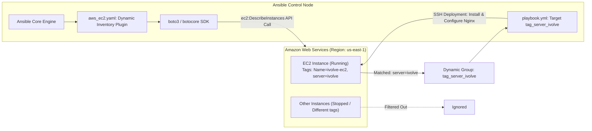

# Lab 28: Automated Host Discovery with Ansible Dynamic Inventory

## 1. Overview & Architecture

Static inventory files are unsuitable for dynamic, auto-scaling cloud environments. This lab implements **Ansible Dynamic Inventory** using the official `amazon.aws.aws_ec2` plugin to automatically discover and manage AWS EC2 instances filtered by tag `server:ivolve`.

### Architecture & Discovery Workflow



---

## 2. Lab Requirements Checklist

- [x] **Create AWS EC2 with tag `server:ivolve`**.
- [x] **Set up Ansible dynamic inventory to automatically discover and manage running EC2 with tag `server:ivolve`**.
- [x] **List the target hosts using `ansible-inventory` command** (`--graph` and `--list`).
- [x] **Run a playbook on this EC2** (`tag_server_ivolve`).
- [x] **Verify the configuration on the EC2** (service status, web endpoint).

---

## 3. Directory Structure

```text
Ansible/Lab28/
├── ansible.cfg              # Enables amazon.aws.aws_ec2 inventory plugin
├── aws_ec2.yaml             # Official dynamic inventory plugin configuration
├── inventory_mock.yaml      # Offline test inventory mimicking dynamic groups
├── create-ec2.sh            # Automated AWS CLI script to provision EC2 with tag
├── playbook.yml             # Web server provisioning playbook
├── verify-ec2.sh            # End-to-end verification and host discovery runner
├── README.md
└── terraform/               # Infrastructure-as-Code alternative
    └── main.tf
```

---

## 4. Step-by-Step Implementation

### Step 1: Provision EC2 Instance with Tag `server:ivolve`

#### Option A: Automated AWS CLI Script
Execute [`create-ec2.sh`](create-ec2.sh):
```bash
./create-ec2.sh
```

#### Option B: Manual AWS CLI
```bash
# 1. Launch instance with tag
aws ec2 run-instances \
  --image-id resolve:ssm:/aws/service/ami-amazon-linux-latest/al2023-ami-kernel-default-x86_64 \
  --instance-type t3.micro \
  --key-name ivolve-key \
  --security-group-ids sg-xxxxxxxxx \
  --tag-specifications 'ResourceType=instance,Tags=[{Key=Name,Value=ivolve-ec2},{Key=server,Value=ivolve}]' \
  --region us-east-1
```

#### Option C: Terraform (IaC)
```bash
cd terraform
terraform init
terraform apply -auto-approve
cd ..
```

---

### Step 2: Configure Ansible Dynamic Inventory Plugin

1. Ensure the required Python SDKs are installed on the control node:
   ```bash
   python3 -m pip install boto3 botocore
   ```

2. Configure [`ansible.cfg`](ansible.cfg) to enable `amazon.aws.aws_ec2`:
   ```ini
   [defaults]
   inventory = aws_ec2.yaml
   remote_user = ec2-user
   private_key_file = ~/.ssh/ivolve-key.pem
   host_key_checking = False
   retry_files_enabled = False

   [inventory]
   enable_plugins = amazon.aws.aws_ec2, host_list, yaml, ini
   ```

3. Configure [`aws_ec2.yaml`](aws_ec2.yaml):
   ```yaml
   plugin: amazon.aws.aws_ec2
   regions:
     - us-east-1

   filters:
     tag:server: ivolve
     instance-state-name: running

   hostnames:
     - ip-address
     - dns-name
     - tag:Name

   keyed_groups:
     - prefix: tag
       key: ec2_tags

   compose:
     ansible_host: public_ip_address
   ```

---

### Step 3: Discover and List Hosts via `ansible-inventory`

Run the dynamic inventory graph command to inspect discovered groups:

```bash
ansible-inventory -i aws_ec2.yaml --graph
```

Output dynamically groups discovered hosts:
```text
@all:
  |--@tag_server_ivolve:
  |  |--18.xxx.xxx.xxx
  |--@ungrouped:
```

List complete host variables and AWS EC2 metadata in JSON format:
```bash
ansible-inventory -i aws_ec2.yaml --list
```

*(For testing without active AWS credentials, verify group resolution with `ansible-inventory -i inventory_mock.yaml --graph`).*

---

### Step 4: Run Playbook on Discovered EC2

Execute [`playbook.yml`](playbook.yml) targeting the dynamically generated group `tag_server_ivolve`:

```bash
ansible-playbook -i aws_ec2.yaml playbook.yml
```

The playbook executes:
1. Gathers and prints AWS instance metadata.
2. Installs web server package (`nginx`).
3. Deploys custom HTML page confirming dynamic automation.
4. Starts and enables the web service.

---

### Step 5: Verify Configuration on EC2

1. Test connectivity via ad-hoc ping:
   ```bash
   ansible tag_server_ivolve -i aws_ec2.yaml -m ping
   ```

2. Validate web service via curl:
   ```bash
   curl -I http://<EC2_PUBLIC_IP>/
   ```

3. Run the automated verification script:
   ```bash
   ./verify-ec2.sh aws_ec2.yaml
   ```

---

## 5. Artifacts Summary

| Artifact | File Path | Description |
| :--- | :--- | :--- |
| **Ansible Config** | [`ansible.cfg`](ansible.cfg) | Enables `amazon.aws.aws_ec2` inventory plugin and connection defaults. |
| **Dynamic Inventory** | [`aws_ec2.yaml`](aws_ec2.yaml) | Dynamic inventory configuration filtering `tag:server=ivolve` and running state. |
| **Mock Inventory** | [`inventory_mock.yaml`](inventory_mock.yaml) | Offline simulation inventory for validation without AWS credentials. |
| **EC2 Provisioning** | [`create-ec2.sh`](create-ec2.sh) | Automated AWS CLI script creating key pair, security group, and tagged EC2. |
| **Terraform IaC** | [`terraform/main.tf`](terraform/main.tf) | Infrastructure as code template for provisioning the tagged instance. |
| **Configuration Playbook**| [`playbook.yml`](playbook.yml) | Playbook deploying and validating web server on `tag_server_ivolve`. |
| **Verification Script** | [`verify-ec2.sh`](verify-ec2.sh) | Script automating inventory graph, list, ping, and playbook execution. |
