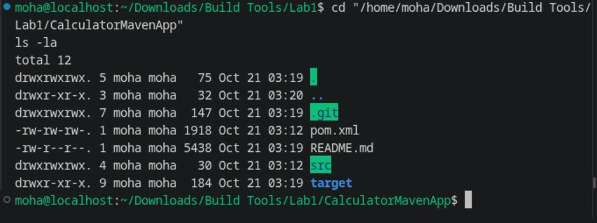
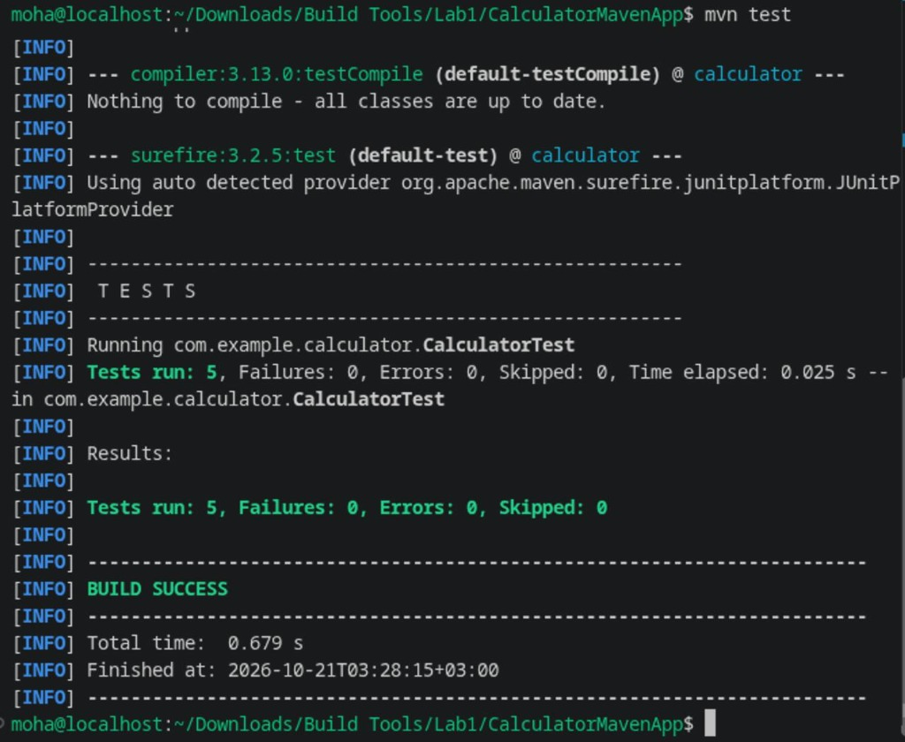
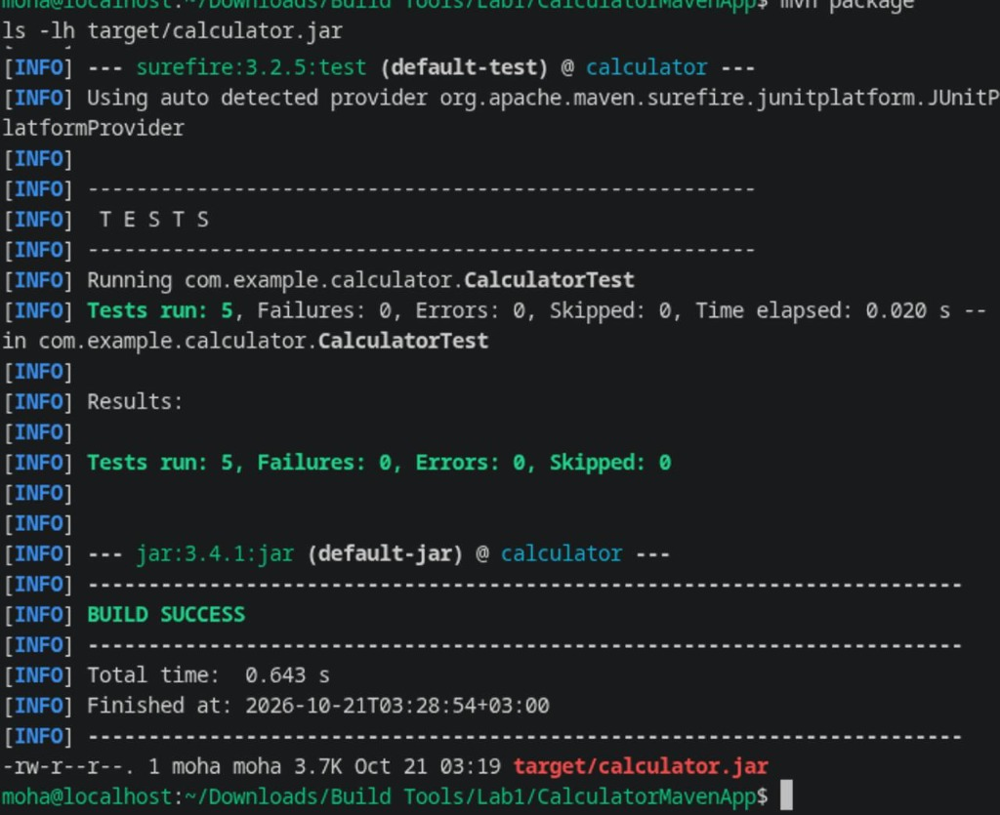
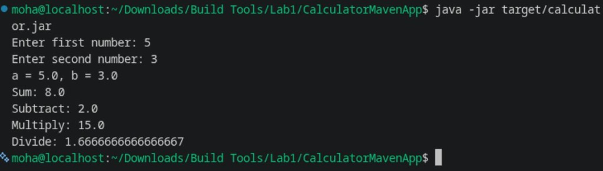

# Lab 1: Building and Packaging Java Application with Maven

Steps and commands completed for Lab 1 (Build Tools).

---

## Prerequisites

Make sure Java 17 and Maven are installed:

```bash
java -version
mvn -version
```

If you need to install them:
```bash
# RHEL / CentOS / Fedora
sudo dnf install -y java-17-openjdk-devel maven

# Ubuntu / Debian
sudo apt update && sudo apt install -y openjdk-17-jdk maven
```

---

## 1. Clone the Project

Clone the repository and go into the project folder:

```bash
git clone https://github.com/Ibrahim-Adel15/CalculatorMavenApp.git
cd CalculatorMavenApp
ls -la
```



Project layout:
- `pom.xml` — Maven configuration with Java 17 and JUnit 5
- `src/main/` — Calculator source code (`Calculator.java`, `Main.java`)
- `src/test/` — Unit tests (`CalculatorTest.java`)

---

## 2. Run Unit Tests

Run the test suite:

```bash
mvn test
```



Tests run: **5**, Failures: **0**, Errors: **0**, Skipped: **0** (`BUILD SUCCESS`).

Tests cover:
- Addition (`testSum`)
- Subtraction (`testSubtract`)
- Multiplication (`testMultiply`)
- Division (`testDivide`)
- Division by zero exception (`testDivideByZeroThrowsException`)

---

## 3. Build & Package the App

Generate the executable JAR and inspect the artifact:

```bash
mvn package
ls -lh target/calculator.jar
```



The output artifact is generated in `target/calculator.jar`.

---

## 4. Run the Application

Run the compiled JAR file and verify calculator operations:

```bash
java -jar target/calculator.jar
```



---

## Quick Reference

| Action | Command |
| :--- | :--- |
| Run tests | `mvn test` |
| Build JAR | `mvn package` |
| Run app | `java -jar target/calculator.jar` |
| Clean target folder | `mvn clean` |
