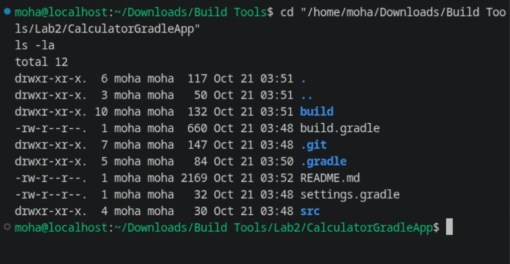
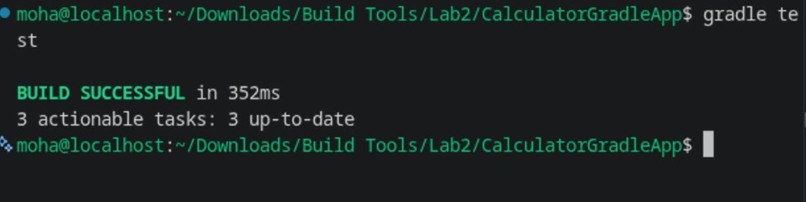
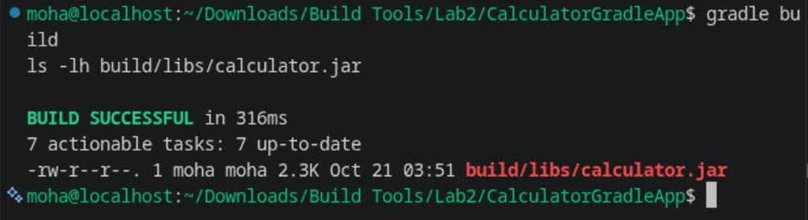
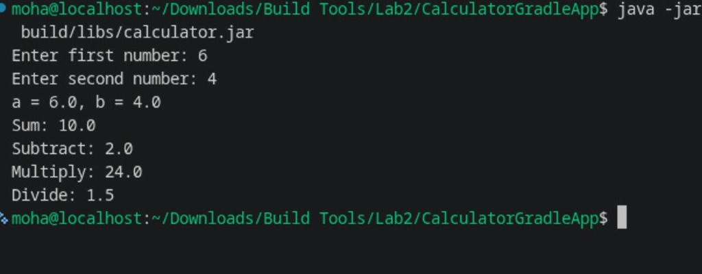

# Lab 2: Building and Packaging Java Application with Gradle

Steps and commands completed for Lab 2 (Build Tools).

---

## Prerequisites

Make sure Java 17 and Gradle are installed:

```bash
java -version
gradle -v
```

If you need to install Gradle:
```bash
# Download and install Gradle 8.10.2
curl -fsSL "https://services.gradle.org/distributions/gradle-8.10.2-bin.zip" -o /tmp/gradle.zip
unzip -q /tmp/gradle.zip -d ~/.tools/
rm -f /tmp/gradle.zip

# Add to PATH
export GRADLE_HOME=~/.tools/gradle-8.10.2
export PATH=$GRADLE_HOME/bin:$PATH
```

---

## 1. Clone the Project

Clone the repository and navigate into the project folder:

```bash
git clone https://github.com/Ibrahim-Adel15/CalculatorGradleApp.git
cd CalculatorGradleApp
ls -la
```



Project layout:
- `build.gradle` — Gradle build script with Java 17 toolchain, JUnit 5, and JAR packaging settings
- `settings.gradle` — Project settings definition
- `src/main/` — Calculator source code (`Calculator.java`, `Main.java`)
- `src/test/` — Unit tests (`CalculatorTest.java`)

---

## 2. Run Unit Tests

Run the test suite using Gradle:

```bash
gradle test
```



Expected output:
```text
> Task :compileJava
> Task :classes
> Task :compileTestJava
> Task :testClasses
> Task :test

BUILD SUCCESSFUL
```

Tests cover:
- Addition (`testSum`)
- Subtraction (`testSubtract`)
- Multiplication (`testMultiply`)
- Division (`testDivide`)
- Division by zero exception (`testDivideByZeroThrowsException`)

---

## 3. Build & Package the App

Build the executable JAR file and inspect the artifact:

```bash
gradle build
ls -lh build/libs/calculator.jar
```



The output artifact is generated in the `build/libs/` directory:
- `build/libs/calculator.jar`

---

## 4. Run the Application

Run the compiled JAR file and verify calculator operations:

```bash
java -jar build/libs/calculator.jar
```



Example input & output:
```text
Enter first number: 6
Enter second number: 4
a = 6.0, b = 4.0
Sum: 10.0
Subtract: 2.0
Multiply: 24.0
Divide: 1.5
```

---

## Quick Reference

| Action | Command |
| :--- | :--- |
| Run tests | `gradle test` |
| Build JAR | `gradle build` |
| Run app | `java -jar build/libs/calculator.jar` |
| Clean build folder | `gradle clean` |
