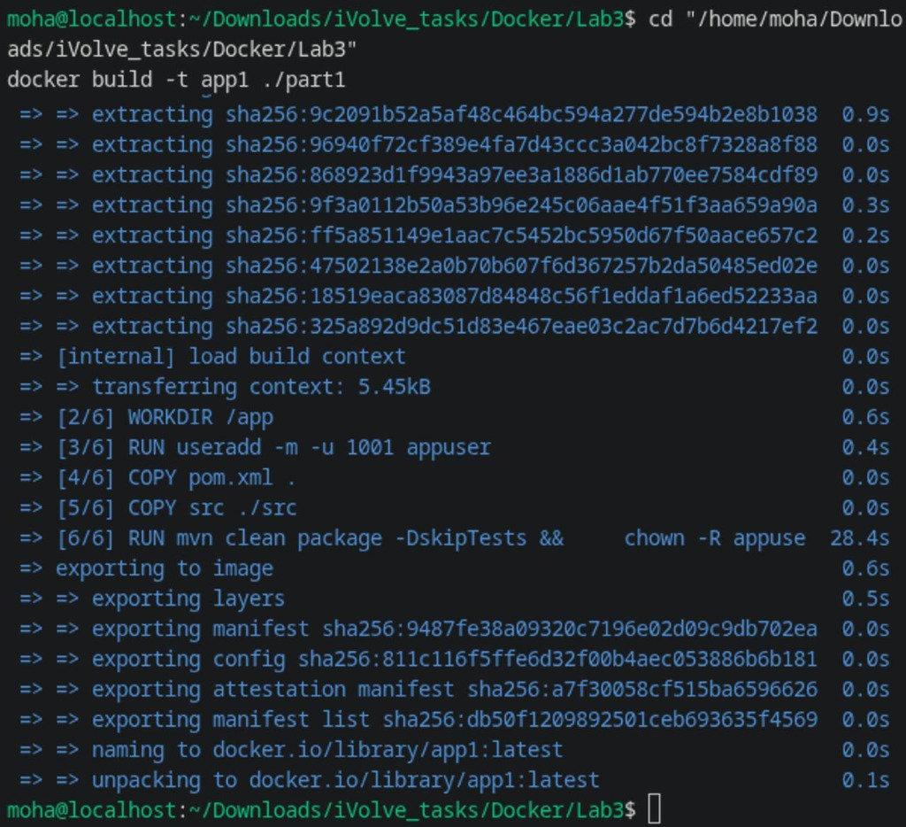
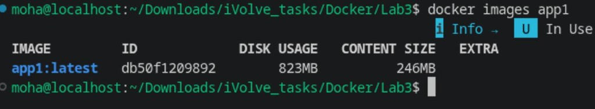
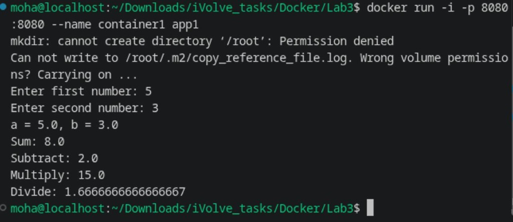
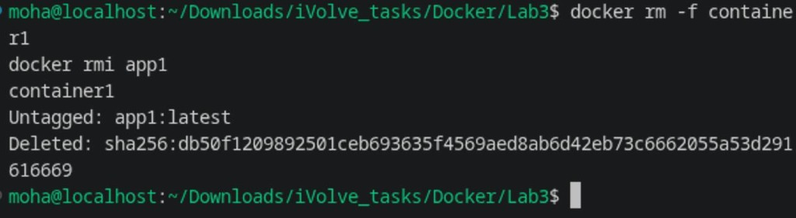
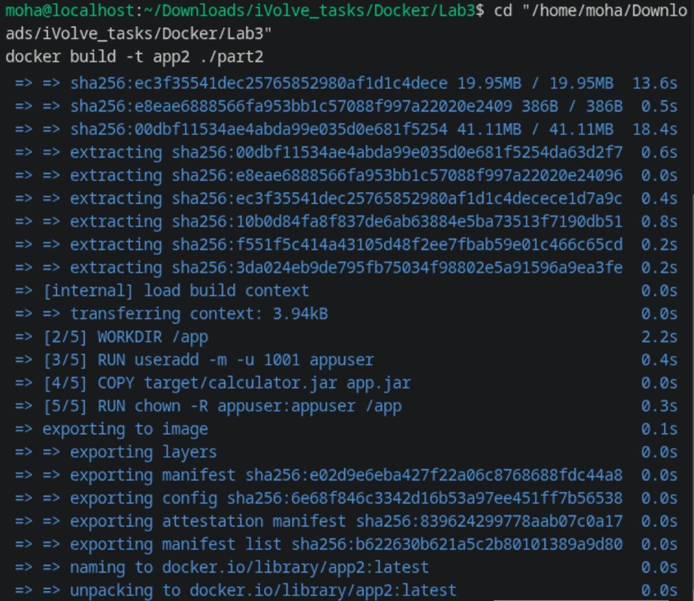
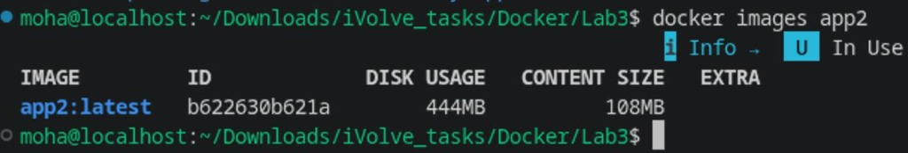
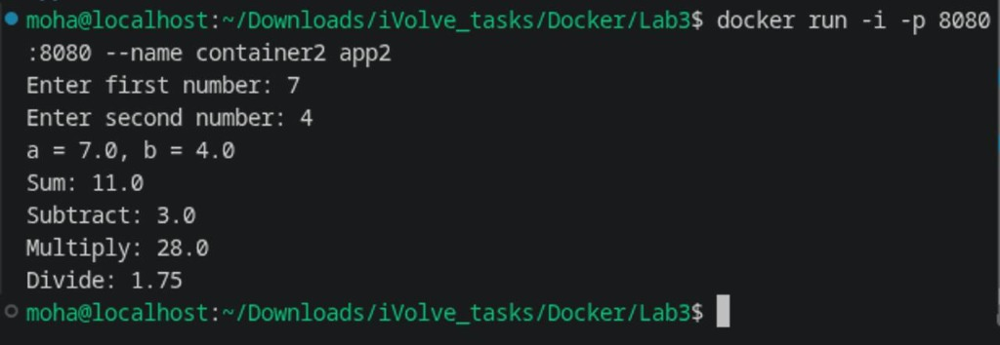
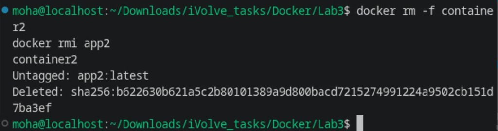

# Lab 3: Creating a Docker Image for a Java Application

Steps and commands completed for Lab 3 (Containerization with Docker).

---

## Overview

In this lab, we containerize a Java 17 Calculator application using two different approaches:
1. **Part 1 (Build Inside Docker)**: Using a Maven + JDK image to build the application entirely inside Docker.
2. **Part 2 (Build Locally)**: Building the application locally on the host machine and packaging only the runtime JAR inside a lightweight JRE image.
3. **Bonus**: Comparing image sizes and analyzing the trade-offs between both approaches.

Both Dockerfiles are configured with a **non-root user (`appuser`, UID 1001)** who owns `/app` and executes the container, ensuring secure container execution.

---

## Part 1: Build Inside Docker

### 1. The Dockerfile (`part1/Dockerfile`)

```dockerfile
FROM maven:3.9.9-eclipse-temurin-17

# Working directory
WORKDIR /app

# Create a non-root user (appuser) to control the container
RUN useradd -m -u 1001 appuser

# Copy build descriptor and source code
COPY pom.xml .
COPY src ./src

# Build the application inside the container and set permissions
RUN mvn clean package -DskipTests && \
    chown -R appuser:appuser /app

# Expose port 8080
EXPOSE 8080

# Switch to non-root user
USER appuser

# Run the generated JAR
CMD ["java", "-jar", "target/calculator.jar"]
```

### 2. Build Image `app1`

```bash
cd "/home/moha/Downloads/iVolve_tasks/Docker/Lab3"
docker build -t app1 ./part1
```



### 3. Check Image Size

```bash
docker images app1
```



The image `app1:latest` takes **823 MB** on disk.

### 4. Run `container1` & Verify

```bash
docker run -i -p 8080:8080 --name container1 app1
```



Entered numbers `5` and `3`:
- `Sum: 8.0`
- `Subtract: 2.0`
- `Multiply: 15.0`
- `Divide: 1.6666666666666667`

### 5. Cleanup `container1` and `app1`

```bash
docker rm -f container1
docker rmi app1
```



---

## Part 2: Build Locally

### 1. Build the Application Locally
First, build the JAR on the host machine using Maven:
```bash
cd "/home/moha/Downloads/iVolve_tasks/Docker/Lab3/CalculatorMavenApp"
mvn clean package
```
The compiled artifact is generated at `target/calculator.jar`.

### 2. The Dockerfile (`part2/Dockerfile`)

```dockerfile
FROM eclipse-temurin:17-jre

# Working directory
WORKDIR /app

# Create a non-root user (appuser) to control the container
RUN useradd -m -u 1001 appuser

# Copy the pre-built JAR from host
COPY target/calculator.jar app.jar

# Set ownership to non-root user
RUN chown -R appuser:appuser /app

# Expose port 8080
EXPOSE 8080

# Switch to non-root user
USER appuser

# Run the application
CMD ["java", "-jar", "app.jar"]
```

### 3. Build Image `app2`

```bash
cd "/home/moha/Downloads/iVolve_tasks/Docker/Lab3"
docker build -t app2 ./part2
```



### 4. Check Image Size

```bash
docker images app2
```



The image `app2:latest` takes **444 MB** on disk.

### 5. Run `container2` & Verify

```bash
docker run -i -p 8080:8080 --name container2 app2
```



Entered numbers `7` and `4`:
- `Sum: 11.0`
- `Subtract: 3.0`
- `Multiply: 28.0`
- `Divide: 1.75`

### 6. Cleanup `container2` and `app2`

```bash
docker rm -f container2
docker rmi app2
```



---

## Bonus: Image Size Comparison & Analysis

| Image | Approach | Base Image | Disk Usage | Content Size |
| :--- | :--- | :--- | :--- | :--- |
| **`app1`** | Build inside Docker | `maven:3.9.9-eclipse-temurin-17` | **823 MB** | 246 MB |
| **`app2`** | Build locally (Host) | `eclipse-temurin:17-jre` | **444 MB** | 108 MB |

### Why is `app2` almost half the size of `app1`?
1. **JDK vs. JRE**:
   - `app1` contains the complete **Java Development Kit (JDK)**, compiler tools (`javac`), header files, and the full Apache Maven installation.
   - `app2` uses only the minimal **Java Runtime Environment (JRE)** needed to run already compiled bytecode.
2. **Build Artifacts & Package Caches**:
   - In `app1`, intermediate layers contain Maven repository downloads (`.m2`), source code, and plugin caches.
   - In `app2`, all compilation is done on the host machine. The Docker image only receives the single lightweight `calculator.jar` (`~3.7 KB`).
3. **Security Benefits (Non-root user)**:
   - Both images define `USER appuser` (UID 1001).
   - `app2` has a significantly smaller attack surface due to fewer installed utilities and binaries.
