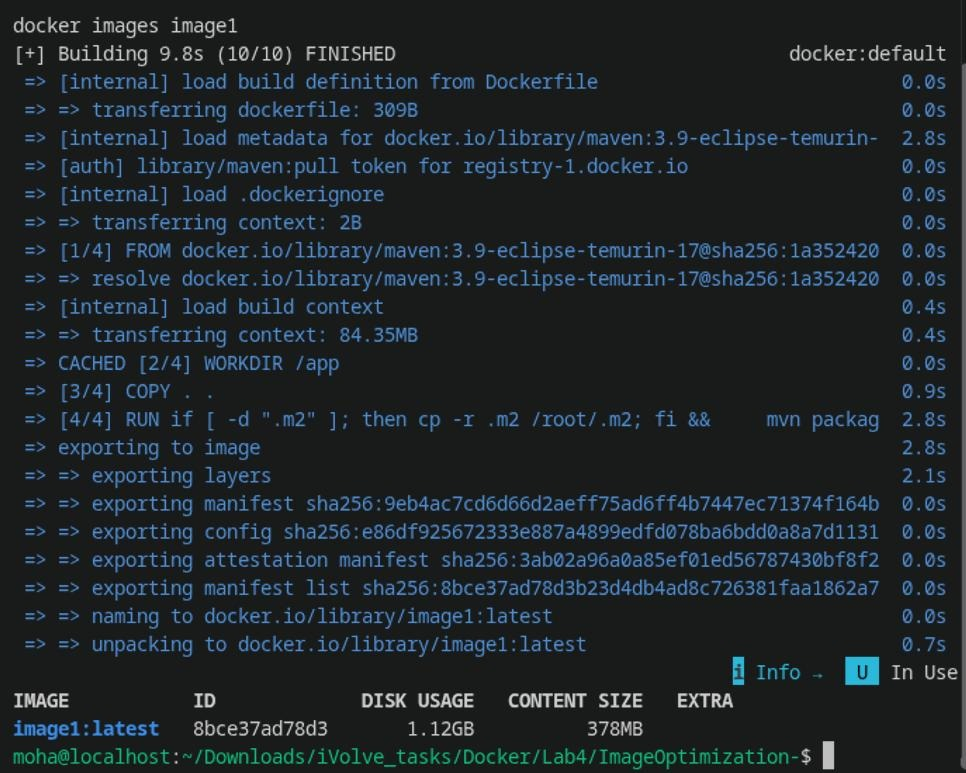
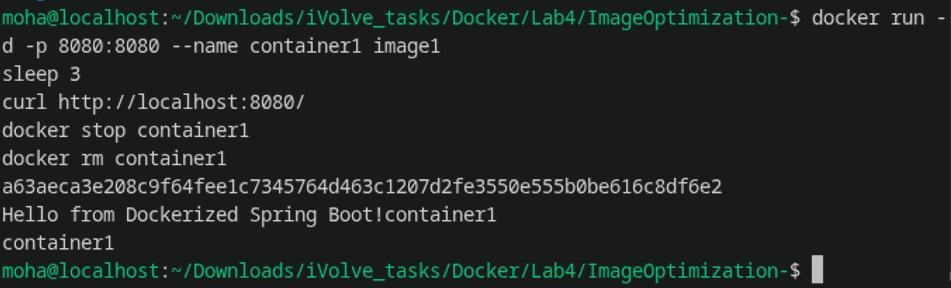
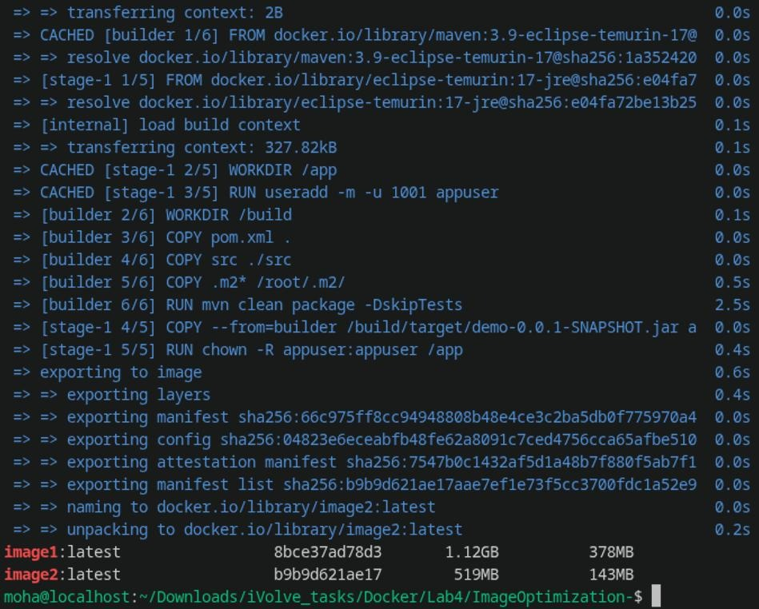
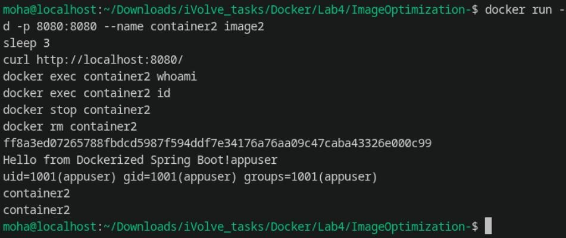
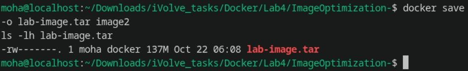
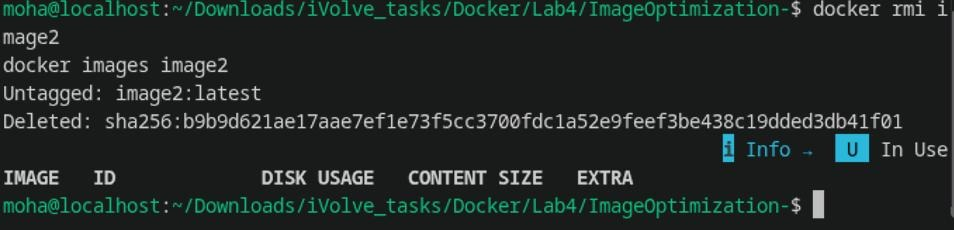
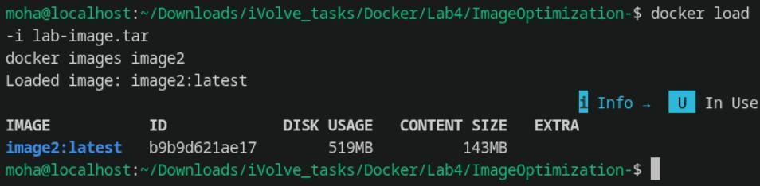

# Lab 4: Docker Image Optimization and Export/Load

Steps and commands completed for Lab 4 (Containerization with Docker).

---

## Lab Objectives

1. Clone source code from `https://github.com/Ibrahim-Adel15/ImageOptimization-.git`
2. Build an initial (single-stage) Docker image named `image1`
3. Inspect `image1` size and run `container1`
4. Verify application response and cleanup `container1`
5. Write a **multi-stage Dockerfile** configured with a **non-root user**
6. Build optimized image `image2` and compare size with `image1`
7. Run `container2` and verify it runs as the non-root user
8. Stop and remove `container2`
9. Export/save `image2` to a TAR archive (`lab-image.tar`)
10. Remove `image2` from the local Docker host
11. Load and restore `image2` from the TAR archive
12. Verify the restored image is available on the Docker host

---

## 1. Project Overview & Setup

The project is a **Spring Boot 3.2.0 Web Application** exposing an HTTP endpoint:
- `GET /` &rarr; returns `"Hello from Dockerized Spring Boot!"`
- Default port: `8080`

```bash
cd "/home/moha/Downloads/iVolve_tasks/Docker/Lab4/ImageOptimization-"
ls -la
```

---

## 2. Part 1: Build & Verify Initial Image (`image1`)

The initial single-stage Dockerfile builds and packages the application inside the same Maven container:

```dockerfile
FROM maven:3.9-eclipse-temurin-17
WORKDIR /app
COPY . .
RUN if [ -d ".m2" ]; then cp -r .m2 /root/.m2; fi && mvn package -DskipTests
EXPOSE 8080
CMD ["java", "-jar", "target/demo-0.0.1-SNAPSHOT.jar"]
```

### Step 1: Build `image1` and Check Size
```bash
docker build -t image1 .
docker images image1
```



The initial image `image1:latest` takes **1.12 GB** on disk (content size: **378 MB**).

---

### Step 2: Run `container1` & Verify
```bash
docker run -d -p 8080:8080 --name container1 image1
sleep 3
curl http://localhost:8080/
docker stop container1
docker rm container1
```



The application responded with:
```text
Hello from Dockerized Spring Boot!
```
Then `container1` was safely stopped and removed.

---

## 3. Part 2: Multi-Stage Optimization (`image2`)

To optimize the image size and harden container security, we created `Dockerfile.multistage`:
- **Stage 1 (`builder`)**: Uses `maven:3.9-eclipse-temurin-17` to compile the app and generate the `.jar`.
- **Stage 2 (`runtime`)**: Uses a lightweight JRE (`eclipse-temurin:17-jre`). Only the compiled `.jar` is copied over.
- **Security**: Adds a dedicated non-root user (`appuser`, UID 1001) and drops root privileges with `USER appuser`.

```dockerfile
# Stage 1: Build the application using Maven + JDK
FROM maven:3.9-eclipse-temurin-17 AS builder
WORKDIR /build
COPY pom.xml .
COPY src ./src
COPY .m2* /root/.m2/
RUN mvn clean package -DskipTests

# Stage 2: Minimal runtime environment using lightweight JRE
FROM eclipse-temurin:17-jre
WORKDIR /app

# Create a non-root user (appuser)
RUN useradd -m -u 1001 appuser

# Copy only the built JAR from builder
COPY --from=builder /build/target/demo-0.0.1-SNAPSHOT.jar app.jar
RUN chown -R appuser:appuser /app

# Switch to the non-root user
USER appuser

EXPOSE 8080
CMD ["java", "-jar", "app.jar"]
```

---

### Step 3: Build `image2` & Compare Sizes
```bash
docker build -f Dockerfile.multistage -t image2 .
docker images | grep -E 'image1|image2'
```



- **`image1`**: 1.12 GB disk usage (378 MB content)
- **`image2`**: 519 MB disk usage (143 MB content) &rarr; **~62% size reduction!**

---

### Step 4: Run `container2` & Verify Non-Root User
```bash
docker run -d -p 8080:8080 --name container2 image2
sleep 3
curl http://localhost:8080/
docker exec container2 whoami
docker exec container2 id
docker stop container2
docker rm container2
```



- **Endpoint response**: `"Hello from Dockerized Spring Boot!"`
- **User verification**: `whoami` returns `appuser`
- **ID verification**: `uid=1001(appuser) gid=1001(appuser)` (Confirms container does NOT run as `root`).

---

## 4. Part 3: Image Export and Load

### Step 5: Save `image2` as TAR Archive
```bash
docker save -o lab-image.tar image2
ls -lh lab-image.tar
```



Exported archive `lab-image.tar` is created with a size of **137 MB**.

---

### Step 6: Delete `image2` from Local Host
```bash
docker rmi image2
docker images image2
```



Confirms `image2` is untagged and deleted from the local Docker image list.

---

### Step 7: Restore `image2` from TAR Archive & Verify
```bash
docker load -i lab-image.tar
docker images image2
```



The image was restored (`Loaded image: image2:latest`) with its original image ID `b9b9d621ae17` and size (**519 MB**).

---

## Summary of Results

| Image | Build Type | Base Image | Non-Root User | Disk Usage | Content Size | TAR Archive Size |
| :--- | :--- | :--- | :--- | :--- | :--- | :--- |
| **`image1`** | Single-Stage | `maven:3.9-eclipse-temurin-17` | No (`root`) | **1.12 GB** | 378 MB | — |
| **`image2`** | Multi-Stage | `eclipse-temurin:17-jre` | Yes (`appuser`, UID 1001) | **519 MB** | 143 MB | **137 MB** |

### Key Takeaways:
1. **Multi-Stage Efficiency**: Separating the build environment (Maven + JDK) from the runtime environment (JRE) cut the content size from **378 MB down to 143 MB**.
2. **Security by Default**: Running as a dedicated non-root user (`appuser`, UID 1001) protects against container breakouts and adheres to container security best practices.
3. **Portability**: Using `docker save` and `docker load` allows moving container images across air-gapped systems or registries without pulling from Docker Hub.
