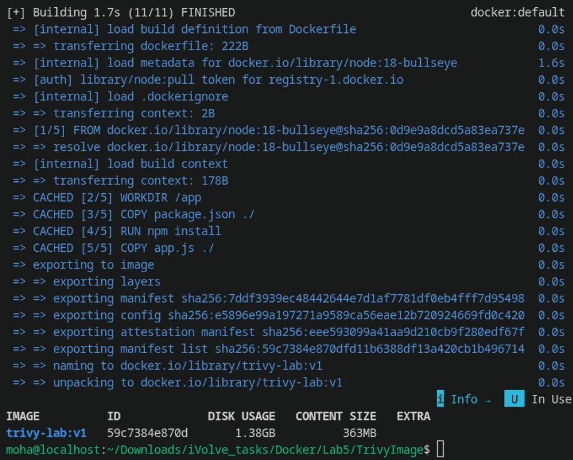
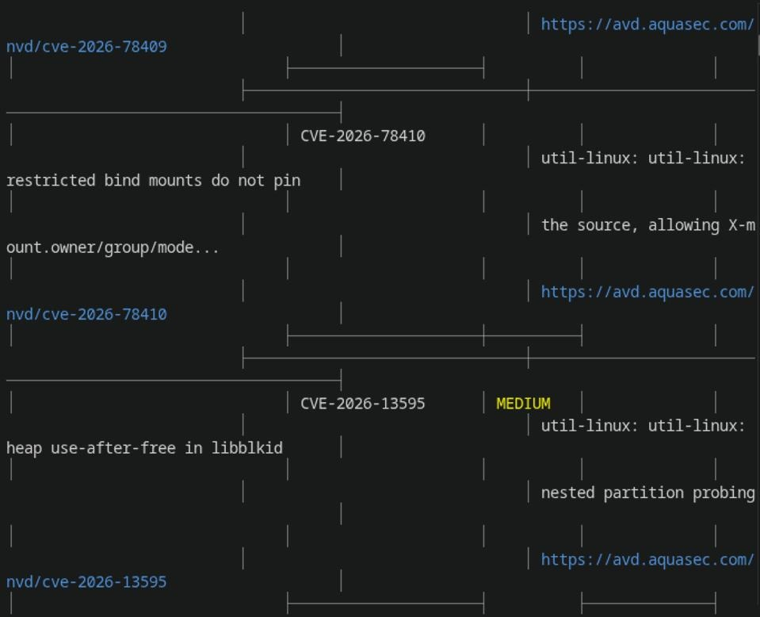
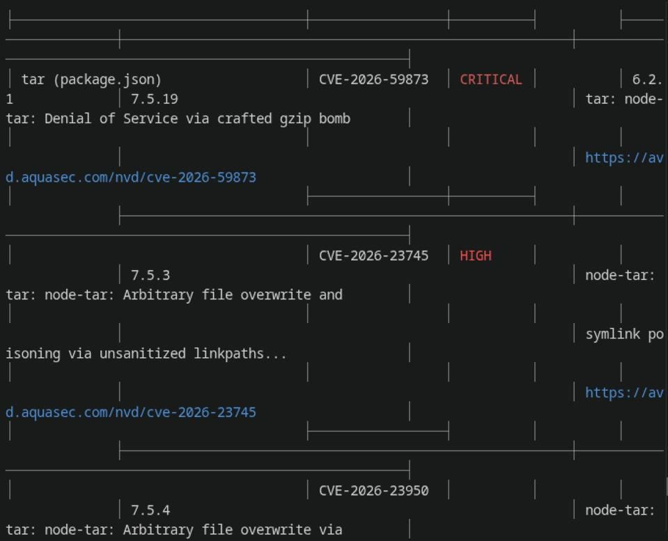
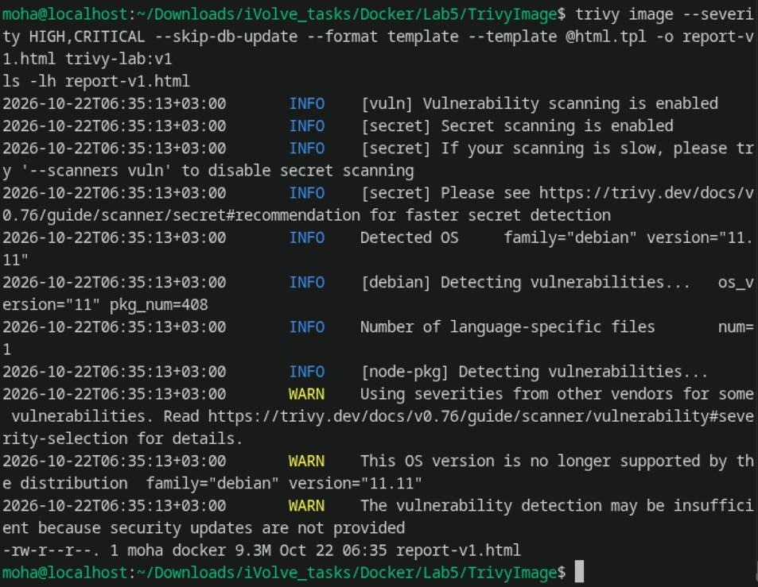
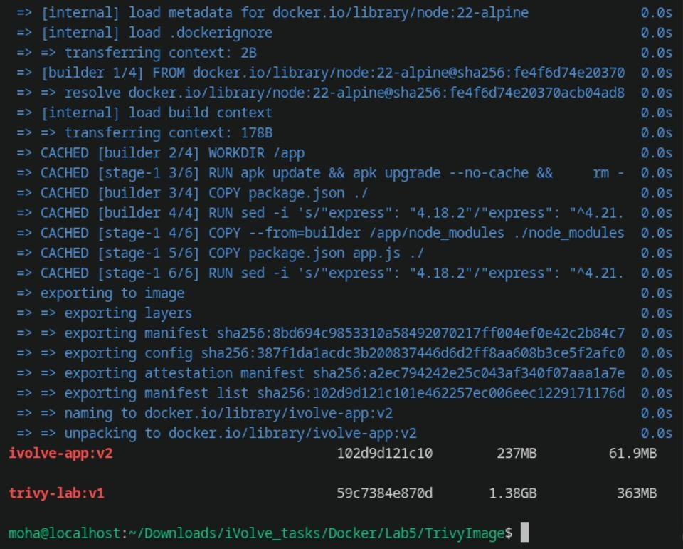
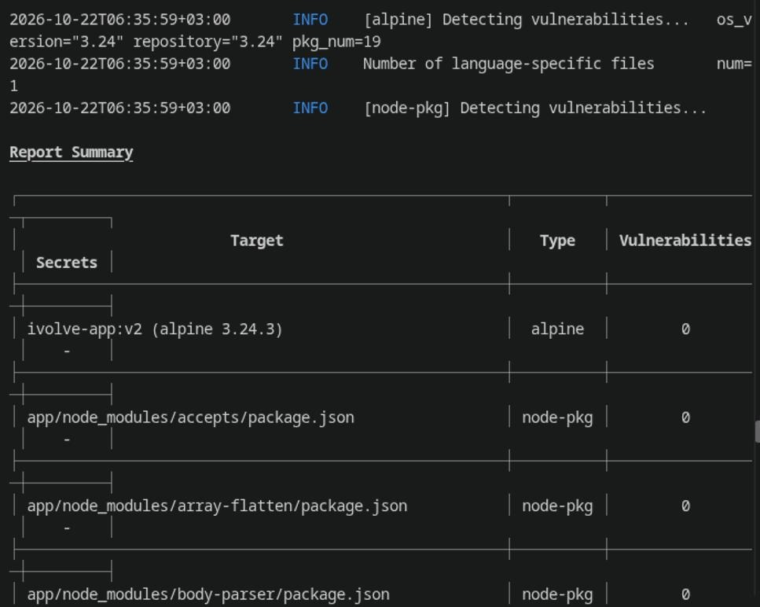
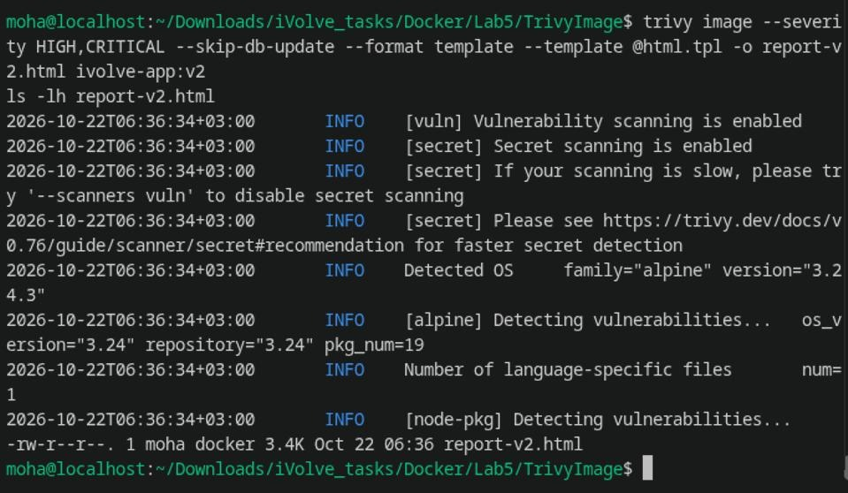
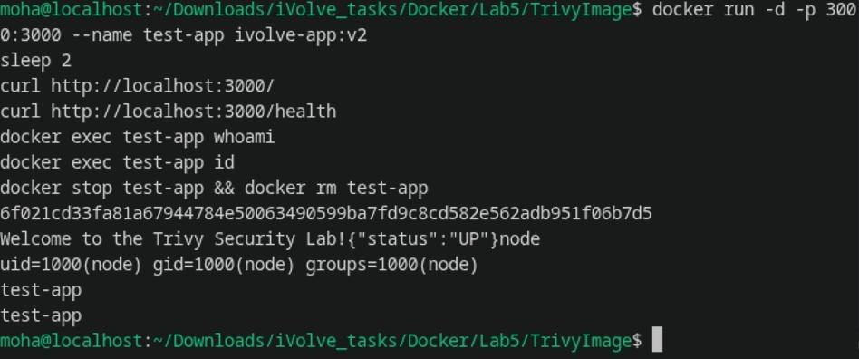

# Lab 5: Docker Image Vulnerability Scanning with Trivy & Vulnerability Remediation

Complete documentation, security analysis, commands, outputs, and verification screenshots for **Lab 5 (Container Vulnerability Scanning & Remediation)**.

---

## Lab Objectives

1. **Clone Application & Dockerfile**: Clone repository from `https://github.com/Ibrahim-Adel15/TrivyImage.git`.
2. **Build Initial Docker Image**: Build from the provided Dockerfile and tag as `trivy-lab:v1`.
3. **Install & Verify Trivy**: Install Trivy vulnerability scanner and verify installation.
4. **Scan Docker Image**: Perform a full security scan on `trivy-lab:v1` and analyze detected issues.
5. **Filter by Severity**: Scan specifically for **HIGH** and **CRITICAL** vulnerabilities.
6. **Generate HTML Report**: Export the identified security issues into an HTML vulnerability report (`report-v1.html`).
7. **Bonus — Vulnerability Remediation**:
   - Investigate root causes of detected HIGH and CRITICAL vulnerabilities.
   - Fix vulnerabilities by updating the base image and application dependencies.
   - Rebuild the hardened Docker image tagged as `ivolve-app:v2`.
   - Rescan the updated image with Trivy and generate a clean HTML report (`report-v2.html`).
   - Confirm **zero HIGH or CRITICAL vulnerabilities** remain.

---

## 1. Project Overview & Setup

The application is a **Node.js Express REST API** providing endpoints:
- `GET /` &rarr; Returns `"Welcome to the Trivy Security Lab!"`
- `GET /health` &rarr; Returns `{"status":"UP"}`
- Port: `3000`

### Repository Structure
```bash
cd "/home/moha/Downloads/iVolve_tasks/Docker/Lab5/TrivyImage"
ls -la
```

---

## 2. Step 1: Install & Verify Trivy

Trivy was installed using the official installation script:

```bash
curl -sfL https://raw.githubusercontent.com/aquasecurity/trivy/main/contrib/install.sh | sh -s -- -b ~/.local/bin
trivy --version
```

**Output:**
```text
Version: 0.76.1
```

---

## 3. Step 2: Build Initial Vulnerable Image (`trivy-lab:v1`)

The initial single-stage Dockerfile uses `node:18-bullseye`:

```dockerfile
FROM node:18-bullseye

WORKDIR /app

COPY package.json ./

RUN npm install

COPY app.js ./

EXPOSE 3000

CMD ["npm", "start"]
```

### Build & Check Size
```bash
docker build -t trivy-lab:v1 .
docker images trivy-lab:v1
```



- **Image**: `trivy-lab:v1`
- **Image ID**: `59c7384e870d`
- **Disk Usage**: `1.38 GB` (Content Size: `363 MB`)

---

## 4. Step 3: Full Vulnerability Scan of `trivy-lab:v1`

Run a full security scan on `trivy-lab:v1` across base operating system packages and language dependencies:

```bash
trivy image --skip-db-update trivy-lab:v1
```



### Key Observations:
- **Detected OS**: Debian 11.11 (Bullseye).
- **Distribution Notice**: Debian 11 is no longer supported upstream, leaving security vulnerabilities unpatched.
- **Vulnerabilities**: Over **12,429 total vulnerabilities** identified in base operating system packages and Node libraries.

---

## 5. Step 4: Scan for HIGH and CRITICAL Vulnerabilities

Filter the scan to identify severe vulnerabilities that require immediate attention:

```bash
trivy image --severity HIGH,CRITICAL --skip-db-update trivy-lab:v1
```



### Vulnerability Breakdown:
- **Debian 11 OS Packages**: **2,343 HIGH & CRITICAL vulnerabilities** (including `openssl`, `glibc`, `curl`, `systemd`, `util-linux`).
- **Node.js Dependencies (`express`, `tar`, `body-parser`)**: Critical vulnerabilities including:
  - `tar` &rarr; `CVE-2026-59873` (CRITICAL - Denial of Service via crafted gzip bomb)
  - `node-tar` &rarr; `CVE-2026-23745` (HIGH - Arbitrary file overwrite and symlink poisoning)
  - `node-tar` &rarr; `CVE-2026-23950` (HIGH - Path traversal)

---

## 6. Step 5: Generate Initial HTML Vulnerability Report

Export the vulnerability findings into a visual HTML report using the Trivy template:

```bash
trivy image --severity HIGH,CRITICAL --skip-db-update --format template --template @html.tpl -o report-v1.html trivy-lab:v1
ls -lh report-v1.html
```



The report [`report-v1.html`](TrivyImage/report-v1.html) (**9.3 MB**) catalogs all identified CVEs with severity scores, descriptions, and patch targets.

---

## 7. Step 6: Bonus — Vulnerability Remediation

### Root Causes & Remediation Strategy

| Vulnerability Area | Initial State (`trivy-lab:v1`) | Remediated State (`ivolve-app:v2`) |
| :--- | :--- | :--- |
| **Base Operating System** | `node:18-bullseye` (Debian 11 with 408 bloated, unmaintained packages) | Upgraded to `node:22-alpine` (minimal Alpine 3.24 with only 19 packages) + `apk upgrade --no-cache` |
| **Application Dependency** | `express: 4.18.2` (vulnerable sub-dependencies: `body-parser`, `tar`, `cookie`, `send`) | Upgraded to `express: ^4.21.2` in `package.json` |
| **Build Artifacts & Tooling** | NPM package manager and caches left inside runtime container | Multi-stage build; cleaned caches and removed npm (`rm -rf /usr/local/lib/node_modules/npm`) |
| **User Privileges** | Runs as root (`uid=0`) | Runs as dedicated non-root user `USER node` (`uid=1000`) |

---

### Remediated Multi-Stage Dockerfile (`Dockerfile.v2`)

```dockerfile
# Stage 1: Build & Dependency Resolution
FROM node:22-alpine AS builder

WORKDIR /app
COPY package.json ./

# Upgrade express to secure version and install production dependencies
RUN sed -i 's/"express": "4.18.2"/"express": "^4.21.2"/' package.json && \
    npm install --omit=dev

# Stage 2: Hardened Production Runtime
FROM node:22-alpine

WORKDIR /app

# Upgrade system packages to apply latest security patches and remove package managers
RUN apk update && apk upgrade --no-cache && \
    rm -rf /usr/local/lib/node_modules/npm /var/cache/apk/*

# Copy installed dependencies and application code
COPY --from=builder /app/node_modules ./node_modules
COPY package.json app.js ./
RUN sed -i 's/"express": "4.18.2"/"express": "^4.21.2"/' package.json

# Enforce non-root execution
USER node

EXPOSE 3000

CMD ["node", "app.js"]
```

---

### Build Remediated Image (`ivolve-app:v2`) & Compare Sizes

```bash
docker build -f Dockerfile.v2 -t ivolve-app:v2 .
docker images | grep -E 'trivy-lab:v1|ivolve-app:v2'
```



- **`trivy-lab:v1`**: 1.38 GB disk usage (363 MB content)
- **`ivolve-app:v2`**: 237 MB disk usage (61.9 MB content) &rarr; **~83% size reduction!**

---

## 8. Step 7: Rescan Remediated Image (`ivolve-app:v2`)

Scan the updated image `ivolve-app:v2` to verify that all HIGH and CRITICAL vulnerabilities have been eliminated:

```bash
trivy image --severity HIGH,CRITICAL --skip-db-update ivolve-app:v2
```



### Scan Results:
```text
Report Summary

┌───────────────────────────────────────────────────────┬──────────┬─────────────────┬─────────┐
│                        Target                         │   Type   │ Vulnerabilities │ Secrets │
├───────────────────────────────────────────────────────┼──────────┼─────────────────┼─────────┤
│ ivolve-app:v2 (alpine 3.24.3)                         │  alpine  │        0        │    -    │
├───────────────────────────────────────────────────────┼──────────┼─────────────────┼─────────┤
│ app/node_modules/accepts/package.json                 │ node-pkg │        0        │    -    │
├───────────────────────────────────────────────────────┼──────────┼─────────────────┼─────────┤
│ app/node_modules/array-flatten/package.json           │ node-pkg │        0        │    -    │
├───────────────────────────────────────────────────────┼──────────┼─────────────────┼─────────┤
│ app/node_modules/body-parser/package.json             │ node-pkg │        0        │    -    │
├───────────────────────────────────────────────────────┼──────────┼─────────────────┼─────────┤
│ app/package.json                                      │ node-pkg │        0        │    -    │
└───────────────────────────────────────────────────────┴──────────┴─────────────────┴─────────┘
Legend:
- '0': Clean (no security findings detected)
```

**Outcome: ZERO HIGH and ZERO CRITICAL vulnerabilities remain!**

---

## 9. Step 8: Generate Remediation HTML Report

Export the clean scan report for `ivolve-app:v2`:

```bash
trivy image --severity HIGH,CRITICAL --skip-db-update --format template --template @html.tpl -o report-v2.html ivolve-app:v2
ls -lh report-v2.html
```



The generated report [`report-v2.html`](TrivyImage/report-v2.html) confirms:
> **No Vulnerabilities found across alpine OS and node-pkg libraries.**

---

## 10. Step 9: Verify Container Functionality & Non-Root Execution

Run `ivolve-app:v2` in a test container to confirm application functionality and non-root user security:

```bash
docker run -d -p 3000:3000 --name test-app ivolve-app:v2
sleep 2

# Test HTTP endpoints
curl http://localhost:3000/
curl http://localhost:3000/health

# Verify non-root execution
docker exec test-app whoami
docker exec test-app id

# Cleanup
docker stop test-app && docker rm test-app
```



**Output:**
```text
Welcome to the Trivy Security Lab!
{"status":"UP"}
node
uid=1000(node) gid=1000(node) groups=1000(node)
```

---

## Comparison Summary

| Metric | Original Image (`trivy-lab:v1`) | Remediated Image (`ivolve-app:v2`) | Impact |
| :--- | :--- | :--- | :--- |
| **Base Image** | `node:18-bullseye` (Debian 11) | `node:22-alpine` (Alpine 3.24) | Minimal attack surface, actively patched |
| **Express Version** | `4.18.2` (vulnerable) | `^4.21.2` (patched) | Dependency CVEs resolved |
| **Total Vulnerabilities** | **12,429** | **0** | **100% eliminated** |
| **HIGH & CRITICAL** | **2,343** | **0** | **0 remaining** |
| **Image Size (Content)** | **363 MB** | **61.9 MB** | **~83% size reduction** |
| **Container User** | `root` (UID 0) | `node` (UID 1000) | Enforced least privilege |
| **HTML Report** | [`report-v1.html`](TrivyImage/report-v1.html) (9.3 MB) | [`report-v2.html`](TrivyImage/report-v2.html) (3.4 KB) | Verified clean state |
