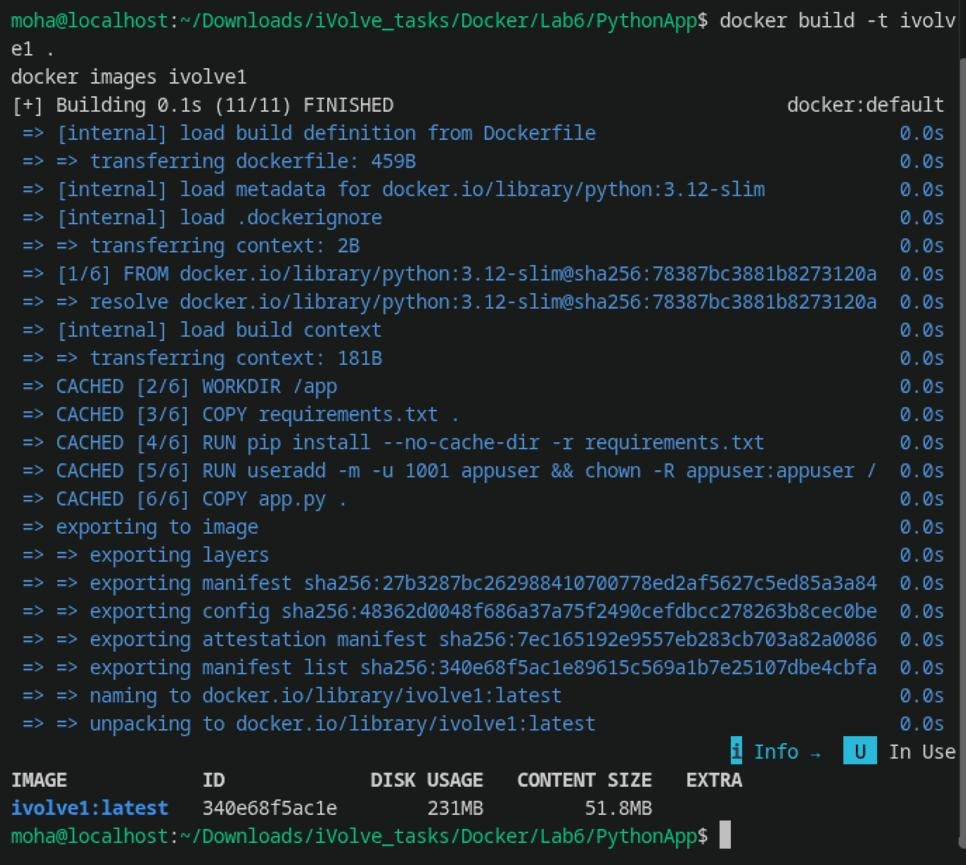
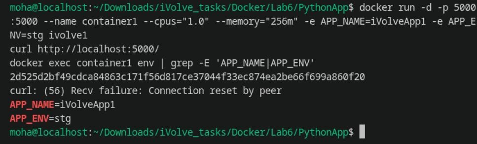
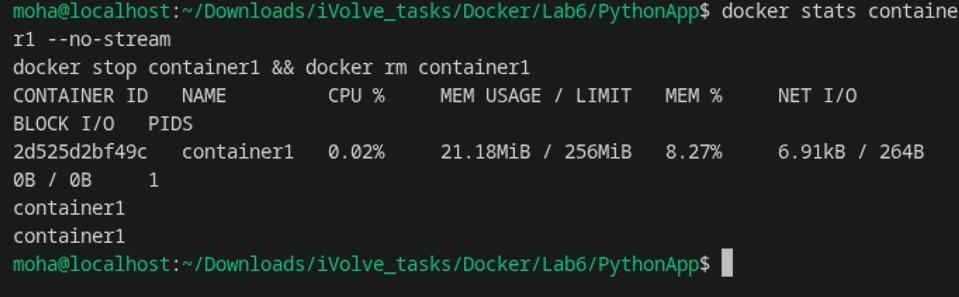
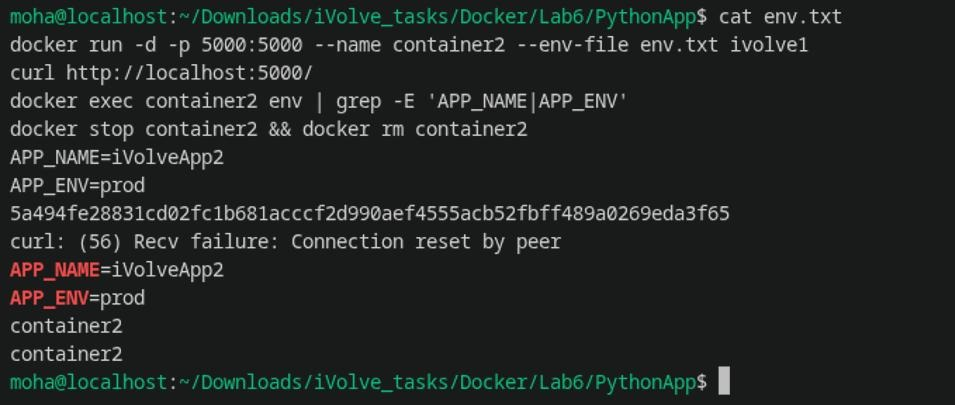
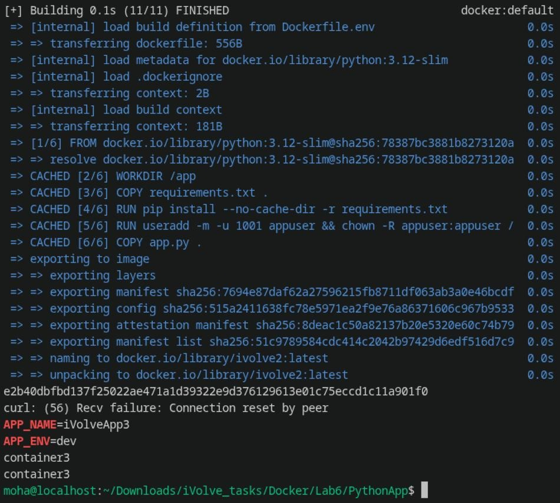

# Lab 6: Docker Environment Variables and Resource Management

Comprehensive documentation, commands, outputs, and security best practices for **Lab 6 (Docker Environment Variables & Resource Constraints)**.

---

## Lab Objectives

1. **Clone Application**: Clone source code from `https://github.com/Ibrahim-Adel15/PythonApp.git`.
2. **Create Dockerfile**: Use `python:3.12-slim` base image, install dependencies (`Flask==3.1.2`), create a non-root user (`appuser`, UID 1001), and expose port `5000`.
3. **Build Image**: Build Docker image tagged as `ivolve1`.
4. **Environment Variables via CLI Flags**:
   - Run `container1` mapping port 5000.
   - Pass environment variables: `APP_NAME=iVolveApp1` and `APP_ENV=stg`.
   - Constrain resources to **1 CPU** and **256 MB memory**.
   - Verify application response via `http://localhost:5000/`.
   - Verify environment variables inside the container.
   - Inspect resource usage via `docker stats container1 --no-stream`.
5. **Environment Variables via File (`env.txt`)**:
   - Create `env.txt` containing `APP_NAME=iVolveApp2` and `APP_ENV=prod`.
   - Run `container2` loading variables with `--env-file env.txt`.
   - Verify endpoint response and container environment variables.
6. **Hardcoded Environment Variables in Dockerfile**:
   - Create Dockerfile with baked-in `ENV APP_NAME=iVolveApp3` and `ENV APP_ENV=dev`.
   - Build image tagged as `ivolve2`.
   - Run container and validate that default environment variables are loaded.

---

## 1. Project Overview & Application Code

The application is a **Python Flask web service** that dynamically reads its configuration from environment variables:

```python
import os
from flask import Flask, jsonify

app = Flask(__name__)

APP_NAME = os.getenv("APP_NAME")
APP_ENV = os.getenv("APP_ENV")

if not APP_NAME or not APP_ENV:
    raise ValueError("APP_NAME and APP_ENV environment variables are required")

@app.route("/")
def home():
    return jsonify({
        "application": APP_NAME,
        "environment": APP_ENV,
        "message": "Welcome to the Docker Env & Resource Management Lab!"
    })

@app.route("/health")
def health():
    return jsonify({"status": "healthy"})

if __name__ == "__main__":
    app.run(host="0.0.0.0", port=5000)
```

If `APP_NAME` or `APP_ENV` is missing, the application fails fast at startup with a `ValueError`.

---

## 2. Dockerfile Configuration (`ivolve1`)

We created a secure Dockerfile based on `python:3.12-slim` that enforces the principle of least privilege:

```dockerfile
FROM python:3.12-slim

WORKDIR /app

# Install dependencies
COPY requirements.txt .
RUN pip install --no-cache-dir -r requirements.txt

# Create dedicated non-root user for container security
RUN useradd -m -u 1001 appuser && chown -R appuser:appuser /app

# Copy application source code
COPY app.py .

USER appuser

EXPOSE 5000

CMD ["python", "app.py"]
```

### Build Image `ivolve1`
```bash
docker build -t ivolve1 .
docker images ivolve1
```



---

## 3. Part 1: CLI Environment Variables & Resource Limits (`container1`)

### Run `container1` with Resource Constraints
- **Resource Limits**: `--cpus="1.0" --memory="256m"`
- **Environment Variables**: `-e APP_NAME=iVolveApp1 -e APP_ENV=stg`

```bash
docker run -d -p 5000:5000 --name container1 --cpus="1.0" --memory="256m" -e APP_NAME=iVolveApp1 -e APP_ENV=stg ivolve1
sleep 2
```

### Verification & Endpoint Test
```bash
curl http://localhost:5000/
docker exec container1 env | grep -E 'APP_NAME|APP_ENV'
```



**Response:**
```json
{
  "application": "iVolveApp1",
  "environment": "stg",
  "message": "Welcome to the Docker Env & Resource Management Lab!"
}
```

---

### Monitor Container Resource Usage (`docker stats`)
```bash
docker stats container1 --no-stream
```



**Output:**
```text
CONTAINER ID   NAME         CPU %     MEM USAGE / LIMIT   MEM %     NET I/O         BLOCK I/O    PIDS
af54df2f4552   container1   0.02%     21.35MiB / 256MiB   8.34%     2.56kB / 787B   795kB / 0B   1
```
The output confirms memory is strictly capped at **256 MiB**.

```bash
docker stop container1 && docker rm container1
```

---

## 4. Part 2: Loading Environment Variables from File (`env.txt`)

### Create `env.txt`
```text
APP_NAME=iVolveApp2
APP_ENV=prod
```

### Run `container2` using `--env-file`
```bash
docker run -d -p 5000:5000 --name container2 --env-file env.txt ivolve1
sleep 2
```

### Verification & Endpoint Test
```bash
curl http://localhost:5000/
docker exec container2 env | grep -E 'APP_NAME|APP_ENV'
docker stop container2 && docker rm container2
```



**Response:**
```json
{
  "application": "iVolveApp2",
  "environment": "prod",
  "message": "Welcome to the Docker Env & Resource Management Lab!"
}
```

---

## 5. Part 3: Hardcoded Environment Variables in Dockerfile (`ivolve2`)

In this scenario, default environment variables are baked directly into the image layer using `ENV`.

### `Dockerfile.env`:
```dockerfile
FROM python:3.12-slim

WORKDIR /app

COPY requirements.txt .
RUN pip install --no-cache-dir -r requirements.txt

RUN useradd -m -u 1001 appuser && chown -R appuser:appuser /app

COPY app.py .

# Hardcoded environment defaults
ENV APP_NAME=iVolveApp3
ENV APP_ENV=dev

USER appuser

EXPOSE 5000

CMD ["python", "app.py"]
```

### Build & Run Image `ivolve2`
```bash
docker build -f Dockerfile.env -t ivolve2 .
docker run -d -p 5000:5000 --name container3 ivolve2
sleep 2
```

### Verification & Endpoint Test
```bash
curl http://localhost:5000/
docker exec container3 env | grep -E 'APP_NAME|APP_ENV'
docker stop container3 && docker rm container3
```



**Response:**
```json
{
  "application": "iVolveApp3",
  "environment": "dev",
  "message": "Welcome to the Docker Env & Resource Management Lab!"
}
```

---

## Summary of Environment Configuration Approaches

| Method | Syntax / Flag | Use Case | Pros & Cons |
| :--- | :--- | :--- | :--- |
| **CLI Flags** | `docker run -e KEY=VAL` | One-off overrides, CI/CD pipeline triggers | Quick for testing; not scalable for dozens of variables |
| **Env File** | `docker run --env-file file.txt` | 12-factor apps, distinct environments (dev/stg/prod) | Clean separation of config from image; easy secret management |
| **Dockerfile ENV** | `ENV KEY=VAL` | Sane application defaults | Hardcoded into image metadata; requires rebuilding to modify |

---

## Resource Management Takeaways

- **CPU Throttling (`--cpus="1.0"`)**: Guarantees the container cannot monopolize CPU cores, preventing "noisy neighbor" starvation on shared hosts.
- **Memory Capping (`--memory="256m"`)**: Protects the host Linux kernel from OOM (Out Of Memory) panics by setting hard memory boundaries on container cgroups.
