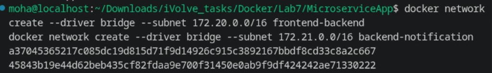
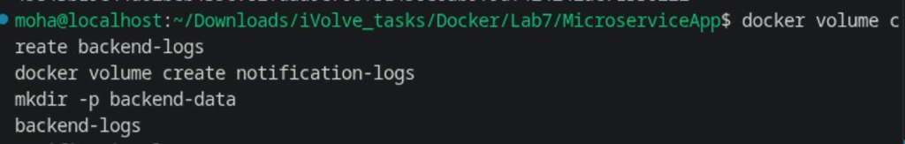
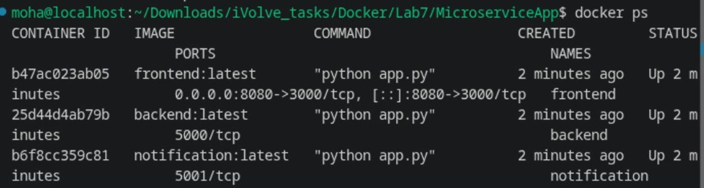
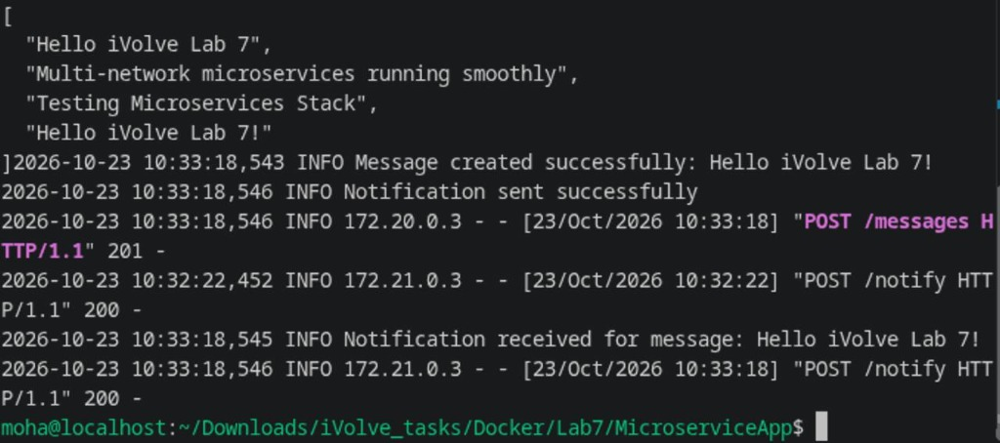

# Lab 7: Multi-Network Microservices, Volumes, and Bind Mounts

Comprehensive guide, architectural design, command execution, and verification screenshots for **Lab 7 (Multi-Network Microservices & Storage Management)**.

---

## Lab Objectives

1. **Clone Application Repository**: Obtain source code from `https://github.com/Ibrahim-Adel15/MicroserviceApp.git`.
2. **Containerize Services**: Build Docker images for `frontend`, `backend`, and `notification` microservices.
3. **Multi-Network Architecture**:
   - Create two isolated bridge networks with custom subnets:
     - `frontend-backend` (Subnet: `172.20.0.0/16`)
     - `backend-notification` (Subnet: `172.21.0.0/16`)
   - Ensure the notification service cannot communicate directly with the frontend (network isolation).
4. **Storage & Persistence**:
   - Create two named Docker volumes: `backend-logs` and `notification-logs`.
   - Create a host directory bind mount for backend application data (`messages.json`).
5. **Deploy & Wire Microservices**:
   - Deploy `notification` on `backend-notification` network with `notification-logs` volume.
   - Deploy `backend` connected to **both** networks (`backend-notification` & `frontend-backend`), with bind mount for data and `backend-logs` volume.
   - Deploy `frontend` on `frontend-backend` network publishing port `8080` to host.
6. **Verification & Testing**:
   - Access the frontend web interface on `http://localhost:8080/`.
   - Submit new messages and verify message display.
   - Verify host data persistence in `backend-data/messages.json`.
   - Verify log outputs in backend and notification volumes.

---

## Architecture Diagram

```
+---------------------------------------------------------------------------------+
|                                    HOST                                         |
|                                                                                 |
|  Browser / curl ---> Port 8080                                                  |
|                          |                                                      |
|                          v                                                      |
|       +------------------------------------+                                    |
|       |        frontend container          |                                    |
|       |        (Port 3000 inside)          |                                    |
|       +-----------------+------------------+                                    |
|                         |                                                       |
|       ==================|=========================                              |
|       NETWORK: frontend-backend (172.20.0.0/16)                                 |
|       ==================|=========================                              |
|                         |                                                       |
|                         v                                                       |
|       +-----------------+------------------+     Bind Mount: ./backend-data/    |
|       |         backend container          | <================================  |
|       |        (Port 5000 inside)          |                                    |
|       +-----------------+------------------+     Volume: backend-logs           |
|                         |                                                       |
|       ==================|=========================                              |
|       NETWORK: backend-notification (172.21.0.0/16)                             |
|       ==================|=========================                              |
|                         |                                                       |
|                         v                                                       |
|       +-----------------+------------------+     Volume: notification-logs      |
|       |      notification container        |                                    |
|       |        (Port 5001 inside)          |                                    |
|       +------------------------------------+                                    |
|                                                                                 |
+---------------------------------------------------------------------------------+
```

---

## 1. Step 1: Create Custom Bridge Networks

Create two bridge networks with distinct subnets to isolate the notification layer from the frontend:

```bash
docker network create --driver bridge --subnet 172.20.0.0/16 frontend-backend
docker network create --driver bridge --subnet 172.21.0.0/16 backend-notification
```



---

## 2. Step 2: Create Volumes & Host Bind Mount Directory

Create named volumes for log aggregation and a local directory for application data persistence:

```bash
docker volume create backend-logs
docker volume create notification-logs
mkdir -p backend-data
```



---

## 3. Step 3: Build & Run Microservices

1. **Build the images**:
```bash
docker build -t frontend:latest ./frontend
docker build -t backend:latest ./backend
docker build -t notification:latest ./notification
```

2. **Deploy Notification Service**:
```bash
docker run -d --name notification --network backend-notification -v notification-logs:/app/logs notification:latest
```

3. **Deploy Backend Service on Both Networks**:
```bash
docker run -d --name backend --network frontend-backend -v "$(pwd)/backend-data:/app/data" -v backend-logs:/app/logs -e NOTIFICATION_URL=http://notification:5001/notify backend:latest
docker network connect backend-notification backend
```

4. **Deploy Frontend Service**:
```bash
docker run -d --name frontend --network frontend-backend -p 8080:3000 -e BACKEND_URL=http://backend:5000 frontend:latest
```

5. **Verify Running Containers**:
```bash
docker ps
```



---

## 4. Step 4: Verification of Message Flow, Data Persistence & Logs

Test submitting messages through the frontend and verify persistence and logging across services:

```bash
# Submit message through frontend form
curl -d "message=Hello iVolve Lab 7!" http://localhost:8080/send

# Verify data persistence on host
cat backend-data/messages.json

# Check backend and notification logs
docker exec backend tail -n 3 /app/logs/backend.log
docker exec notification tail -n 3 /app/logs/notification.log
```



---

## Key Learnings & Architecture Benefits

1. **Network Segmentation**: The notification service is not attached to `frontend-backend`, preventing unauthorized external or frontend access to notification internals.
2. **Multi-Homed Backend**: The backend container sits on both networks, acting as a secure intermediary between the web frontend and internal microservices.
3. **Named Volumes vs Bind Mounts**:
   - **Named Volumes** (`backend-logs`, `notification-logs`): Ideal for operational logs managed directly by Docker storage drivers.
   - **Bind Mounts** (`backend-data` -> `/app/data`): Ideal for application data that requires direct host inspection, backup, or persistence outside Docker lifecycle.
