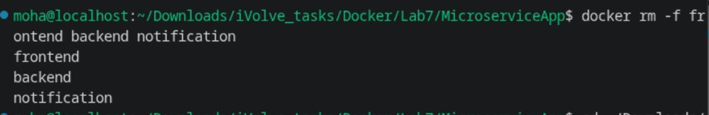
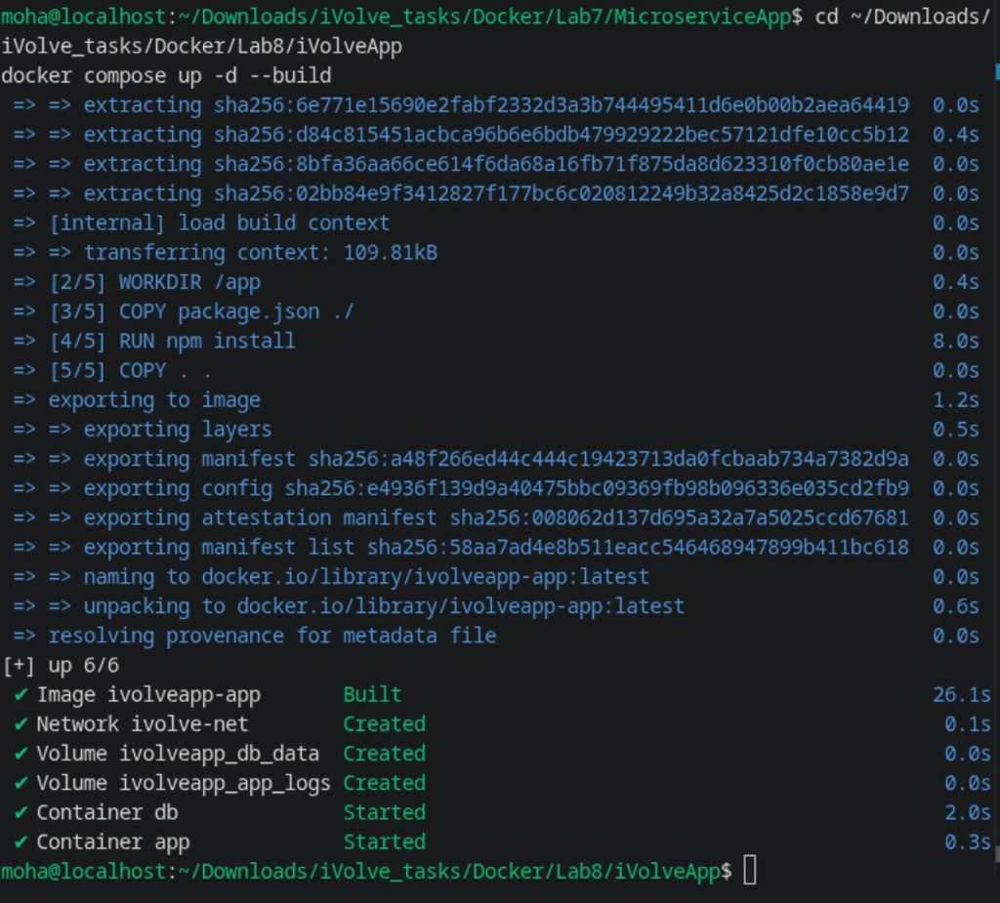
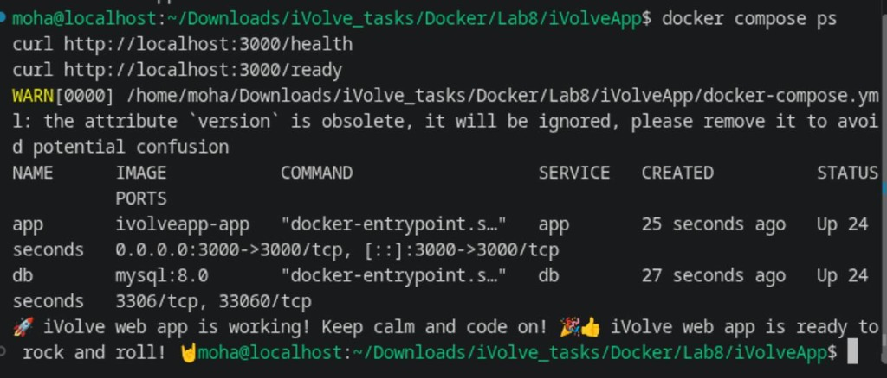
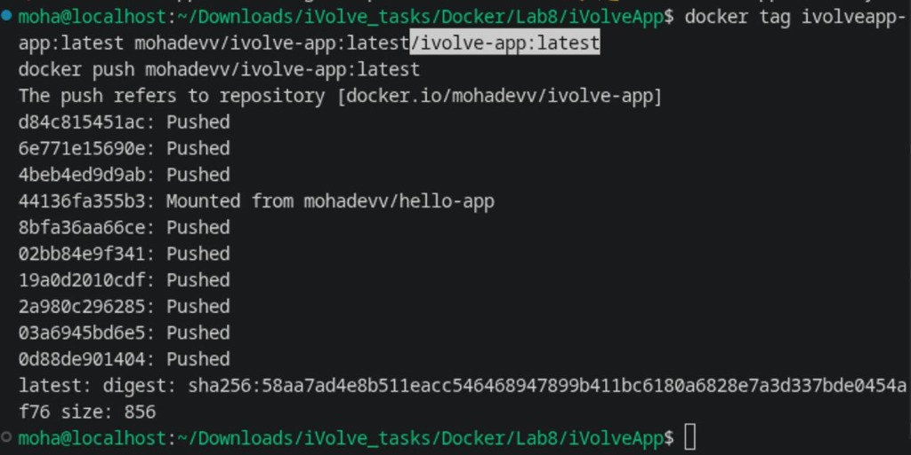

# Lab 8: Containerized Node.js and MySQL Stack Using Docker Compose

Comprehensive guide, service orchestration, verification, and Docker Hub deployment for **Lab 8 (Multi-Container Docker Compose Stack)**.

---

## Lab Objectives

1. **Clone Application Repository**: Clone the Node.js e-commerce app from `https://github.com/Ibrahim-Adel15/iVolveApp.git`.
2. **Database Integration**: Configure MySQL 8.0 with automated initialization for database `ivolve`.
3. **Orchestrate Stack via Docker Compose (`docker-compose.yml`)**:
   - **`app` Service**: Build from Dockerfile, publish port `3000:3000`, configure database credentials, and persist application logs to `/app/logs`.
   - **`db` Service**: MySQL 8.0 container with credentials, health monitoring, and data persistence via `db_data`.
   - **Custom Network (`ivolve-net`)**: Connect both containers for isolated DNS-based service discovery.
   - **Persistent Volumes**:
     - `db_data` mounted at `/var/lib/mysql`
     - `app_logs` mounted at `/app/logs`
4. **Deploy & Verify Connectivity**:
   - Start services using `docker compose up -d`.
   - Verify health (`/health`) and readiness (`/ready`) endpoints.
   - Verify products database query and frontend web interface.
5. **Docker Hub Image Publishing**:
   - Tag application image with Docker Hub username (`mohadevv`).
   - Push image to Docker Hub repository.

---

## Architecture Diagram

```
+-----------------------------------------------------------------------------+
|                                    HOST                                     |
|                                                                             |
|  Browser / curl ---> Port 3000                                              |
|                          |                                                  |
|                          v                                                  |
|       +------------------------------------+                                |
|       |           app container            | ===> Volume: app_logs          |
|       |        (Node.js Express API)       |      (/app/logs/access.log)    |
|       +-----------------+------------------+                                |
|                         |                                                   |
|       ==================|=========================                          |
|       NETWORK: ivolve-net (Bridge)                                          |
|       ==================|=========================                          |
|                         |                                                   |
|                         v                                                   |
|       +-----------------+------------------+                                |
|       |            db container            | ===> Volume: db_data           |
|       |            (MySQL 8.0)             |      (/var/lib/mysql)          |
|       +------------------------------------+                                |
|                                                                             |
+-----------------------------------------------------------------------------+
```

---

## 1. Step 1: Docker Compose Configuration (`docker-compose.yml`)

The multi-container stack is defined in `iVolveApp/docker-compose.yml`:

```yaml
version: '3.8'

services:
  db:
    image: mysql:8.0
    container_name: db
    restart: always
    environment:
      MYSQL_ROOT_PASSWORD: rootpassword
      MYSQL_DATABASE: ivolve
    volumes:
      - db_data:/var/lib/mysql
    networks:
      - ivolve-net

  app:
    build: .
    container_name: app
    restart: always
    ports:
      - "3000:3000"
    environment:
      DB_HOST: db
      DB_USER: root
      DB_PASSWORD: rootpassword
      DB_NAME: ivolve
    volumes:
      - app_logs:/app/logs
    networks:
      - ivolve-net
    depends_on:
      - db

volumes:
  db_data:
  app_logs:

networks:
  ivolve-net:
    name: ivolve-net
```

---

## 2. Step 2: Environment Cleanup & Launch Services

1. Clean up any previous lab containers:
```bash
docker rm -f frontend backend notification
```



2. Navigate to `iVolveApp` and launch the full stack in detached mode:
```bash
cd ~/Downloads/iVolve_tasks/Docker/Lab8/iVolveApp
docker compose up -d --build
```



---

## 3. Step 3: Verify Application & Database Connectivity

Test service status and application health/readiness endpoints:

```bash
docker compose ps
curl http://localhost:3000/health
curl http://localhost:3000/ready
```



**Responses:**
```text
🚀 iVolve web app is working! Keep calm and code on! 🎉
👍 iVolve web app is ready to rock and roll! 🤘
```

---

## 4. Step 4: Tag & Push Application Image to Docker Hub

Tag the application image with the Docker Hub username (`mohadevv`) and push to Docker Hub:

```bash
docker tag ivolveapp-app:latest mohadevv/ivolve-app:latest
docker push mohadevv/ivolve-app:latest
```



---

## Summary of Completed Tasks

| Requirement | Implementation | Status |
| :--- | :--- | :---: |
| **Node.js App** | Express e-commerce application exposing port 3000 | ✅ |
| **MySQL Database** | MySQL 8.0 auto-provisioning `ivolve` database and tables | ✅ |
| **Docker Compose** | Orchestration of `app` and `db` services | ✅ |
| **Custom Network** | `ivolve-net` bridge network for inter-container communication | ✅ |
| **Data Persistence** | `db_data` volume for `/var/lib/mysql` | ✅ |
| **Log Persistence** | `app_logs` volume for `/app/logs/access.log` | ✅ |
| **Docker Hub Push** | Pushed `mohadevv/ivolve-app:latest` to Docker Hub | ✅ |
