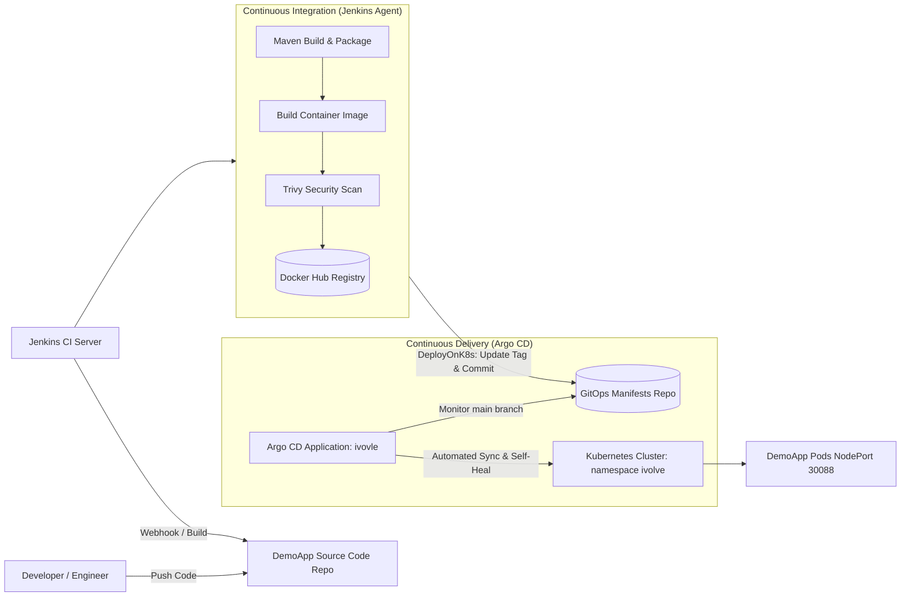
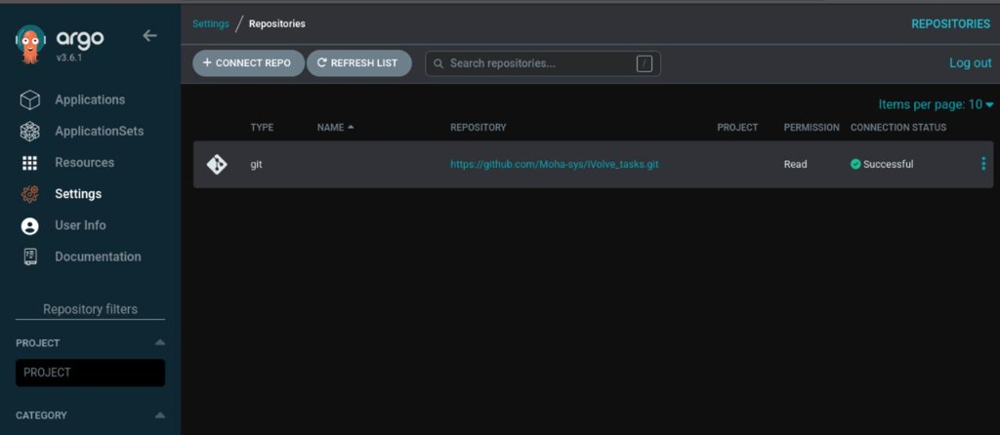
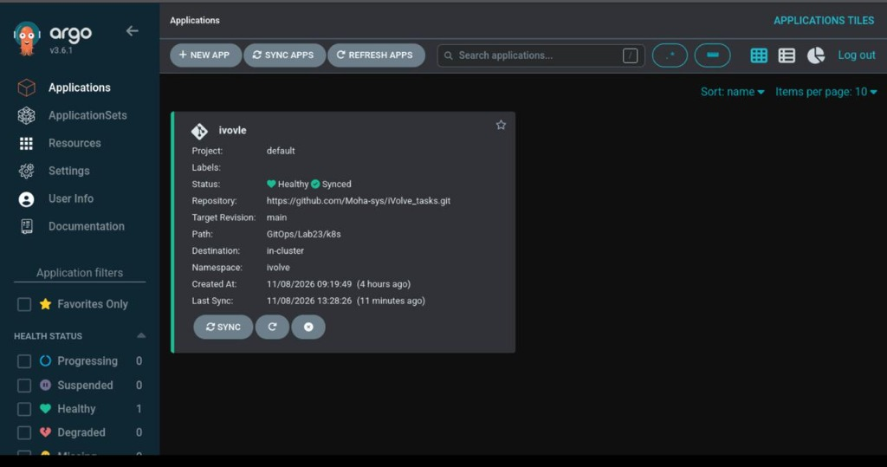
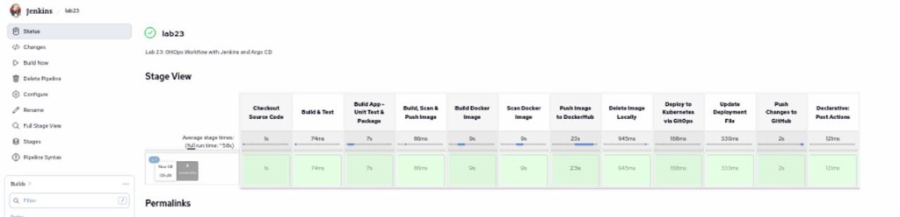
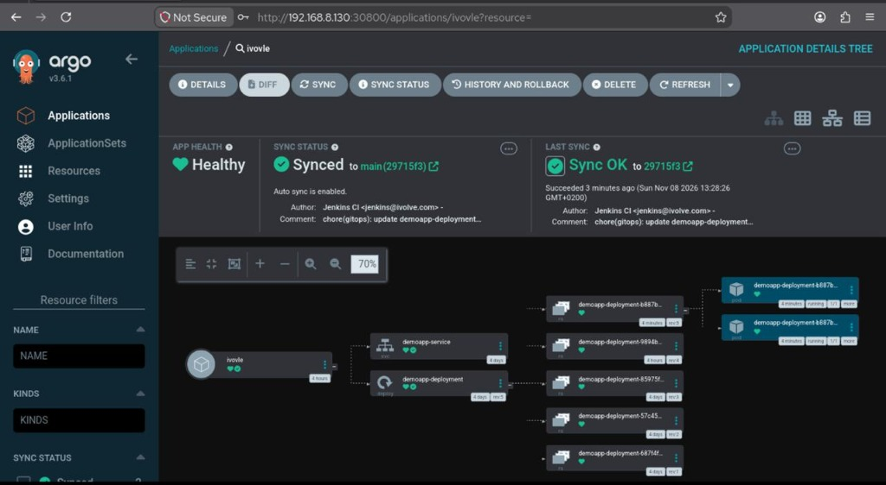
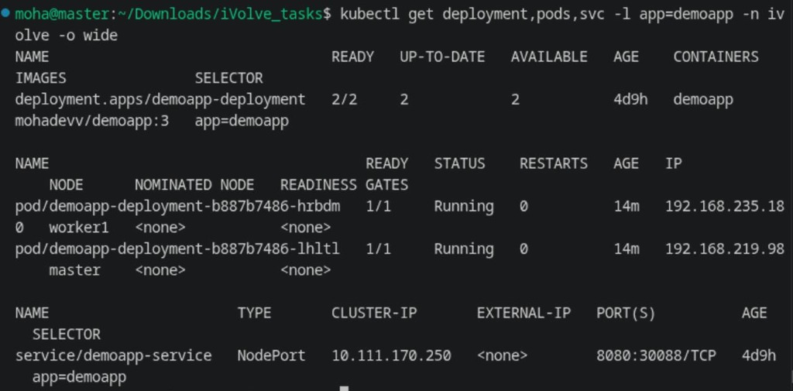
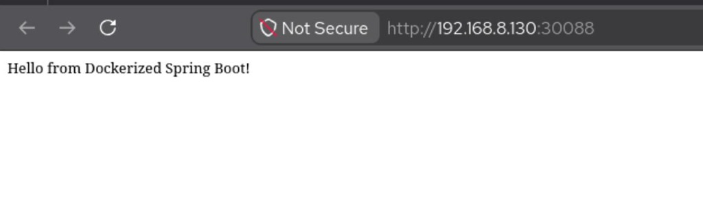

# Lab 23: Implementing a GitOps Workflow with Jenkins and Argo CD

## 1. Overview & Architecture

This lab implements a production-grade **GitOps Continuous Delivery workflow** combining **Jenkins CI** and **Argo CD** on a multi-node Kubernetes cluster.

In traditional CI/CD pipelines, Jenkins holds cluster credentials and directly invokes `kubectl apply` to push changes to the cluster. In contrast, the **GitOps paradigm** uses Git as the single source of truth for desired infrastructure and application state.

### GitOps Workflow Architecture



### Key Workflow Highlights
1. **CI Pipeline (Jenkins)**:
   - Clones application source code from `DemoApp`.
   - Compiles, tests, and packages the Spring Boot application using Maven (`BuildApp` step).
   - Builds container image `mohadevv/demoapp:${BUILD_NUMBER}`, scans for vulnerabilities with Trivy, and pushes to Docker Hub (`BuildImage` step).
   - Executes the GitOps role (`DeployOnK8s`): Modifies `k8s/deployment.yaml` with the newly published image tag, commits the change, and pushes the updated manifest to GitHub (`main` branch).
2. **CD Engine (Argo CD)**:
   - Continually monitors GitHub repository `https://github.com/Moha-sys/iVolve_tasks.git` at path `GitOps/Lab23/k8s`.
   - Automatically detects Git commits pushed by Jenkins.
   - Automatically synchronizes the desired state into target Kubernetes namespace `ivolve`, rolling out updated pods with zero downtime.

---

## 2. Infrastructure & Environment Details

| Component | Target / Value |
| :--- | :--- |
| **Kubernetes Control Plane** | `master` (`192.168.8.130`) |
| **Kubernetes Worker Node** | `worker1` (`172.20.10.4`) |
| **Argo CD Namespace** | `argocd` |
| **Argo CD Web UI** | `http://192.168.8.130:30800/` |
| **Argo CD Service Type** | `NodePort` (HTTP `30800`, HTTPS `30443`) |
| **Argo CD Application** | `ivovle` |
| **Target Application Namespace** | `ivolve` |
| **Application Service NodePort** | `30088` (`http://192.168.8.130:30088/`) |
| **Application Image** | `mohadevv/demoapp:3` |
| **Jenkins Controller** | `http://localhost:8080/` |
| **Jenkins Agent** | Inbound agent `slave-node` |
| **Shared Library** | `ivolve-shared-library` (`https://github.com/Moha-sys/ivolve-shared-library.git`) |
| **Manifest Repository** | `https://github.com/Moha-sys/iVolve_tasks.git` (`GitOps/Lab23/k8s`) |

---

## 3. Step-by-Step Implementation

### Step 1: Install Argo CD in Kubernetes Cluster

1. Created dedicated namespace `argocd`:
   ```bash
   kubectl create namespace argocd
   ```
2. Applied the official Argo CD stable installation manifests:
   ```bash
   kubectl apply --server-side --force-conflicts -n argocd -f https://raw.githubusercontent.com/argoproj/argo-cd/stable/manifests/install.yaml
   ```
3. Exposed `argocd-server` via `NodePort`:
   ```bash
   kubectl patch svc argocd-server -n argocd -p '{"spec": {"type": "NodePort", "ports": [{"name": "http", "port": 80, "targetPort": 8080, "nodePort": 30800}, {"name": "https", "port": 443, "targetPort": 8080, "nodePort": 30443}]}}'
   ```
4. Configured insecure mode in `argocd-cmd-params-cm` to allow direct HTTP reverse proxying:
   ```bash
   kubectl patch configmap argocd-cmd-params-cm -n argocd -p '{"data":{"server.insecure":"true"}}'
   ```

### Step 2: Access the Argo CD UI & Authenticate

1. Retrieved the initial admin password from Kubernetes secrets:
   ```bash
   kubectl -n argocd get secret argocd-initial-admin-secret -o jsonpath="{.data.password}" | base64 -d && echo
   ```
2. Accessed the Argo CD Web UI at `http://192.168.8.130:30800/`.
3. Logged in with initial admin credentials:
   - **Username**: `admin`
   - **Password**: `fMHhcfeeJj5oRhCm`
4. Authenticated via Argo CD CLI:
   ```bash
   argocd login 192.168.8.130:30800 --username admin --password fMHhcfeeJj5oRhCm --plaintext --insecure
   ```

### Step 3: Connect Argo CD to GitHub Repository

Connected GitHub repository `https://github.com/Moha-sys/iVolve_tasks.git` using repository credentials in namespace `argocd`:

```yaml
apiVersion: v1
kind: Secret
metadata:
  name: repo-ivolve-tasks
  namespace: argocd
  labels:
    argocd.argoproj.io/secret-type: repository
stringData:
  type: git
  url: https://github.com/Moha-sys/iVolve_tasks.git
  username: Moha-sys
  password: <GITHUB_PAT>
```



### Step 4: Create Argo CD Application `ivovle`

Created the Argo CD Application named `ivovle` with automated synchronization, prune, and self-healing:

```yaml
apiVersion: argoproj.io/v1alpha1
kind: Application
metadata:
  name: ivovle
  namespace: argocd
  finalizers:
  - resources-finalizer.argocd.argoproj.io
spec:
  project: default
  source:
    repoURL: https://github.com/Moha-sys/iVolve_tasks.git
    targetRevision: main
    path: GitOps/Lab23/k8s
  destination:
    server: https://kubernetes.default.svc
    namespace: ivolve
  syncPolicy:
    automated:
      prune: true
      selfHeal: true
    syncOptions:
    - CreateNamespace=true
```



### Step 5: GitOps-Enabled Shared Library `DeployOnK8s` Role

Enhanced `vars/DeployOnK8s.groovy` in the `ivolve-shared-library` repository. Instead of executing direct `kubectl apply`, it edits the deployment file, commits, and pushes the updated manifest to GitHub:

```groovy
#!/usr/bin/env groovy

/**
 * Shared Library Step: DeployOnK8s
 * GitOps-enabled step that updates the Kubernetes deployment manifest with the newly built
 * image tag and pushes the changes to GitHub so Argo CD can automatically synchronize the cluster.
 */
def call(Map config = [:]) {
    def imageName        = config.get('imageName', 'mohadevv/demoapp')
    def imageTag         = config.get('imageTag', "${env.BUILD_NUMBER}")
    def manifestPath     = config.get('manifestPath', 'GitOps/Lab23/k8s/deployment.yaml')
    def deploymentName   = config.get('deploymentName', 'demoapp-deployment')
    def localRepoPath    = config.get('localRepoPath', '/home/moha/Downloads/iVolve_tasks')

    stage("Update Deployment File") {
        echo "Updating container image tag in ${manifestPath}..."
        sh """
        cd ${localRepoPath}
        sed -i 's|image: .*|image: ${imageName}:${imageTag}|g' ${manifestPath}
        echo "--- Updated Manifest ---"
        grep -n "image:" ${manifestPath}
        """
    }

    stage("Push Changes to GitHub") {
        echo "Pushing updated deployment manifest to GitHub repository for Argo CD sync..."
        sh """
        cd ${localRepoPath}
        git config user.name "Jenkins CI"
        git config user.email "jenkins@ivolve.com"
        git add ${manifestPath}

        if git diff --staged --quiet; then
            echo "No changes detected to commit."
        else
            git commit -m "chore(gitops): update ${deploymentName} image to ${imageName}:${imageTag} [build #${imageTag}]"
            git push origin main
            echo "Successfully pushed updated manifest to GitHub!"
        fi
        """
    }
}
```

### Step 6: Jenkins CI/CD Pipeline Execution (`lab23`)

The Jenkinsfile triggers the end-to-end pipeline on `slave-node`:

```groovy
@Library('ivolve-shared-library') _

pipeline {
    agent { label 'slave-node' }

    environment {
        PATH          = "/home/moha/.tools/jdk-21/bin:/home/moha/.tools/apache-maven-3.9.9/bin:/home/moha/.local/bin:/usr/local/bin:/usr/bin:${env.PATH}"
        JAVA_HOME     = '/home/moha/.tools/jdk-21'
        IMAGE_NAME    = 'mohadevv/demoapp'
        IMAGE_TAG     = "${BUILD_NUMBER}"
        K8S_NAMESPACE = 'ivolve'
        DOCKER_CREDS  = 'docker'
    }

    stages {
        stage('Checkout Source Code') {
            steps {
                sh '''
                rm -rf * .git
                git clone --depth 1 https://github.com/Ibrahim-Adel15/DemoApp.git .
                '''
            }
        }

        stage('Build & Test') {
            steps {
                BuildApp(skipTests: false)
            }
        }

        stage('Build, Scan & Push Image') {
            steps {
                BuildImage(
                    imageName: "${IMAGE_NAME}",
                    imageTag: "${IMAGE_TAG}",
                    credentialsId: "${DOCKER_CREDS}"
                )
            }
        }

        stage('Deploy to Kubernetes via GitOps') {
            steps {
                DeployOnK8s(
                    imageName: "${IMAGE_NAME}",
                    imageTag: "${IMAGE_TAG}",
                    manifestPath: 'GitOps/Lab23/k8s/deployment.yaml',
                    deploymentName: 'demoapp-deployment'
                )
            }
        }
    }
}
```



### Step 7: Argo CD Automated Rollout & Resource Topology

Argo CD detected Git commit `29715f3` pushed by Jenkins (`chore(gitops): update demoapp-deployment image to mohadevv/demoapp:3 [build #3]`), automatically pulled the new manifest, and rolled out the deployment in namespace `ivolve`:



---

## 4. Verification & Validation

### Cluster Deployment Verification
Verified that `demoapp-deployment` is running image `mohadevv/demoapp:3` with 2 replicas healthy across nodes `master` and `worker1`:



### Live Application Endpoint Verification
Verified the running application at NodePort `http://192.168.8.130:30088/`:



---

## 5. Artifacts Summary

| Artifact | File Path | Description |
| :--- | :--- | :--- |
| **Deployment Manifest** | [`k8s/deployment.yaml`](k8s/deployment.yaml) | Kubernetes Deployment manifest configured with 2 replicas, tolerations, and resource limits. |
| **Service Manifest** | [`k8s/service.yaml`](k8s/service.yaml) | Kubernetes NodePort Service exposing port `8080` on node port `30088`. |
| **Argo CD Application** | [`argocd/application.yaml`](argocd/application.yaml) | Application resource `ivovle` monitoring `GitOps/Lab23/k8s` on branch `main`. |
| **Jenkins Pipeline** | [`Jenkinsfile`](Jenkinsfile) | Declarative Pipeline orchestrating checkout, Maven build, Docker push, and GitOps manifest push. |
| **Shared Library Role** | `vars/DeployOnK8s.groovy` | Reusable shared library role for updating and committing manifests back to Git. |
