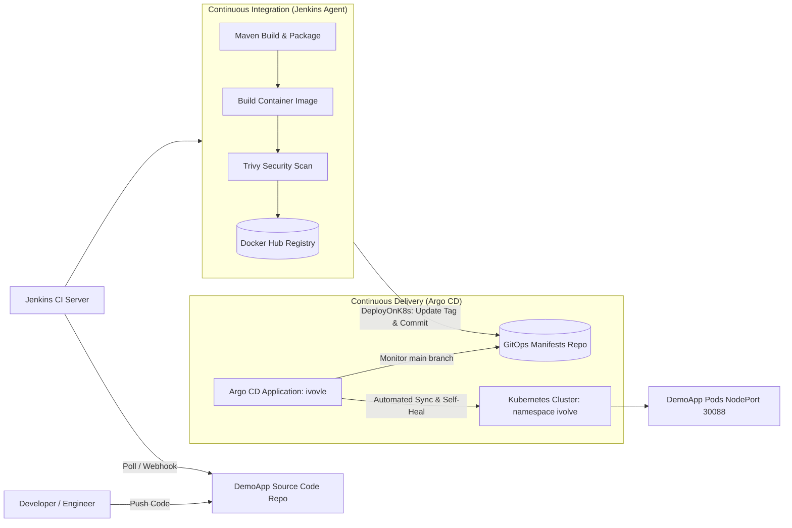

# Lab 23: Implementing a GitOps Workflow with Jenkins and Argo CD

## 1. Overview & Architecture

This lab implements a production-grade **GitOps Continuous Delivery workflow** integrating **Jenkins CI** and **Argo CD** on a multi-node Kubernetes cluster.

In traditional CI/CD pipelines, Jenkins holds cluster credentials and directly invokes `kubectl apply` to push changes to the cluster. In contrast, the **GitOps paradigm** uses Git as the single source of truth for desired infrastructure and application state.

### GitOps Workflow Architecture



### Key Workflow Steps
1. **CI Pipeline (Jenkins)**:
   - Clones application source code from `DemoApp`.
   - Compiles, tests, and packages the Spring Boot application using Maven (`BuildApp` step).
   - Builds container image `mohadevv/demoapp:${BUILD_NUMBER}`, scans for vulnerabilities with Trivy, and pushes to Docker Hub (`BuildImage` step).
   - Executes the GitOps role (`DeployOnK8s`): Clones the manifest repository, updates `k8s/deployment.yaml` with the new image tag, commits, and pushes the updated manifest to GitHub.
2. **CD Engine (Argo CD)**:
   - Continually monitors GitHub repository `https://github.com/Moha-sys/iVolve_tasks.git` at path `GitOps/Lab23/k8s`.
   - Detects the new Git commit made by Jenkins.
   - Automatically synchronizes the desired state to the target Kubernetes namespace `ivolve`, rolling out updated pods with zero downtime.

---

## 2. Infrastructure & Environment Details

| Component | Target / Value |
| :--- | :--- |
| **Kubernetes Control Plane** | `master` (`192.168.8.130`) |
| **Kubernetes Worker Node** | `worker1` (`172.20.10.4`) |
| **Argo CD Namespace** | `argocd` |
| **Argo CD Web UI** | `http://192.168.8.130:30800/` |
| **Argo CD Service Type** | `NodePort` (HTTP `30800`, HTTPS `30443`) |
| **Argo CD Application** | `ivovle` |
| **Target Application Namespace** | `ivolve` |
| **Application Service NodePort** | `30088` (`http://192.168.8.130:30088/`) |
| **Application Image** | `mohadevv/demoapp:<BUILD_NUMBER>` |
| **Jenkins Controller** | `http://localhost:8080/` |
| **Jenkins Agent** | Inbound agent `slave-node` |
| **Shared Library** | `ivolve-shared-library` (`https://github.com/Moha-sys/ivolve-shared-library.git`) |
| **Manifest Repository** | `https://github.com/Moha-sys/iVolve_tasks.git` (`GitOps/Lab23/k8s`) |

---

## 3. Step-by-Step Implementation

### Step 1: Install Argo CD in Kubernetes Cluster

1. Create dedicated namespace `argocd`:
   ```bash
   kubectl create namespace argocd
   ```
2. Apply the official Argo CD stable installation manifests using server-side apply:
   ```bash
   kubectl apply --server-side --force-conflicts -n argocd -f https://raw.githubusercontent.com/argoproj/argo-cd/stable/manifests/install.yaml
   ```
3. Expose the `argocd-server` via `NodePort`:
   ```bash
   kubectl patch svc argocd-server -n argocd -p '{"spec": {"type": "NodePort", "ports": [{"name": "http", "port": 80, "targetPort": 8080, "nodePort": 30800}, {"name": "https", "port": 443, "targetPort": 8080, "nodePort": 30443}]}}'
   ```
4. Configure insecure mode on `argocd-cmd-params-cm` for direct HTTP NodePort proxying:
   ```bash
   kubectl patch configmap argocd-cmd-params-cm -n argocd -p '{"data":{"server.insecure":"true"}}'
   ```
5. Verify that all 7 Argo CD control plane components are running:
   ```bash
   kubectl get pods -n argocd
   ```

### Step 2: Access the Argo CD UI & Authenticate

1. Retrieve the initial admin password from Kubernetes secrets:
   ```bash
   kubectl -n argocd get secret argocd-initial-admin-secret -o jsonpath="{.data.password}" | base64 -d && echo
   ```
2. Open the Argo CD Web UI in your browser at `http://192.168.8.130:30800/`.
3. Log in with credentials:
   - **Username**: `admin`
   - **Password**: `<extracted-initial-password>`
4. Authenticate via Argo CD CLI:
   ```bash
   argocd login 192.168.8.130:30800 --username admin --password <extracted-initial-password> --plaintext --insecure
   ```

### Step 3: Connect Argo CD to GitHub Repository

Configure repository credentials via Kubernetes Secret in the `argocd` namespace:

```yaml
apiVersion: v1
kind: Secret
metadata:
  name: repo-ivolve-tasks
  namespace: argocd
  labels:
    argocd.argoproj.io/secret-type: repository
stringData:
  type: git
  url: https://github.com/Moha-sys/iVolve_tasks.git
  username: Moha-sys
  password: <GITHUB_PAT>
```

Verify repository connection status:
```bash
argocd repo list
```
The repository displays `CONNECTION: Successful`.

### Step 4: Create Argo CD Application `ivovle`

Create the Argo CD Application resource configured with automated sync, prune, and self-healing:

```yaml
apiVersion: argoproj.io/v1alpha1
kind: Application
metadata:
  name: ivovle
  namespace: argocd
  finalizers:
  - resources-finalizer.argocd.argoproj.io
spec:
  project: default
  source:
    repoURL: https://github.com/Moha-sys/iVolve_tasks.git
    targetRevision: main
    path: GitOps/Lab23/k8s
  destination:
    server: https://kubernetes.default.svc
    namespace: ivolve
  syncPolicy:
    automated:
      prune: true
      selfHeal: true
    syncOptions:
    - CreateNamespace=true
```

Apply the application:
```bash
kubectl apply -f GitOps/Lab23/argocd/application.yaml
```

Verify application synchronization:
```bash
argocd app get ivovle
```

### Step 5: GitOps-Enabled Shared Library `DeployOnK8s`

Modify `vars/DeployOnK8s.groovy` in `ivolve-shared-library` so that instead of executing `kubectl apply`, it edits the deployment file, commits, and pushes the updated manifest back to GitHub using Jenkins credentials:

```groovy
#!/usr/bin/env groovy

/**
 * Shared Library Step: DeployOnK8s
 * GitOps-enabled step that updates the Kubernetes deployment manifest with the newly built
 * image tag and pushes the changes to GitHub so Argo CD can automatically synchronize the cluster.
 */
def call(Map config = [:]) {
    def imageName        = config.get('imageName', 'mohadevv/demoapp')
    def imageTag         = config.get('imageTag', "${env.BUILD_NUMBER}")
    def manifestPath     = config.get('manifestPath', 'GitOps/Lab23/k8s/deployment.yaml')
    def gitRepo          = config.get('gitRepo', 'github.com/Moha-sys/iVolve_tasks.git')
    def gitBranch        = config.get('gitBranch', 'main')
    def gitCredentialsId = config.get('gitCredentialsId', 'jenkins')
    def deploymentName   = config.get('deploymentName', 'demoapp-deployment')
    def gitUserName      = config.get('gitUserName', 'Jenkins CI')
    def gitUserEmail     = config.get('gitUserEmail', 'jenkins@ivolve.com')
    def manifestsDir     = config.get('manifestsDir', 'gitops-repo')

    withCredentials([usernamePassword(
        credentialsId: gitCredentialsId,
        usernameVariable: 'GIT_USER',
        passwordVariable: 'GIT_PASS'
    )]) {
        stage("Update Deployment File") {
            echo "Cloning manifests repository and updating image tag in ${manifestPath}..."
            sh """
            rm -rf ${manifestsDir}
            git clone --depth 1 https://\${GIT_USER}:\${GIT_PASS}@${gitRepo} ${manifestsDir}
            cd ${manifestsDir}
            git checkout ${gitBranch}

            if [ -f "${manifestPath}" ]; then
                sed -i 's|image: .*|image: ${imageName}:${imageTag}|g' ${manifestPath}
                echo "--- Manifest Diff ---"
                git diff ${manifestPath} || true
            else
                echo "ERROR: Manifest file ${manifestPath} not found in repository!"
                exit 1
            fi
            """
        }

        stage("Push Changes to GitHub") {
            echo "Pushing updated deployment manifest to GitHub repository for Argo CD sync..."
            sh """
            cd ${manifestsDir}
            git config user.name "${gitUserName}"
            git config user.email "${gitUserEmail}"
            git add ${manifestPath}

            if git diff --staged --quiet; then
                echo "No changes detected to commit."
            else
                git commit -m "chore(gitops): update ${deploymentName} image to ${imageName}:${imageTag} [build #${imageTag}]"
                git push origin ${gitBranch}
                echo "Successfully pushed updated manifest to GitHub branch ${gitBranch}!"
            fi
            """
        }
    }
}
```

### Step 6: Jenkins CI/CD Pipeline Execution (`lab23`)

The Jenkinsfile triggers the end-to-end pipeline on `slave-node`:

```groovy
@Library('ivolve-shared-library') _

pipeline {
    agent { label 'slave-node' }

    environment {
        PATH          = "/home/moha/.tools/jdk-21/bin:/home/moha/.tools/apache-maven-3.9.9/bin:/home/moha/.local/bin:/usr/local/bin:/usr/bin:${env.PATH}"
        JAVA_HOME     = '/home/moha/.tools/jdk-21'
        IMAGE_NAME    = 'mohadevv/demoapp'
        IMAGE_TAG     = "${BUILD_NUMBER}"
        K8S_NAMESPACE = 'ivolve'
        DOCKER_CREDS  = 'docker'
    }

    stages {
        stage('Checkout Source Code') {
            steps {
                sh '''
                rm -rf * .git
                git clone --depth 1 https://github.com/Ibrahim-Adel15/DemoApp.git .
                '''
            }
        }

        stage('Build & Test') {
            steps {
                BuildApp(skipTests: false)
            }
        }

        stage('Build, Scan & Push Image') {
            steps {
                BuildImage(
                    imageName: "${IMAGE_NAME}",
                    imageTag: "${IMAGE_TAG}",
                    credentialsId: "${DOCKER_CREDS}"
                )
            }
        }

        stage('Deploy to Kubernetes via GitOps') {
            steps {
                DeployOnK8s(
                    imageName: "${IMAGE_NAME}",
                    imageTag: "${IMAGE_TAG}",
                    manifestPath: 'GitOps/Lab23/k8s/deployment.yaml',
                    deploymentName: 'demoapp-deployment'
                )
            }
        }
    }
}
```

---

## 4. Verification & Validation

1. **Jenkins Pipeline Verification**:
   - Access Jenkins UI at `http://localhost:8080/job/lab23/`.
   - Verify green stages across Checkout, Build & Test, Build/Scan/Push, and GitOps Deploy.
2. **Docker Hub Image Verification**:
   - Verify image `mohadevv/demoapp:<BUILD_NUMBER>` and `latest` pushed to Docker Hub.
3. **GitHub Manifest Commit Verification**:
   - Inspect GitHub repository commit history on `main` branch:
     `chore(gitops): update demoapp-deployment image to mohadevv/demoapp:<BUILD_NUMBER>`
4. **Argo CD Application Status**:
   - Inspect Argo CD Dashboard:
     - Health Status: **Healthy**
     - Sync Status: **Synced**
5. **Live Application Verification**:
   - Access DemoApp at `http://192.168.8.130:30088/`.
   - Verify application response: `"Hello from Dockerized Spring Boot!"`.

---

## 5. Artifacts & Deliverables

- `GitOps/Lab23/k8s/deployment.yaml`: Deployment manifest with replica count 2, tolerations, and resource limits.
- `GitOps/Lab23/k8s/service.yaml`: NodePort Service manifest on port `30088`.
- `GitOps/Lab23/argocd/application.yaml`: Argo CD Application resource `ivovle`.
- `GitOps/Lab23/Jenkinsfile`: Declarative Pipeline definition.
- `shared-library/vars/DeployOnK8s.groovy`: GitOps manifest editor and git pusher role.
