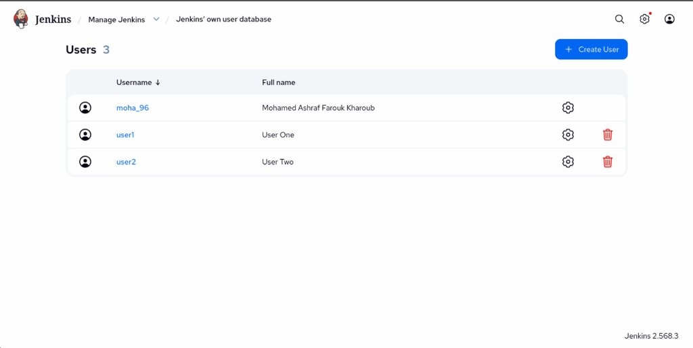

# Lab 20: Role-based Authorization in Jenkins

Comprehensive guide, configuration, automation scripts, and verification for **Lab 20 (Role-Based Authorization Strategy in Jenkins)** in Continuous Integration & Continuous Delivery (CI/CD).

---

## Lab Objectives

1. **User Management**:
   - Create two dedicated local accounts in Jenkins: `user1` and `user2`.
2. **Role-Based Authorization Strategy**:
   - Install and configure the Jenkins **Role-based Authorization Strategy** (`role-strategy`) plugin.
   - Define global roles:
     - `admin`: Full administrative control (`Administer`).
     - `read-only`: Read-only permissions (`Overall/Read`, `Job/Read`, `View/Read`).
3. **Role Assignment**:
   - Assign the `admin` role to `user1` (and `moha_96`).
   - Assign the `read-only` role to `user2`.
4. **Verification**:
   - Verify that `user1` possesses full administrative access (including `Manage Jenkins`, job creation, configuration, and execution).
   - Verify that `user2` is restricted to read-only access (can inspect jobs and build history, but cannot access `Manage Jenkins` or trigger/modify builds).

---

## Architecture Diagram

```
+-----------------------------------------------------------------------------------------+
|                                  JENKINS RBAC ARCHITECTURE                              |
|                                                                                         |
|       +-------------------------------------------------------------------------+       |
|       |                 Security Realm: HudsonPrivateSecurityRealm              |       |
|       |                                                                         |       |
|       |        [ User: user1 ]                            [ User: user2 ]       |       |
|       +---------------+------------------------------------------+--------------+       |
|                       |                                          |                      |
|                       | Bound to                                 | Bound to             |
|                       v                                          v                      |
|       +---------------+------------------------------------------+--------------+       |
|       |       Role: admin                                Role: read-only        |       |
|       |       (Global Role)                              (Global Role)          |       |
|       +---------------+------------------------------------------+--------------+       |
|                       |                                          |                      |
|                       | Permissions:                             | Permissions:         |
|                       | - Overall: Administer                    | - Overall: Read      |
|                       | - Job: All                               | - Job: Read          |
|                       | - View: All                              | - View: Read         |
|                       v                                          v                      |
|       +---------------+------------------------------------------+--------------+       |
|       |  FULL ADMIN ACCESS                       READ-ONLY DASHBOARD            |       |
|       |  - Manage Jenkins                        - View Pipelines & Status      |       |
|       |  - Configure System & Credentials        - Read Build Logs              |       |
|       |  - Create, Build & Delete Jobs           - CANNOT Build or Configure    |       |
|       +-------------------------------------------------------------------------+       |
+-----------------------------------------------------------------------------------------+
```

---

## 1. Step 1: User Management (`user1` & `user2`)

Create the user accounts in Jenkins under **Manage Jenkins** > **Users** (or via automated initialization):

- **User 1**:
  - Username: `user1`
  - Name: `User One`
  - Password: `user1password`
- **User 2**:
  - Username: `user2`
  - Name: `User Two`
  - Password: `user2password`



---

## 2. Step 2: Configure Role-Based Authorization Strategy & Define Roles

1. In **Manage Jenkins** > **Security**, set **Authorization** to **Role-Based Strategy**.
2. Navigate to **Manage Jenkins** > **Manage and Assign Roles** > **Manage Roles**.
3. Under **Global roles**, configure:
   - **`admin`**: Check `Administer` (grants all permissions).
   - **`read-only`**: Check `Overall/Read`, `Job/Read`, and `View/Read`.


---

## 3. Step 3: Assign Roles to Users

1. Navigate to **Manage Jenkins** > **Manage and Assign Roles** > **Assign Roles**.
2. Under **Global roles**:
   - Add `user1` and assign the **`admin`** role.
   - Add `user2` and assign the **`read-only`** role.


---

## 4. Step 4: Verification

### 1. `user1` (Admin View)
Log in as `user1` and confirm administrative control over Jenkins:
- Access to **Manage Jenkins**.
- Full pipeline and job configuration privileges.


### 2. `user2` (Read-Only View)
Log in as `user2` and confirm restricted read-only permissions:
- **Manage Jenkins** menu item is completely hidden.
- Can view existing projects (`lab22`, `muilti_branch`) and build logs.
- Build trigger (`Build Now`) and configuration buttons are hidden or disabled.


---

## Automated RBAC Setup Script (`setup_rbac.groovy`)

The configuration can also be applied automatically via the Groovy script located at `setup_rbac.groovy`:

```bash
docker cp setup_rbac.groovy jenkins:/var/jenkins_home/init.groovy.d/setup_rbac.groovy
docker restart jenkins
```

---

## Summary of Commands & API Verification

| Action | Command / Endpoint |
| :--- | :--- |
| **Verify user1 Access to /manage** | `curl -s -u user1:user1password -o /dev/null -w "%{http_code}" http://localhost:8080/manage/` |
| **Verify user2 Denied /manage (403)** | `curl -s -u user2:user2password -o /dev/null -w "%{http_code}" http://localhost:8080/manage/` |
| **Verify user2 View Jobs (200)** | `curl -s -u user2:user2password -o /dev/null -w "%{http_code}" http://localhost:8080/api/json` |
| **Verify user2 Denied Build (403)** | `curl -s -u user2:user2password -o /dev/null -w "%{http_code}" -X POST http://localhost:8080/job/lab22/build` |
