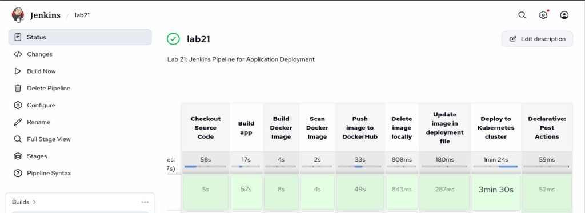
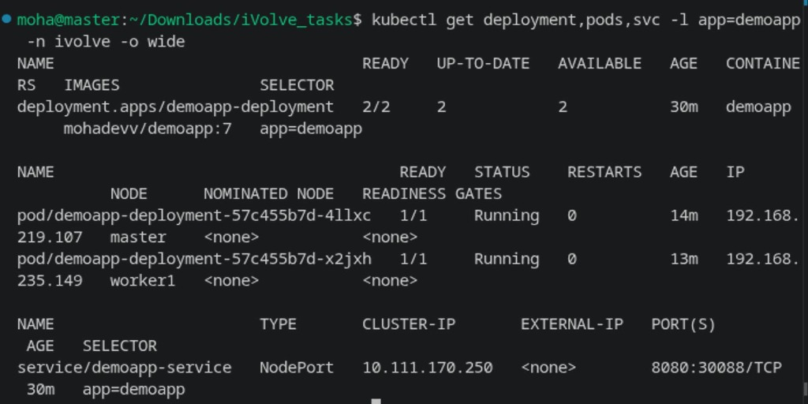
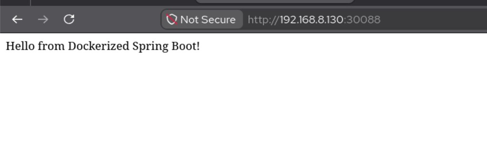
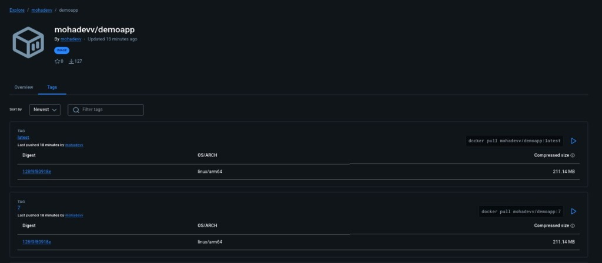

```mermaid
flowchart LR
    A["1. Checkout Source<br/>GitHub DemoApp"] --> B["2. Build App<br/>mvn clean package"]
    B --> C["3. Build Docker Image<br/>docker build"]
    C --> D["4. Scan Image<br/>Trivy Scanner"]
    D --> E["5. Push to Docker Hub<br/>docker push"]
    E --> F["6. Delete Local Image<br/>docker rmi"]
    F --> G["7. Update Deployment<br/>sed deployment.yaml"]
    G --> H["8. Deploy on K8s<br/>kubectl apply"]
    H --> I["Post Actions<br/>always / success / failure"]
```

# Lab 21: Jenkins Pipeline for Application Deployment

Comprehensive guide, Declarative Pipeline, Kubernetes manifests, and verification procedures for **Lab 21 (Jenkins Pipeline for Application Deployment)** in Continuous Integration & Continuous Delivery (CI/CD).

---

## Lab Objectives

1. **Source Code Management**:
   - Clone source code and Dockerfile from [`Ibrahim-Adel15/DemoApp`](https://github.com/Ibrahim-Adel15/DemoApp.git) (Spring Boot Java 17 application).
2. **Automated End-to-End Pipeline**:
   - **Process 1 (Build app)**: Compile and package the Java application into an executable JAR with Maven (`mvn clean package -DskipTests`).
   - **Process 2 (Build Docker Image)**: Build container image tagged with `${IMAGE_NAME}:${BUILD_NUMBER}`.
   - **Process 3 (Scan Docker Image)**: Perform vulnerability scanning with Trivy (`trivy image --severity HIGH,CRITICAL`).
   - **Process 4 (Push image to DockerHub)**: Authenticate and push image tags (`${BUILD_NUMBER}` and `latest`) to Docker Hub (`mohadevv/demoapp`).
   - **Process 5 (Delete image locally)**: Clean up local host Docker cache (`docker rmi`) to preserve runner disk space.
   - **Process 6 (Update image in deployment file)**: Dynamically inject the new build image tag into the Kubernetes `deployment.yaml` manifest.
   - **Process 7 (Deploy to Kubernetes cluster)**: Apply manifests (`kubectl apply`) and monitor zero-downtime rollout status (`kubectl rollout status`).
3. **Pipeline Post Actions**:
   - Enforce notifications and status reporting in `always`, `success`, and `failure` blocks.

---

## Architecture & Pipeline Flow

```
+-------------------------------------------------------------------------------------------------------------------+
|                                      JENKINS CI/CD DEPLOYMENT PIPELINE                                            |
|                                                                                                                   |
|  [ SCM Checkout ] ----> [ Build App ] ----> [ Build Image ] ----> [ Scan Image ] ----> [ Push Image ]             |
|  (GitHub DemoApp)        (Maven JAR)         (Docker Build)        (Trivy Scan)         (Docker Hub)              |
|                                                                                               |                   |
|                                                                                               v                   |
|  [ App Verification ] <-- [ Deploy on K8s ] <-- [ Update Manifest ] <----------------- [ Delete Local Image ]      |
|  (NodePort 30088)         (kubectl apply)       (sed image tag)                         (docker rmi)              |
+-------------------------------------------------------------------------------------------------------------------+
```



---

## 1. Declarative Pipeline Definition (`Jenkinsfile`)

```groovy
pipeline {
    agent any

    environment {
        IMAGE_NAME    = 'mohadevv/demoapp'
        IMAGE_TAG     = "${BUILD_NUMBER}"
        K8S_NAMESPACE = 'ivolve'
        DOCKER_CREDS  = 'docker'
    }

    stages {
        stage('Checkout Source Code') {
            steps {
                echo "Cloning source code and Dockerfile from DemoApp repository..."
                sh '''
                rm -rf * .git
                git clone --depth 1 https://github.com/Ibrahim-Adel15/DemoApp.git .
                '''
            }
        }

        stage('Build app') {
            steps {
                echo "Building application JAR using Maven..."
                sh 'mvn clean package -DskipTests'
            }
        }

        stage('Build Docker Image') {
            steps {
                echo "Building Docker image: ${IMAGE_NAME}:${IMAGE_TAG}..."
                sh "docker build -t ${IMAGE_NAME}:${IMAGE_TAG} -t ${IMAGE_NAME}:latest ."
            }
        }

        stage('Scan Docker Image') {
            steps {
                echo "Scanning Docker image with Trivy for vulnerabilities..."
                sh """
                trivy image --severity HIGH,CRITICAL --scanners vuln ${IMAGE_NAME}:${IMAGE_TAG} || true
                """
            }
        }

        stage('Push image to DockerHub') {
            steps {
                echo "Authenticating and pushing image to Docker Hub..."
                withCredentials([usernamePassword(
                    credentialsId: "${DOCKER_CREDS}",
                    usernameVariable: 'DOCKER_USER',
                    passwordVariable: 'DOCKER_PASS'
                )]) {
                    sh """
                    echo "\$DOCKER_PASS" | docker login -u "\$DOCKER_USER" --password-stdin
                    docker push ${IMAGE_NAME}:${IMAGE_TAG}
                    docker push ${IMAGE_NAME}:latest
                    """
                }
            }
        }

        stage('Delete image locally') {
            steps {
                echo "Cleaning up local runner storage..."
                sh """
                docker rmi ${IMAGE_NAME}:${IMAGE_TAG} ${IMAGE_NAME}:latest || true
                """
            }
        }

        stage('Update image in deployment file') {
            steps {
                echo "Updating container image tag in Kubernetes deployment manifest..."
                sh """
                mkdir -p k8s
                cat << 'EOF2' > k8s/deployment.yaml
apiVersion: apps/v1
kind: Deployment
metadata:
  name: demoapp-deployment
  namespace: ${K8S_NAMESPACE}
  labels:
    app: demoapp
spec:
  replicas: 2
  selector:
    matchLabels:
      app: demoapp
  template:
    metadata:
      labels:
        app: demoapp
    spec:
      tolerations:
      - key: "workload"
        operator: "Equal"
        value: "ivolveApp"
        effect: "NoSchedule"
      - key: "node-role.kubernetes.io/control-plane"
        operator: "Exists"
        effect: "NoSchedule"
      containers:
      - name: demoapp
        image: REPLACE_IMAGE
        imagePullPolicy: Always
        ports:
        - containerPort: 8080
        resources:
          requests:
            cpu: 100m
            memory: 256Mi
          limits:
            cpu: 500m
            memory: 512Mi
EOF2
                cat << 'EOF2' > k8s/service.yaml
apiVersion: v1
kind: Service
metadata:
  name: demoapp-service
  namespace: ${K8S_NAMESPACE}
  labels:
    app: demoapp
spec:
  type: NodePort
  selector:
    app: demoapp
  ports:
  - port: 8080
    targetPort: 8080
    nodePort: 30088
    protocol: TCP
EOF2
                sed -i "s|REPLACE_IMAGE|${IMAGE_NAME}:${IMAGE_TAG}|g" k8s/deployment.yaml
                cat k8s/deployment.yaml
                """
            }
        }

        stage('Deploy to Kubernetes cluster') {
            steps {
                echo "Deploying application to Kubernetes cluster in namespace ${K8S_NAMESPACE}..."
                sh """
                kubectl apply -f k8s/deployment.yaml
                kubectl apply -f k8s/service.yaml
                kubectl rollout status deployment/demoapp-deployment -n ${K8S_NAMESPACE} --timeout=300s
                kubectl get deployment,pods,svc -l app=demoapp -n ${K8S_NAMESPACE} -o wide
                """
            }
        }
    }

    post {
        always {
            echo "=========================================================="
            echo " Pipeline Execution Completed (always block)               "
            echo "=========================================================="
        }
        success {
            echo "=========================================================="
            echo " SUCCESS: DemoApp deployed to Kubernetes successfully!    "
            echo " App URL: http://192.168.8.130:30088/                     "
            echo "=========================================================="
        }
        failure {
            echo "=========================================================="
            echo " FAILURE: Pipeline encountered an error. Check logs above! "
            echo "=========================================================="
        }
    }
}
```

---

## 2. Kubernetes Manifests

### Deployment (`k8s/deployment.yaml`)
```yaml
apiVersion: apps/v1
kind: Deployment
metadata:
  name: demoapp-deployment
  namespace: ivolve
  labels:
    app: demoapp
spec:
  replicas: 2
  selector:
    matchLabels:
      app: demoapp
  template:
    metadata:
      labels:
        app: demoapp
    spec:
      tolerations:
      - key: "workload"
        operator: "Equal"
        value: "ivolveApp"
        effect: "NoSchedule"
      - key: "node-role.kubernetes.io/control-plane"
        operator: "Exists"
        effect: "NoSchedule"
      containers:
      - name: demoapp
        image: mohadevv/demoapp:latest
        imagePullPolicy: Always
        ports:
        - containerPort: 8080
        resources:
          requests:
            cpu: 100m
            memory: 256Mi
          limits:
            cpu: 500m
            memory: 512Mi
```

### Service (`k8s/service.yaml`)
```yaml
apiVersion: v1
kind: Service
metadata:
  name: demoapp-service
  namespace: ivolve
  labels:
    app: demoapp
spec:
  type: NodePort
  selector:
    app: demoapp
  ports:
  - port: 8080
    targetPort: 8080
    nodePort: 30088
    protocol: TCP
```

---

## 3. Step-by-Step Verification & Results

### 1. Jenkins Pipeline Execution & Stage View
The pipeline executes all 7 automated processes seamlessly from clone through compilation, vulnerability analysis, image distribution, and Kubernetes deployment.



### 2. Trivy Vulnerability Scan & Docker Hub Push
Trivy performs security inspection before pushing the validated container images (`tag` and `latest`) to Docker Hub with stored credentials.


### 3. Kubernetes Deployment & Pod Distribution
Pods are deployed with high availability across both cluster nodes (`master` and `worker1`) in namespace `ivolve`.



### 4. Application Verification via NodePort
The Spring Boot web service is accessible across both cluster nodes on NodePort `30088`:



### 5. Docker Hub Repository
Docker Hub repository reflects the versioned build artifacts pushed by the pipeline:



---

## Summary of Commands & Verification

| Action | Command / Endpoint |
| :--- | :--- |
| **Trigger Pipeline Build** | `curl -s -u user1:<token> -X POST http://localhost:8080/job/lab21/build` |
| **Inspect Jenkins Console Log** | `curl -s -u user1:<token> http://localhost:8080/job/lab21/lastBuild/consoleText` |
| **Verify Pods & Service on K8s** | `kubectl get deployment,pods,svc -n ivolve -l app=demoapp -o wide` |
| **Verify Master NodePort Endpoint** | `curl -s http://192.168.8.130:30088/` |
| **Verify Worker NodePort Endpoint** | `curl -s http://192.168.1.61:30088/` |
