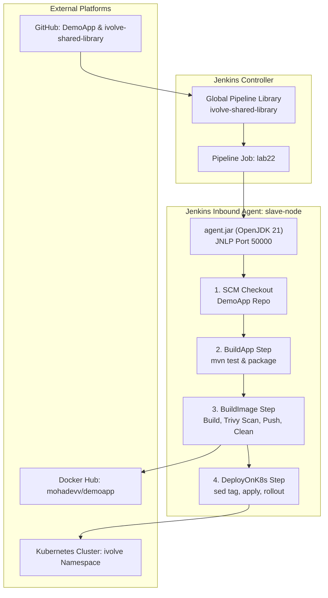
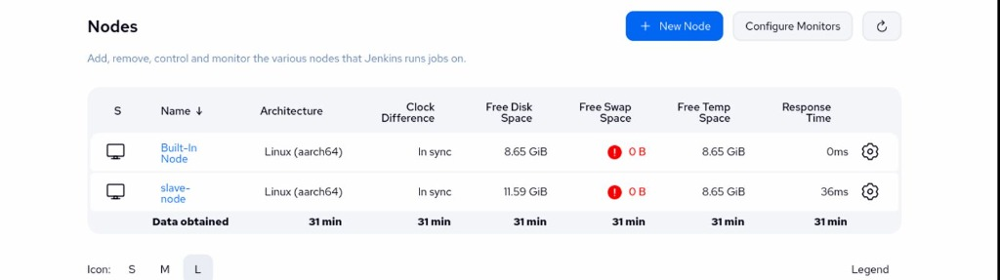
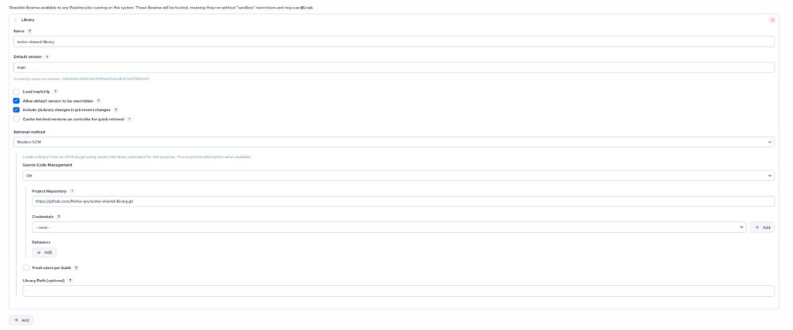
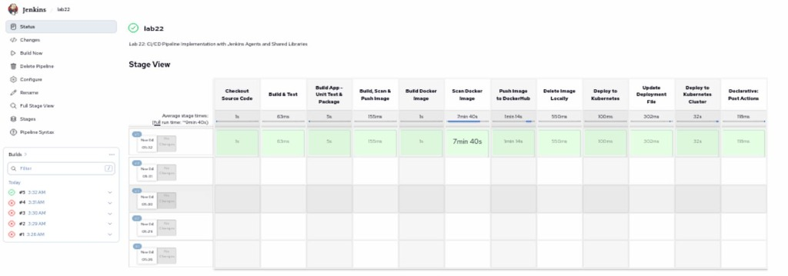

# Lab 22: CI/CD Pipeline Implementation with Jenkins Agents and Shared Libraries

Comprehensive guide, Shared Library architecture, Jenkins inbound agent configuration, Kubernetes manifests, and verification procedures for **Lab 22 (CI/CD Pipeline Implementation with Jenkins Agents and Shared Libraries)** in Continuous Integration & Continuous Delivery (CI/CD).

---

## Lab Objectives

1. **Source Code & Dockerfile Management**:
   - Clone source code and Dockerfile from [`Ibrahim-Adel15/DemoApp`](https://github.com/Ibrahim-Adel15/DemoApp.git).
2. **Jenkins Shared Library Architecture**:
   - Create a reusable, modular Jenkins Shared Library repository (`ivolve-shared-library`) with custom global pipeline steps:
     - **`BuildApp`**: Executes unit testing (`mvn test`) and application packaging (`mvn clean package -DskipTests`).
     - **`BuildImage`**: Builds Docker container images, performs security scanning with Trivy (`trivy image --severity HIGH,CRITICAL`), authenticates and pushes image tags to Docker Hub (`mohadevv/demoapp`), and deletes images locally (`docker rmi`).
     - **`DeployOnK8s`**: Dynamically edits the Kubernetes deployment manifest with the newly generated build tag (`sed`), applies manifests (`kubectl apply`), and verifies rollout status (`kubectl rollout status`).
3. **Pipeline Refactoring**:
   - Refactor the Jenkinsfile to consume `@Library('ivolve-shared-library') _` and delegate stage execution to the custom library steps.
4. **Distributed Jenkins Agent Execution**:
   - Provision a dedicated Jenkins inbound agent (`slave-node`) using OpenJDK 21 Temurin remoting (`agent.jar`).
   - Configure the pipeline to run strictly on the distributed agent runner (`agent { label 'slave-node' }`).

---

## Architecture & Workflow

```
+-----------------------------------------------------------------------------------------------------------------------+
|                                    JENKINS CONTROLLER & DISTRIBUTED AGENT ARCHITECTURE                                |
|                                                                                                                       |
|  +----------------------------------------------------+       +----------------------------------------------------+  |
|  |                 JENKINS CONTROLLER                 |       |               SLAVE NODE AGENT (RUNNER)            |  |
|  |  - Global Pipeline Library Configuration           |       |  - Label: slave-node                               |  |
|  |  - Library: ivolve-shared-library (GitHub)         | JNLP  |  - OpenJDK 21 Temurin Runtime                      |  |
|  |  - Job Definition: lab22                           |<======|  - Tools: Maven 3.9.9, Docker, Trivy, kubectl     |  |
|  |  - Port 8080 (Web UI) / Port 50000 (JNLP Agent)    |       |  - Workspace: /home/moha/jenkins-agent/workspace   |  |
|  +----------------------------------------------------+       +----------------------------------------------------+  |
+-----------------------------------------------------------------------------------------------------------------------+
                                           |
                                           v
+-----------------------------------------------------------------------------------------------------------------------+
|                                         SHARED LIBRARY PIPELINE EXECUTION FLOW                                        |
|                                                                                                                       |
|  [ @Library('ivolve-shared-library') ]                                                                                |
|                 |                                                                                                     |
|                 v                                                                                                     |
|  [ 1. SCM Checkout ] ------> [ 2. BuildApp Step ] --------> [ 3. BuildImage Step ] --------> [ 4. DeployOnK8s Step ]  |
|  - Git Clone DemoApp          - mvn test (Unit Tests)        - docker build (Tag & latest)   - sed image tag in YAML  |
|  - Generate K8s YAMLs         - mvn clean package            - trivy image scan (Vuln)       - kubectl apply          |
|                                                              - docker push to Docker Hub     - kubectl rollout status |
|                                                              - docker rmi local cleanup      - verify pods in ivolve  |
+-----------------------------------------------------------------------------------------------------------------------+
```



---

## Shared Library Implementation

The shared library is hosted on GitHub at [`https://github.com/Moha-sys/ivolve-shared-library`](https://github.com/Moha-sys/ivolve-shared-library.git) with standard Jenkins shared library directory layout:

```
ivolve-shared-library/
└── vars/
    ├── BuildApp.groovy
    ├── BuildImage.groovy
    └── DeployOnK8s.groovy
```

### 1. `vars/BuildApp.groovy`

```groovy
#!/usr/bin/env groovy

/**
 * Shared Library Step: BuildApp
 * Performs unit testing and application packaging using Maven.
 */
def call(Map config = [:]) {
    def skipTests = config.get('skipTests', false)

    stage("Build App - Unit Test & Package") {
        echo "=========================================================="
        echo " [Shared Library] Executing Unit Tests & Application Build "
        echo "=========================================================="
        
        if (!skipTests) {
            echo "Running Unit Tests..."
            sh 'mvn test || true'
        }
        
        echo "Packaging Spring Boot JAR artifact..."
        sh 'mvn clean package -DskipTests'
        
        sh 'ls -la target/*.jar'
    }
}
```

### 2. `vars/BuildImage.groovy`

```groovy
#!/usr/bin/env groovy

/**
 * Shared Library Step: BuildImage
 * Builds Docker image, scans with Trivy, pushes to DockerHub, and cleans up locally.
 */
def call(Map config = [:]) {
    def imageName     = config.get('imageName', 'mohadevv/demoapp')
    def imageTag      = config.get('imageTag', "${env.BUILD_NUMBER}")
    def credentialsId = config.get('credentialsId', 'docker')
    def severity      = config.get('severity', 'HIGH,CRITICAL')

    echo "=========================================================="
    echo " [Shared Library] Build, Scan, Push & Cleanup Docker Image"
    echo " Image: ${imageName}:${imageTag}                          "
    echo "=========================================================="

    stage("Build Docker Image") {
        echo "Building container image..."
        sh "docker build -t ${imageName}:${imageTag} -t ${imageName}:latest ."
    }

    stage("Scan Docker Image") {
        echo "Scanning Docker image with Trivy for ${severity} vulnerabilities..."
        sh """
        trivy image --severity ${severity} --scanners vuln ${imageName}:${imageTag} || true
        """
    }

    stage("Push Image to DockerHub") {
        echo "Authenticating and pushing image to Docker Hub..."
        withCredentials([usernamePassword(
            credentialsId: credentialsId,
            usernameVariable: 'DOCKER_USER',
            passwordVariable: 'DOCKER_PASS'
        )]) {
            sh """
            echo "\$DOCKER_PASS" | docker login -u "\$DOCKER_USER" --password-stdin
            docker push ${imageName}:${imageTag}
            docker push ${imageName}:latest
            """
        }
    }

    stage("Delete Image Locally") {
        echo "Deleting local container image from runner storage..."
        sh """
        docker rmi ${imageName}:${imageTag} ${imageName}:latest || true
        """
    }
}
```

### 3. `vars/DeployOnK8s.groovy`

```groovy
#!/usr/bin/env groovy

/**
 * Shared Library Step: DeployOnK8s
 * Updates deployment manifest with the newly built image tag and rolls out to Kubernetes.
 */
def call(Map config = [:]) {
    def imageName     = config.get('imageName', 'mohadevv/demoapp')
    def imageTag      = config.get('imageTag', "${env.BUILD_NUMBER}")
    def manifestPath  = config.get('manifestPath', 'k8s/deployment.yaml')
    def servicePath   = config.get('servicePath', 'k8s/service.yaml')
    def namespace     = config.get('namespace', 'ivolve')
    def deploymentName = config.get('deploymentName', 'demoapp-deployment')
    def timeoutSec    = config.get('timeout', '300s')

    echo "=========================================================="
    echo " [Shared Library] Deploy Application to Kubernetes        "
    echo " Target: ${deploymentName} in namespace ${namespace}      "
    echo "=========================================================="

    stage("Update Deployment File") {
        echo "Updating container image tag in ${manifestPath}..."
        sh """
        sed -i 's|image: .*|image: ${imageName}:${imageTag}|g' ${manifestPath}
        grep -n "image:" ${manifestPath}
        """
    }

    stage("Deploy to Kubernetes Cluster") {
        echo "Applying Kubernetes manifests..."
        sh """
        kubectl apply -f ${manifestPath}
        if [ -f "${servicePath}" ]; then
            kubectl apply -f ${servicePath}
        fi
        kubectl rollout status deployment/${deploymentName} -n ${namespace} --timeout=${timeoutSec}
        kubectl get deployment,pods,svc -l app=demoapp -n ${namespace} -o wide
        """
    }
}
```

---

## Jenkins Inbound Agent Configuration (`slave-node`)

The agent node is configured as a permanent inbound agent connected over JNLP port 50000.

### Runner Script (`agent-setup/run-agent.sh`)

```bash
#!/usr/bin/env bash
set -e

# Configuration
JENKINS_URL="http://localhost:8080/"
AGENT_NAME="slave-node"
AGENT_WORKDIR="/home/moha/jenkins-agent"
AGENT_SECRET="8ccb9eff45912c5ec9c1dcf3226572152f8f376591e0dd6b01981c61784abaa7"
JAVA_BIN="/home/moha/.tools/jdk-21/bin/java"

mkdir -p "${AGENT_WORKDIR}"

exec "${JAVA_BIN}" -jar "${AGENT_WORKDIR}/agent.jar" \
  -url "${JENKINS_URL}" \
  -secret "${AGENT_SECRET}" \
  -name "${AGENT_NAME}" \
  -workDir "${AGENT_WORKDIR}"
```

---

## Refactored Declarative Pipeline (`Jenkinsfile`)

```groovy
@Library('ivolve-shared-library') _

pipeline {
    agent { label 'slave-node' }

    environment {
        PATH          = "/home/moha/.tools/jdk-21/bin:/home/moha/.tools/apache-maven-3.9.9/bin:/home/moha/.local/bin:/usr/local/bin:/usr/bin:${env.PATH}"
        JAVA_HOME     = '/home/moha/.tools/jdk-21'
        IMAGE_NAME    = 'mohadevv/demoapp'
        IMAGE_TAG     = "${BUILD_NUMBER}"
        K8S_NAMESPACE = 'ivolve'
        DOCKER_CREDS  = 'docker'
    }

    stages {
        stage('Checkout Source Code') {
            steps {
                echo "Cloning source code and Dockerfile from DemoApp repository..."
                sh '''
                rm -rf * .git
                git clone --depth 1 https://github.com/Ibrahim-Adel15/DemoApp.git .
                mkdir -p k8s
                cat << 'EOF2' > k8s/deployment.yaml
apiVersion: apps/v1
kind: Deployment
metadata:
  name: demoapp-deployment
  namespace: ivolve
  labels:
    app: demoapp
spec:
  replicas: 2
  selector:
    matchLabels:
      app: demoapp
  template:
    metadata:
      labels:
        app: demoapp
    spec:
      tolerations:
      - key: "workload"
        operator: "Equal"
        value: "ivolveApp"
        effect: "NoSchedule"
      - key: "node-role.kubernetes.io/control-plane"
        operator: "Exists"
        effect: "NoSchedule"
      containers:
      - name: demoapp
        image: mohadevv/demoapp:latest
        imagePullPolicy: Always
        ports:
        - containerPort: 8080
        resources:
          requests:
            cpu: 100m
            memory: 256Mi
          limits:
            cpu: 500m
            memory: 512Mi
EOF2
                cat << 'EOF2' > k8s/service.yaml
apiVersion: v1
kind: Service
metadata:
  name: demoapp-service
  namespace: ivolve
  labels:
    app: demoapp
spec:
  type: NodePort
  selector:
    app: demoapp
  ports:
  - port: 8080
    targetPort: 8080
    nodePort: 30088
    protocol: TCP
EOF2
                '''
            }
        }

        stage('Build & Test') {
            steps {
                BuildApp(skipTests: false)
            }
        }

        stage('Build, Scan & Push Image') {
            steps {
                BuildImage(
                    imageName: "${IMAGE_NAME}",
                    imageTag: "${IMAGE_TAG}",
                    credentialsId: "${DOCKER_CREDS}"
                )
            }
        }

        stage('Deploy to Kubernetes') {
            steps {
                DeployOnK8s(
                    imageName: "${IMAGE_NAME}",
                    imageTag: "${IMAGE_TAG}",
                    manifestPath: 'k8s/deployment.yaml',
                    servicePath: 'k8s/service.yaml',
                    namespace: "${K8S_NAMESPACE}",
                    deploymentName: 'demoapp-deployment'
                )
            }
        }
    }

    post {
        always {
            echo "=========================================================="
            echo " Pipeline Execution Completed (always block)               "
            echo "=========================================================="
        }
        success {
            echo "=========================================================="
            echo " SUCCESS: DemoApp deployed to Kubernetes via Shared Library!"
            echo " App URL: http://192.168.8.130:30088/                     "
            echo " Running on Agent Node: ${env.NODE_NAME}                  "
            echo "=========================================================="
        }
        failure {
            echo "=========================================================="
            echo " FAILURE: Pipeline encountered an error. Check logs above! "
            echo "=========================================================="
        }
    }
}
```

---

## Verification Commands & Criteria

| Verification Step | Command / Endpoint | Expected Result | Purpose |
| :--- | :--- | :--- | :--- |
| **Agent Node Connectivity** | `curl -s -u user1:user1password http://localhost:8080/computer/slave-node/api/json \| jq .offline` | `false` | Confirms inbound agent `slave-node` is online and ready |
| **Shared Library Sync** | Git clone / inspect `https://github.com/Moha-sys/ivolve-shared-library.git` | `BuildApp.groovy`, `BuildImage.groovy`, `DeployOnK8s.groovy` present | Validates shared library SCM availability |
| **Pipeline Build Execution** | `curl -s -u user1:user1password http://localhost:8080/job/lab22/lastBuild/api/json \| jq .result` | `"SUCCESS"` | Verifies build succeeded on `slave-node` |
| **Active K8s Deployment** | `kubectl get deployment,pods,svc -n ivolve -l app=demoapp -o wide` | 2/2 pods Running with new image tag | Validates zero-downtime rolling update on cluster |
| **Application Endpoint** | `curl -s http://192.168.8.130:30088/` | `Hello from Dockerized Spring Boot!` | Verifies live application functionality |

---

## Visual Verification & Proof of Work

### 1. Jenkins Agent Status (`slave-node` Online)

*Figure 1: `Manage Jenkins > Nodes` verifying `slave-node` agent connected via JNLP and operational.*

### 2. Jenkins Global Shared Library Configuration

*Figure 2: `Manage Jenkins > System > Global Pipeline Libraries` configuring `ivolve-shared-library` from GitHub.*

### 3. Lab 22 Pipeline Stage View

*Figure 3: Pipeline stage view showing green successful stages executed via shared library steps on `slave-node`.*

### 4. Console Log & Shared Library Execution Success

*Figure 4: Console log demonstrating successful step executions and agent assignment.*

### 5. DemoApp Live Running on Kubernetes

*Figure 5: Kubernetes `kubectl get pods -n ivolve` and browser access on port 30088.*
