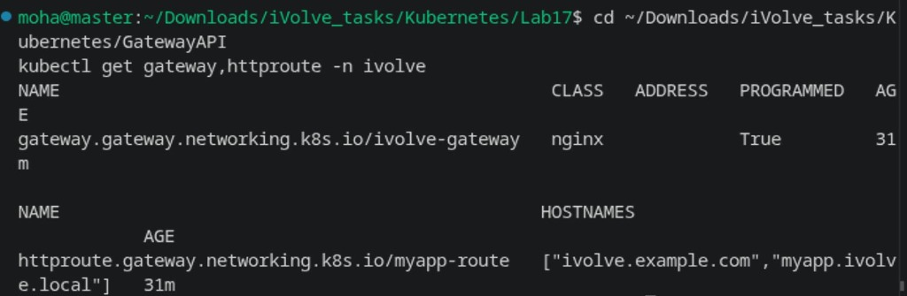
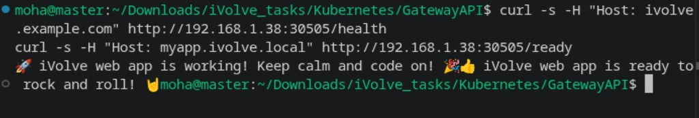

# GatewayAPI: Exposing Application via Kubernetes Gateway API

Comprehensive guide, Gateway API architecture, controller installation, and HTTP routing manifests for the **Kubernetes Gateway API (Gateway + HTTPRoute)** task.

---

## Lab Objectives

1. **Gateway API CRDs & Controller**:
   - Install standard Gateway API CRDs (`gatewayclasses`, `gateways`, `httproutes`, `referencegrants`).
   - Deploy an active Gateway controller (NGINX Gateway Fabric).
   - Verify `GatewayClass` `nginx` is accepted (`Accepted: True`).
2. **Gateway Resource (`gateway.yaml`)**:
   - Define a `Gateway` named `ivolve-gateway` in namespace `ivolve` using `gatewayClassName: nginx` listening on HTTP port `80`.
3. **HTTPRoute Resource (`httproute.yaml`)**:
   - Define an `HTTPRoute` named `myapp-route` attached to `ivolve-gateway`.
   - Match custom hostnames (`ivolve.example.com`, `myapp.ivolve.local`).
   - Forward all traffic (`PathPrefix: /`) to `myapp-service` / `ivolveappsvc` on port `3000`.
4. **Verification**:
   - Map hostname to node IP in `/etc/hosts`.
   - Query endpoint via `curl` with hostname header and verify application response.

---

## Architecture Diagram

```
+-----------------------------------------------------------------------------+
|                            GATEWAY API INGRESS                              |
|                                                                             |
|   Client / Browser / curl                                                   |
|   (Host: ivolve.example.com)                                                |
|             |                                                               |
|             v (HTTP Port 80)                                                |
|   +---------------------------------------------------------------------+   |
|   |                   Gateway: ivolve-gateway                           |   |
|   |                   GatewayClass: nginx                               |   |
|   +---------------------------------+-----------------------------------+   |
|                                     |                                       |
|                                     v (Matches Host & Path)                 |
|   +---------------------------------------------------------------------+   |
|   |                   HTTPRoute: myapp-route                            |   |
|   |                   Host: ivolve.example.com                          |   |
|   |                   Path: /                                           |   |
|   +---------------------------------+-----------------------------------+   |
|                                     |                                       |
|                                     v (Routes to Backend Port 3000)         |
|   +---------------------------------------------------------------------+   |
|   |             Service: myapp-service / ivolveappsvc (Port 3000)       |   |
|   +---------------------------------+-----------------------------------+   |
|                                     |                                       |
|                                     v (Dispatches to Pods)                  |
|                        +-------------------------+                          |
|                        |  ivolveapp (Node.js)    |                          |
|                        +-------------------------+                          |
+-----------------------------------------------------------------------------+
```

---

## 1. Step 1: Install Gateway API CRDs & Controller

```bash
# Install standard Gateway API CRDs (v1.2.0)
kubectl apply -f https://github.com/kubernetes-sigs/gateway-api/releases/download/v1.2.0/standard-install.yaml

# Install NGINX Gateway Fabric CRDs & Controller
kubectl apply -f https://raw.githubusercontent.com/nginx/nginx-gateway-fabric/v1.5.0/deploy/crds.yaml
kubectl apply -f https://raw.githubusercontent.com/nginx/nginx-gateway-fabric/v1.5.0/deploy/default/deploy.yaml

# Verify GatewayClass
kubectl get gatewayclass
```

---

## 2. Step 2: Gateway Manifest (`gateway.yaml`)

```yaml
apiVersion: gateway.networking.k8s.io/v1
kind: Gateway
metadata:
  name: ivolve-gateway
  namespace: ivolve
spec:
  gatewayClassName: nginx
  listeners:
    - name: http
      protocol: HTTP
      port: 80
      allowedRoutes:
        namespaces:
          from: Same
```

---

## 3. Step 3: HTTPRoute Manifest (`httproute.yaml`)

```yaml
apiVersion: gateway.networking.k8s.io/v1
kind: HTTPRoute
metadata:
  name: myapp-route
  namespace: ivolve
spec:
  parentRefs:
    - name: ivolve-gateway
  hostnames:
    - "ivolve.example.com"
    - "myapp.ivolve.local"
  rules:
    - matches:
        - path:
            type: PathPrefix
            value: /
      backendRefs:
        - name: myapp-service
          port: 3000
        - name: ivolveappsvc
          port: 3000
```

---

## 4. Step 4: Verification

1. **Apply Gateway & HTTPRoute**:
   ```bash
   kubectl apply -f gateway.yaml
   kubectl apply -f httproute.yaml
   kubectl get gateway,httproute -n ivolve
   ```



2. **Test Ingress Routing**:
   ```bash
   curl -H "Host: ivolve.example.com" http://<NODE_IP>:<PORT>/health
   curl -H "Host: myapp.ivolve.local" http://<NODE_IP>:<PORT>/ready
   ```



---

## Summary of Commands

| Action | Command |
| :--- | :--- |
| **Install Gateway CRDs** | `kubectl apply -f https://github.com/kubernetes-sigs/gateway-api/releases/download/v1.2.0/standard-install.yaml` |
| **Install NGINX Controller** | `kubectl apply -f https://raw.githubusercontent.com/nginx/nginx-gateway-fabric/v1.5.0/deploy/default/deploy.yaml` |
| **Apply Gateway** | `kubectl apply -f gateway.yaml` |
| **Apply HTTPRoute** | `kubectl apply -f httproute.yaml` |
| **Verify Gateway & Route** | `kubectl get gateway,httproute -n ivolve` |
| **Test Route (/health)** | `curl -s -H "Host: ivolve.example.com" http://<NODE_IP>:<PORT>/health` |
| **Test Route (/ready)** | `curl -s -H "Host: myapp.ivolve.local" http://<NODE_IP>:<PORT>/ready` |

