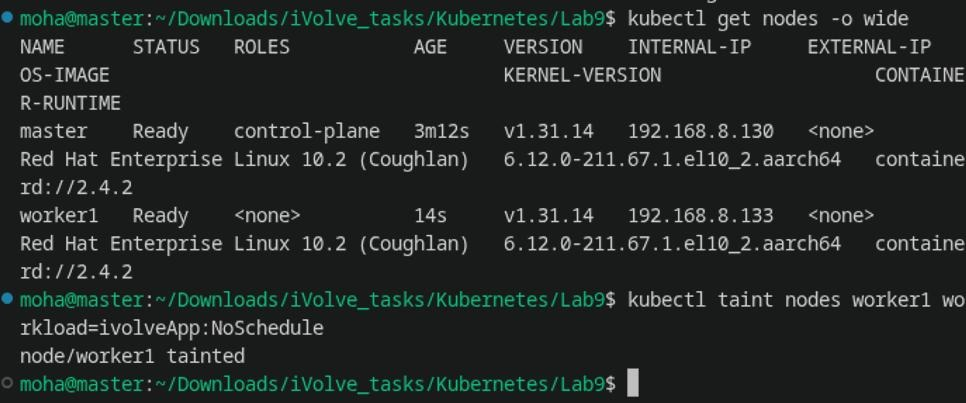
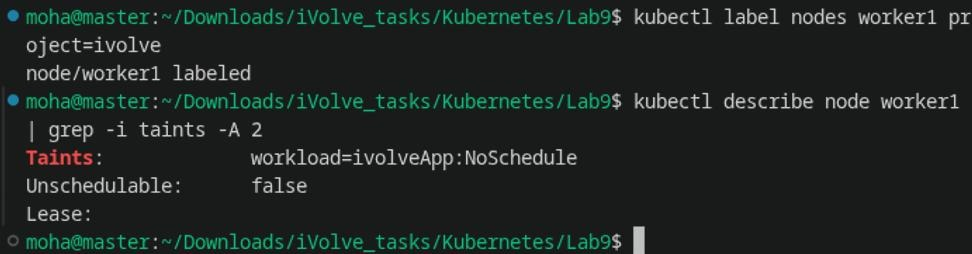
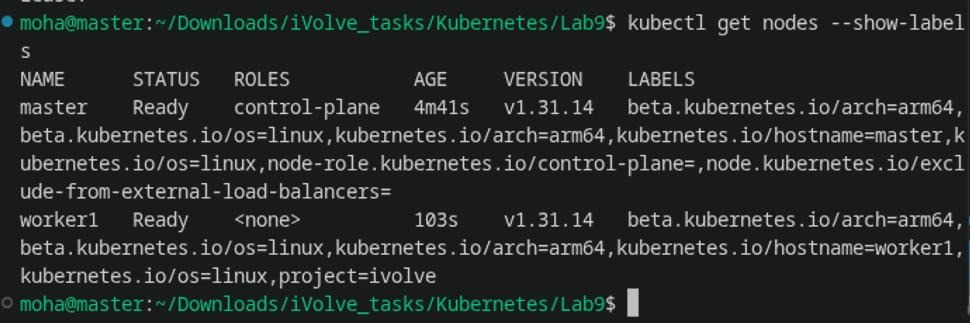

# Lab 10: Node Isolation Using Taints and Labels in Kubernetes

Comprehensive guide, concepts, step-by-step commands, and verification screenshots for **Lab 10 (Node Isolation Using Taints and Labels)** in Kubernetes.

---

## Lab Objectives

1. **Apply Node Taint**: Taint a worker node with key `workload`, value `ivolveApp`, and effect `NoSchedule` to prevent pods from being scheduled on it unless they have a matching toleration.
2. **Apply Node Label**: Label the same worker node with `project=ivolve` to enable targeted workload scheduling via `nodeSelector`.
3. **Verification**:
   - Verify the taint using `kubectl describe node <node-name>`.
   - Verify the label using `kubectl get nodes --show-labels`.
4. **Behavioral Testing (Concepts & Manifests)**:
   - Provide pod specifications showing how standard pods are repelled and how dedicated project pods use matching tolerations and `nodeSelector` to run on the node.

---

## Concepts & Architecture

```
                                 KUBERNETES SCHEDULER
                                          |
                      +-------------------+-------------------+
                      |                                       |
                      v                                       v
             [Standard Pod]                         [Tolerant Pod]
          (No toleration defined)               (toleration: workload=ivolveApp)
                      |                         (nodeSelector: project=ivolve)
                      |                                       |
                      v                                       v
            +-------------------+                   +-------------------+
            |    MASTER NODE    |                   |    WORKER NODE    |
            |                   |                   |  (Node: worker1)  |
            | Taint:            |                   | Taint:            |
            | control-plane:    |                   | workload=ivolveApp|
            |   NoSchedule      |                   |   :NoSchedule     |
            |                   |                   | Label:            |
            |                   |                   | project=ivolve    |
            +-------------------+                   +-------------------+
                      X (Repelled)                            | (Admitted)
                      |                                       v
                      +----------------------------> [Pod Running on worker1]
```

* **Taint (`workload=ivolveApp:NoSchedule`)**: Repels any pod that does not have an explicit toleration for `workload=ivolveApp`.
* **Label (`project=ivolve`)**: Attracts pods that specify `nodeSelector: project=ivolve`.
* **Together**: Implements strict node isolation and dedicated compute environments.

---

## 1. Step 1: Verify Cluster Health & Apply Taint to Worker Node

Verify both cluster nodes are in the `Ready` status, then apply the `NoSchedule` taint:

```bash
kubectl get nodes -o wide
kubectl taint nodes worker1 workload=ivolveApp:NoSchedule
```

**Output:**
```text
node/worker1 tainted
```



---

## 2. Step 2: Apply Label to Worker Node & Verify Taint

Label the worker node with `project=ivolve` and verify the taint using `kubectl describe node`:

```bash
kubectl label nodes worker1 project=ivolve
kubectl describe node worker1 | grep -i taints -A 2
```

**Output:**
```text
node/worker1 labeled
Taints:             workload=ivolveApp:NoSchedule
Unschedulable:      false
Lease:
```



---

## 3. Step 3: Verify Labels Across Cluster Nodes

Verify all node labels across the cluster using `kubectl get nodes --show-labels`:

```bash
kubectl get nodes --show-labels
```

**Output:**
```text
NAME      STATUS   ROLES           AGE     VERSION    LABELS
master    Ready    control-plane   4m41s   v1.31.14   ...,node-role.kubernetes.io/control-plane=,...
worker1   Ready    <none>          103s    v1.31.14   ...,project=ivolve
```



---

## 4. Step 4: Workload Scheduling Demonstration

### Test 1: Standard Pod (Without Toleration)
A standard workload without toleration will be rejected by the scheduler:
```bash
kubectl apply -f pod-no-toleration.yaml
kubectl get pods -o wide
```
*Result*: Pod cannot be placed on `worker1` because of the untolerated `workload=ivolveApp:NoSchedule` taint.

### Test 2: Dedicated Pod (With Toleration and NodeSelector)
```yaml
apiVersion: v1
kind: Pod
metadata:
  name: app-with-toleration
spec:
  nodeSelector:
    project: ivolve
  tolerations:
  - key: "workload"
    operator: "Equal"
    value: "ivolveApp"
    effect: "NoSchedule"
  containers:
  - name: nginx
    image: nginx:alpine
```
```bash
kubectl apply -f pod-with-toleration.yaml
kubectl get pods -o wide
```
*Result*: Pod is admitted and scheduled successfully onto `worker1`.

---

## Summary of Commands

| Action | Command |
| :--- | :--- |
| **Apply Taint** | `kubectl taint nodes worker1 workload=ivolveApp:NoSchedule` |
| **Apply Label** | `kubectl label nodes worker1 project=ivolve` |
| **Verify Taint** | `kubectl describe node worker1 \| grep -i taints -A 2` |
| **Verify Labels** | `kubectl get nodes --show-labels` |
| **Filter by Label** | `kubectl get nodes -l project=ivolve` |
| **Remove Taint (if needed)** | `kubectl taint nodes worker1 workload:NoSchedule-` |
| **Remove Label (if needed)** | `kubectl label nodes worker1 project-` |
