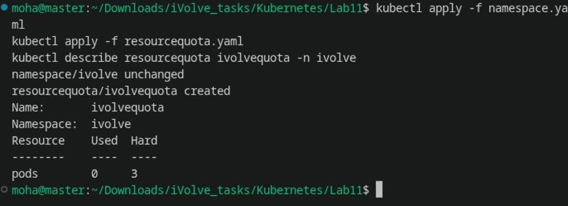
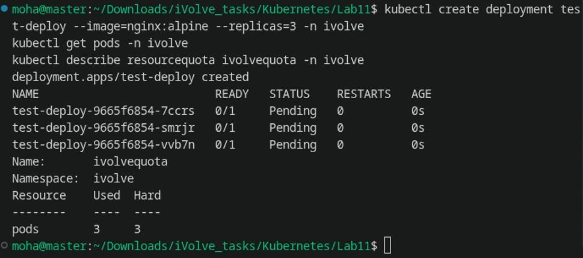
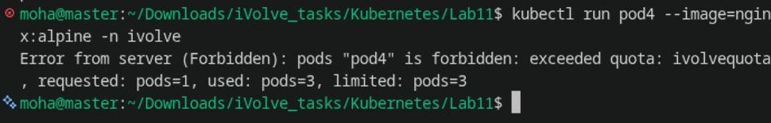
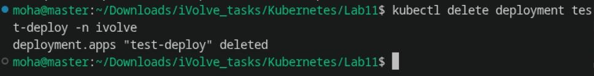

# Lab 11: Namespace Management and Resource Quota Enforcement

Comprehensive guide, manifests, commands, and verification screenshots for **Lab 11 (Namespace Management and ResourceQuota Enforcement)** in Kubernetes.

---

## Lab Objectives

1. **Namespace Isolation**: Create a dedicated namespace named `ivolve` to logically isolate application workloads.
2. **Resource Quota Enforcement**: Create a `ResourceQuota` named `ivolvequota` inside the `ivolve` namespace to strictly limit the maximum number of pods to **3**.
3. **Verification**:
   - Verify the `ResourceQuota` configuration using `kubectl describe resourcequota`.
   - Deploy 3 pods to reach the quota limit (`3/3`).
   - Attempt to deploy a 4th pod and confirm that Kubernetes rejects it with a `Forbidden: exceeded quota` error.
   - Clean up test workloads.

---

## Architecture Diagram

```
+-----------------------------------------------------------------------------+
|                          KUBERNETES CLUSTER                                 |
|                                                                             |
|   +---------------------------------------------------------------------+   |
|   |                      NAMESPACE: ivolve                              |   |
|   |                                                                     |   |
|   |    +-----------------------------------------------------------+    |   |
|   |    |            ResourceQuota: ivolvequota                     |    |   |
|   |    |            Hard limit: pods: 3                            |    |   |
|   |    +-----------------------------------------------------------+    |   |
|   |                                                                     |   |
|   |    [ Pod 1 ]              [ Pod 2 ]              [ Pod 3 ]          |   |
|   |    (Admitted 1/3)         (Admitted 2/3)         (Admitted 3/3)     |   |
|   |                                                        |            |   |
|   |                                                        |            |   |
|   |                                         [ Pod 4 Attempt ]           |   |
|   |                                                |                    |   |
|   |                                                X REJECTED           |   |
|   |                              "exceeded quota: ivolvequota"          |   |
|   +---------------------------------------------------------------------+   |
+-----------------------------------------------------------------------------+
```

---

## 1. Step 1: Create Namespace & Apply ResourceQuota

Apply the namespace and ResourceQuota manifests:

```bash
kubectl apply -f namespace.yaml
kubectl apply -f resourcequota.yaml
kubectl describe resourcequota ivolvequota -n ivolve
```

**Output:**
```text
namespace/ivolve unchanged
resourcequota/ivolvequota created
Name:       ivolvequota
Namespace:  ivolve
Resource    Used  Hard
--------    ----  ----
pods        0     3
```



---

## 2. Step 2: Deploy 3 Pods (Reaching the Quota Limit)

Deploy 3 replicas into the `ivolve` namespace to consume the full quota:

```bash
kubectl create deployment test-deploy --image=nginx:alpine --replicas=3 -n ivolve
kubectl get pods -n ivolve
kubectl describe resourcequota ivolvequota -n ivolve
```

**Output:**
```text
deployment.apps/test-deploy created
NAME                           READY   STATUS    RESTARTS   AGE
test-deploy-9665f6854-7ccrs    0/1     Pending   0          0s
test-deploy-9665f6854-smrjr    0/1     Pending   0          0s
test-deploy-9665f6854-vvb7n    0/1     Pending   0          0s
Name:       ivolvequota
Namespace:  ivolve
Resource    Used  Hard
--------    ----  ----
pods        3     3
```



---

## 3. Step 3: Quota Limit Enforcement (4th Pod Rejected)

Attempt to create a 4th pod in the `ivolve` namespace:

```bash
kubectl run pod4 --image=nginx:alpine -n ivolve
```

**Output:**
```text
Error from server (Forbidden): pods "pod4" is forbidden: exceeded quota: ivolvequota, requested: pods=1, used: pods=3, limited: pods=3
```

Kubernetes admission controller actively prevents the 4th pod from being admitted into the namespace.



---

## 4. Step 4: Cleanup Test Deployment

Clean up the test deployment from the `ivolve` namespace:

```bash
kubectl delete deployment test-deploy -n ivolve
```

**Output:**
```text
deployment.apps "test-deploy" deleted
```



---

## Summary of Commands

| Action | Command |
| :--- | :--- |
| **Apply Namespace** | `kubectl apply -f namespace.yaml` |
| **Apply Quota** | `kubectl apply -f resourcequota.yaml` |
| **Describe Quota** | `kubectl describe resourcequota ivolvequota -n ivolve` |
| **Deploy 3 Pods** | `kubectl create deployment test-deploy --image=nginx:alpine --replicas=3 -n ivolve` |
| **Attempt 4th Pod** | `kubectl run pod4 --image=nginx:alpine -n ivolve` |
| **Delete Deployment** | `kubectl delete deployment test-deploy -n ivolve` |
