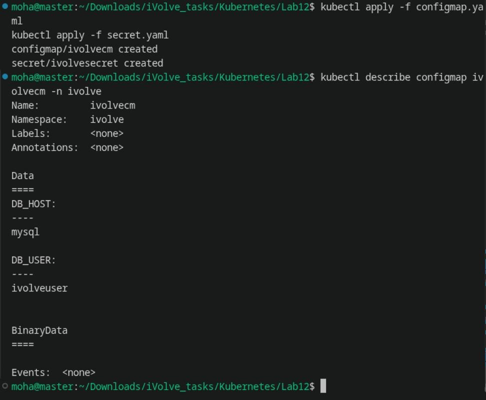
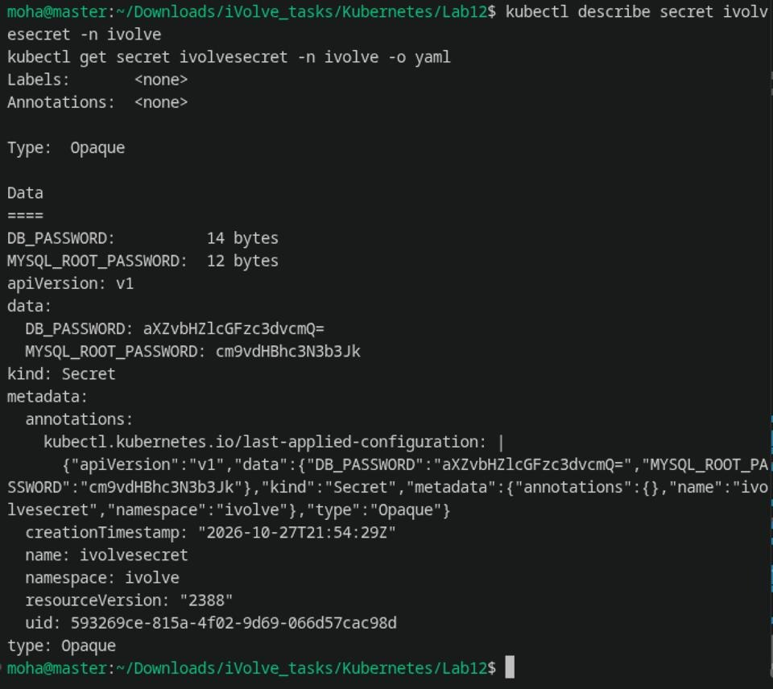
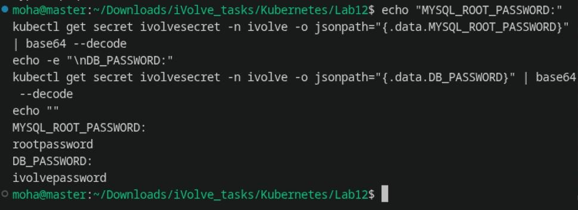

# Lab 12: Managing Configuration and Sensitive Data with ConfigMaps and Secrets

Comprehensive guide, manifests, commands, and verification screenshots for **Lab 12 (ConfigMaps and Base64-Encoded Secrets)** in Kubernetes.

---

## Lab Objectives

1. **ConfigMap Creation**: Create a `ConfigMap` named `ivolvecm` in the `ivolve` namespace to store non-sensitive MySQL configuration parameters:
   - `DB_HOST`: Hostname of the MySQL StatefulSet's headless service (`mysql`).
   - `DB_USER`: Application database user (`ivolveuser`).
2. **Secret Creation**: Create a `Secret` named `ivolvesecret` in the `ivolve` namespace to store sensitive credentials:
   - `MYSQL_ROOT_PASSWORD`: The root password for the MySQL database.
   - `DB_PASSWORD`: The database password for the user specified by `DB_USER`.
3. **Base64 Encoding**: Use standard Base64 encoding for the secret values in the YAML manifest.
4. **Verification**: Verify both objects using `kubectl describe`, inspect the YAML payload with `kubectl get secret -o yaml`, and decode the secret payload to confirm data integrity.

---

## Architecture Diagram

```
+-----------------------------------------------------------------------------+
|                          NAMESPACE: ivolve                                  |
|                                                                             |
|      +---------------------------------------------------------------+      |
|      |                  ConfigMap: ivolvecm                          |      |
|      |                  (Plaintext Non-Sensitive Data)               |      |
|      +---------------------------------------------------------------+      |
|      |  DB_HOST: "mysql"                                             |      |
|      |  DB_USER: "ivolveuser"                                        |      |
|      +---------------------------------------------------------------+      |
|                                                                             |
|      +---------------------------------------------------------------+      |
|      |                  Secret: ivolvesecret                         |      |
|      |                  (Base64-Encoded Sensitive Data)              |      |
|      +---------------------------------------------------------------+      |
|      |  MYSQL_ROOT_PASSWORD: cm9vdHBhc3N3b3Jk (rootpassword)         |      |
|      |  DB_PASSWORD:         aXZvbHZlcGFzc3dvcmQ= (ivolvepassword)   |      |
|      +---------------------------------------------------------------+      |
|                                                                             |
|                                      |                                      |
|                                      v                                      |
|                       +-----------------------------+                       |
|                       |        Application Pod      |                       |
|                       |   (Consumes CM & Secret)    |                       |
|                       +-----------------------------+                       |
+-----------------------------------------------------------------------------+
```

---

## 1. Step 1: Base64 Encoding for Secret Values

Generate the Base64-encoded strings for sensitive credentials:

```bash
# Encode MySQL Root Password
echo -n 'rootpassword' | base64
# Output: cm9vdHBhc3N3b3Jk

# Encode Application Database Password
echo -n 'ivolvepassword' | base64
# Output: aXZvbHZlcGFzc3dvcmQ=
```

---

## 2. Step 2: Define & Apply ConfigMap `ivolvecm`

The ConfigMap stores non-sensitive variables in `ivolvecm`:

```yaml
apiVersion: v1
kind: ConfigMap
metadata:
  name: ivolvecm
  namespace: ivolve
data:
  DB_HOST: "mysql"
  DB_USER: "ivolveuser"
```

Apply the manifest and inspect:
```bash
kubectl apply -f configmap.yaml
kubectl describe configmap ivolvecm -n ivolve
```

**Output:**
```text
configmap/ivolvecm created
Name:         ivolvecm
Namespace:    ivolve
Data
====
DB_HOST:
----
mysql
DB_USER:
----
ivolveuser
```



---

## 3. Step 3: Define & Apply Secret `ivolvesecret`

The Secret stores the Base64-encoded credentials:

```yaml
apiVersion: v1
kind: Secret
metadata:
  name: ivolvesecret
  namespace: ivolve
type: Opaque
data:
  MYSQL_ROOT_PASSWORD: cm9vdHBhc3N3b3Jk
  DB_PASSWORD: aXZvbHZlcGFzc3dvcmQ=
```

Apply the manifest and inspect both the metadata and the raw encoded YAML payload:
```bash
kubectl apply -f secret.yaml
kubectl describe secret ivolvesecret -n ivolve
kubectl get secret ivolvesecret -n ivolve -o yaml
```

**Output:**
```text
secret/ivolvesecret created
Type:  Opaque

Data
====
DB_PASSWORD:          14 bytes
MYSQL_ROOT_PASSWORD:  12 bytes
```



---

## 4. Step 4: Verify Secret Decoding

Confirm that the Base64 values decode back to their original plaintext strings:

```bash
echo "MYSQL_ROOT_PASSWORD:"
kubectl get secret ivolvesecret -n ivolve -o jsonpath="{.data.MYSQL_ROOT_PASSWORD}" | base64 --decode
echo -e "\nDB_PASSWORD:"
kubectl get secret ivolvesecret -n ivolve -o jsonpath="{.data.DB_PASSWORD}" | base64 --decode
echo ""
```

**Output:**
```text
MYSQL_ROOT_PASSWORD:
rootpassword
DB_PASSWORD:
ivolvepassword
```



---

## Summary of Commands

| Action | Command |
| :--- | :--- |
| **Apply ConfigMap** | `kubectl apply -f configmap.yaml` |
| **Apply Secret** | `kubectl apply -f secret.yaml` |
| **Describe ConfigMap** | `kubectl describe configmap ivolvecm -n ivolve` |
| **Describe Secret** | `kubectl describe secret ivolvesecret -n ivolve` |
| **Inspect Secret YAML** | `kubectl get secret ivolvesecret -n ivolve -o yaml` |
| **Decode Root Password** | `kubectl get secret ivolvesecret -n ivolve -o jsonpath="{.data.MYSQL_ROOT_PASSWORD}" \| base64 --decode` |
| **Decode DB Password** | `kubectl get secret ivolvesecret -n ivolve -o jsonpath="{.data.DB_PASSWORD}" \| base64 --decode` |
