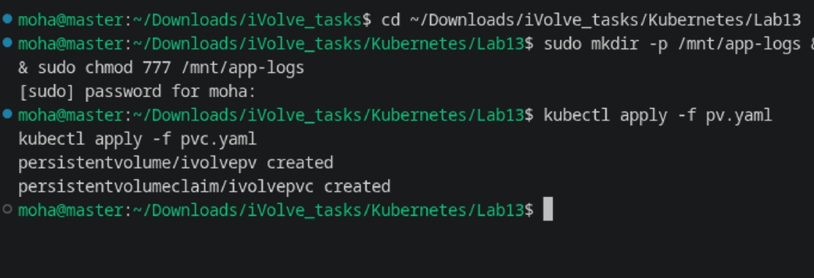
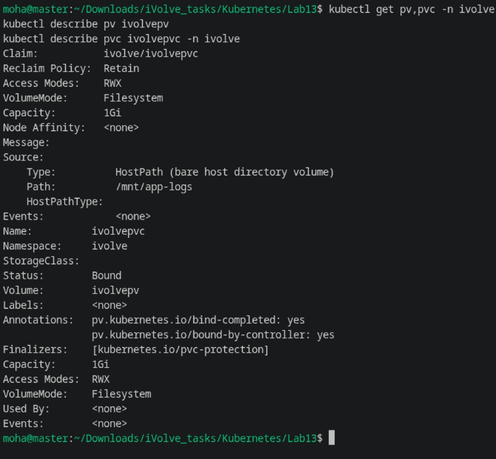
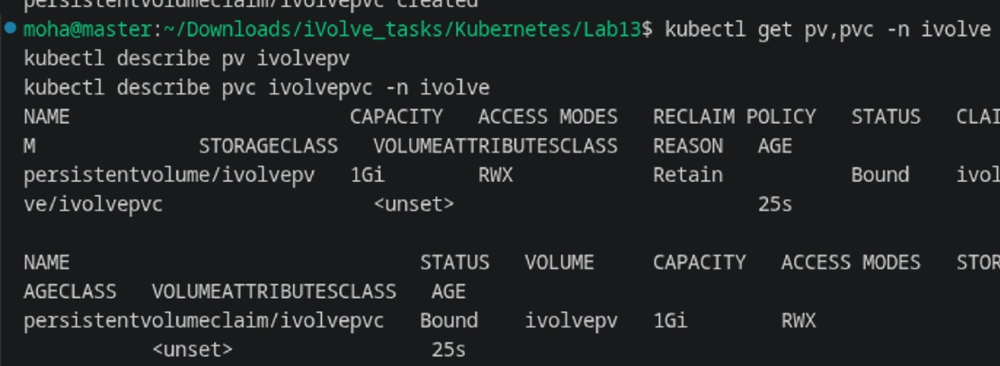

# Lab 13: Persistent Storage Setup for Application Logging

Comprehensive guide, manifests, commands, and verification screenshots for **Lab 13 (PersistentVolume & PersistentVolumeClaim for Application Logging)** in Kubernetes.

---

## Lab Objectives

1. **Persistent Volume (PV)**:
   - Define a PV named `ivolvepv`.
   - Capacity: `1Gi`.
   - Access Mode: `ReadWriteMany` (allowing multiple replicas read/write access).
   - Storage Type: `hostPath` at `/mnt/app-logs`.
   - Reclaim Policy: `Retain`.
   - StorageClass: Direct binding without dynamic StorageClass (`storageClassName: ""`).
2. **Persistent Volume Claim (PVC)**:
   - Define a PVC named `ivolvepvc` in namespace `ivolve` requesting `1Gi` storage.
   - Matching Access Mode: `ReadWriteMany`.
   - Direct binding to `ivolvepv`.
3. **Verification**:
   - Verify that the PV and PVC immediately bind (`Status: Bound`).
   - Describe both resources to verify capacity, access modes, and volume path.

---

## Architecture Diagram

```
+-----------------------------------------------------------------------------+
|                          KUBERNETES CLUSTER                                 |
|                                                                             |
|   +---------------------------------------------------------------------+   |
|   |                      NAMESPACE: ivolve                              |   |
|   |                                                                     |   |
|   |         +-------------------------------------------------+         |   |
|   |         |        PersistentVolumeClaim: ivolvepvc         |         |   |
|   |         |        Size: 1Gi | Mode: ReadWriteMany          |         |   |
|   |         |        Status: Bound                            |         |   |
|   |         +-----------------------+-------------------------+         |   |
|   +---------------------------------|-----------------------------------+   |
|                                     |                                       |
|                                     | (Binds To)                            |
|                                     v                                       |
|   +---------------------------------------------------------------------+   |
|   |                 PersistentVolume: ivolvepv                          |   |
|   |                 Size: 1Gi | Mode: ReadWriteMany                     |   |
|   |                 ReclaimPolicy: Retain                               |   |
|   |                 Type: hostPath (/mnt/app-logs)                      |   |
|   +---------------------------------+-----------------------------------+   |
|                                     |                                       |
|                                     v                                       |
|                   Host Node Directory: /mnt/app-logs                        |
+-----------------------------------------------------------------------------+
```

---

## 1. Step 1: Create Host Directory & Apply Manifests

1. Create the logging directory with full permissions on the node file system:

```bash
sudo mkdir -p /mnt/app-logs && sudo chmod 777 /mnt/app-logs
```

2. Apply the PersistentVolume and PersistentVolumeClaim manifests:

```yaml
# pv.yaml
apiVersion: v1
kind: PersistentVolume
metadata:
  name: ivolvepv
spec:
  storageClassName: ""
  capacity:
    storage: 1Gi
  accessModes:
    - ReadWriteMany
  persistentVolumeReclaimPolicy: Retain
  hostPath:
    path: /mnt/app-logs
```

```yaml
# pvc.yaml
apiVersion: v1
kind: PersistentVolumeClaim
metadata:
  name: ivolvepvc
  namespace: ivolve
spec:
  storageClassName: ""
  accessModes:
    - ReadWriteMany
  resources:
    requests:
      storage: 1Gi
```

```bash
kubectl apply -f pv.yaml
kubectl apply -f pvc.yaml
```



---

## 2. Step 2: Verify Volume Binding Status

Verify that both the PV and PVC immediately enter the `Bound` status:

```bash
kubectl get pv,pvc -n ivolve
```

**Output:**
```text
NAME                        CAPACITY   ACCESS MODES   RECLAIM POLICY   STATUS   CLAIM              REASON   AGE
persistentvolume/ivolvepv   1Gi        RWX            Retain           Bound    ivolve/ivolvepvc            25s

NAME                              STATUS   VOLUME     CAPACITY   ACCESS MODES   STORAGECLASS   AGE
persistentvolumeclaim/ivolvepvc   Bound    ivolvepv   1Gi        RWX                           25s
```



---

## 3. Step 3: Inspect PV and PVC Details

Describe both `ivolvepv` and `ivolvepvc` to confirm volume parameters:

```bash
kubectl describe pv ivolvepv
kubectl describe pvc ivolvepvc -n ivolve
```

**Output Details:**
```text
Claim:          ivolve/ivolvepvc
Reclaim Policy: Retain
Access Modes:   RWX
VolumeMode:     Filesystem
Capacity:       1Gi
Source:
    Type:       HostPath (bare host directory volume)
    Path:       /mnt/app-logs
Status:         Bound
```



---

## Summary of Commands

| Action | Command |
| :--- | :--- |
| **Create Host Dir** | `sudo mkdir -p /mnt/app-logs && sudo chmod 777 /mnt/app-logs` |
| **Apply PV** | `kubectl apply -f pv.yaml` |
| **Apply PVC** | `kubectl apply -f pvc.yaml` |
| **Check Binding** | `kubectl get pv,pvc -n ivolve` |
| **Describe PV** | `kubectl describe pv ivolvepv` |
| **Describe PVC** | `kubectl describe pvc ivolvepvc -n ivolve` |
