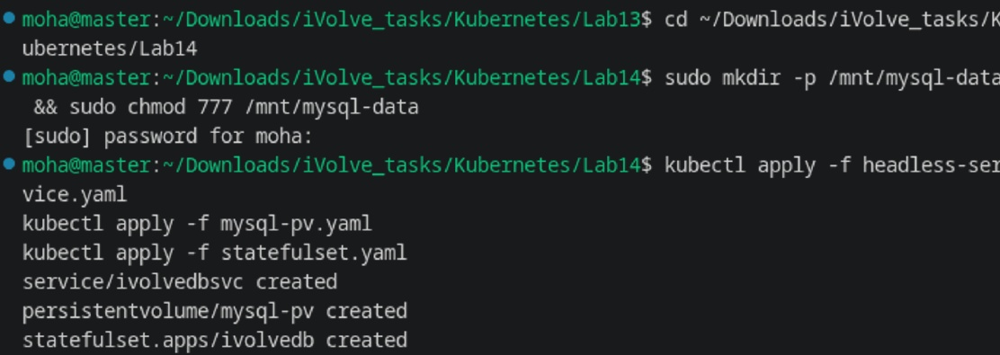
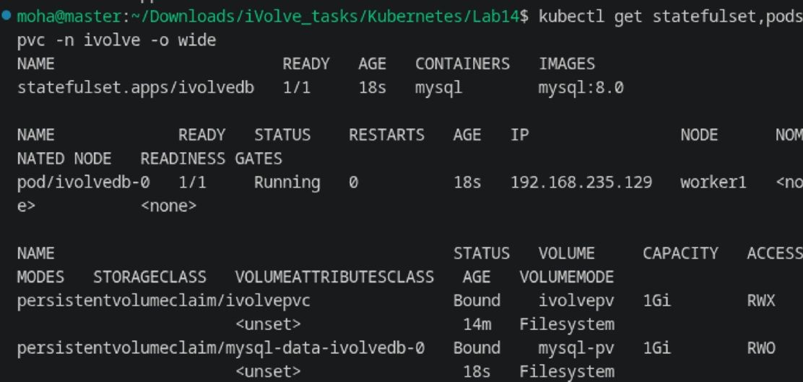
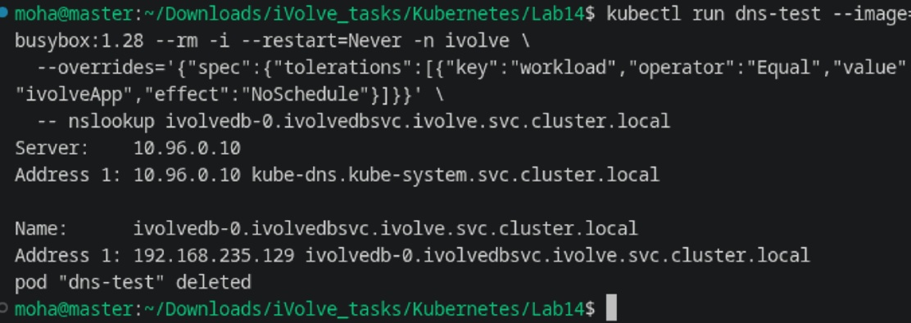
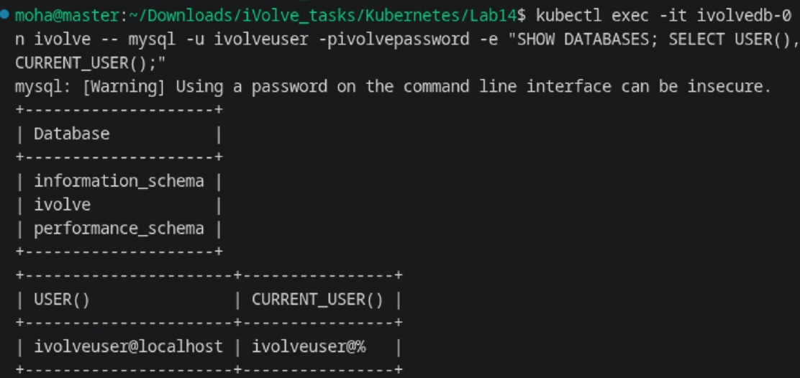

# Lab 14: StatefulSet with Headless Service

Comprehensive guide, manifests, commands, and verification screenshots for **Lab 14 (StatefulSet, Headless Service, ConfigMaps, Secrets, Taints, and DNS)** in Kubernetes.

---

## Lab Objectives

1. **StatefulSet Deployment**: Create a StatefulSet named `ivolvedb` in namespace `ivolve` with 1 replica running `mysql:8.0`.
2. **Configuration & Secrets Integration**:
   - Consume database configurations from ConfigMap `ivolvecm` (`DB_HOST`, `DB_USER`).
   - Consume sensitive credentials from Secret `ivolvesecret` (`MYSQL_ROOT_PASSWORD`, `DB_PASSWORD`).
3. **Targeted Node Scheduling**:
   - Configure `nodeSelector: project=ivolve` to target the worker node (`worker1`).
   - Configure matching toleration for `workload=ivolveApp:NoSchedule` to tolerate the worker node taint.
4. **Persistent Storage (PVC Template)**:
   - Configure a `volumeClaimTemplates` to persistently mount `/var/lib/mysql` in the pod.
5. **Headless Service**:
   - Create a headless Service named `ivolvedbsvc` (`clusterIP: None`) targeting port `3306` on the `ivolvedb` pod.
6. **Verification & Connectivity**:
   - Confirm database operations by connecting via a MySQL client.
   - Verify cluster DNS resolution for the StatefulSet pod (`ivolvedb-0.ivolvedbsvc.ivolve.svc.cluster.local`).

---

## Architecture Diagram

```
+-----------------------------------------------------------------------------------------+
|                                  NAMESPACE: ivolve                                      |
|                                                                                         |
|       +-------------------------------------------------------------------------+       |
|       |                     Headless Service: ivolvedbsvc                       |       |
|       |                     ClusterIP: None | Port: 3306                        |       |
|       +------------------------------------+------------------------------------+       |
|                                            |                                            |
|                                            v (Direct Pod DNS)                           |
|                  ivolvedb-0.ivolvedbsvc.ivolve.svc.cluster.local                        |
|                                            |                                            |
|                                            v                                            |
|       +-------------------------------------------------------------------------+       |
|       |                     StatefulSet Pod: ivolvedb-0                         |       |
|       |  Node: worker1 (nodeSelector: project=ivolve)                           |       |
|       |  Toleration: workload=ivolveApp:NoSchedule                              |       |
|       +------------------------------------+------------------------------------+       |
|       | Config:                            | Storage:                                   |       |
|       |  - ConfigMap: ivolvecm             |  - PVC: mysql-data-ivolvedb-0              |       |
|       |  - Secret:    ivolvesecret         |  - Mount: /var/lib/mysql                   |       |
|       +------------------------------------+------------------------------------+       |
+-----------------------------------------------------------------------------------------+
```

---

## 1. Step 1: Prepare Storage, Headless Service & StatefulSet

1. Create host directory for MySQL data persistence:

```bash
sudo mkdir -p /mnt/mysql-data && sudo chmod 777 /mnt/mysql-data
```

2. Apply the Headless Service, Storage PV, and StatefulSet manifests:

```yaml
# headless-service.yaml
apiVersion: v1
kind: Service
metadata:
  name: ivolvedbsvc
  namespace: ivolve
  labels:
    app: ivolvedb
spec:
  ports:
  - port: 3306
    name: mysql
  clusterIP: None
  selector:
    app: ivolvedb
```

```yaml
# mysql-pv.yaml
apiVersion: v1
kind: PersistentVolume
metadata:
  name: mysql-pv
spec:
  storageClassName: ""
  capacity:
    storage: 1Gi
  accessModes:
    - ReadWriteOnce
  persistentVolumeReclaimPolicy: Retain
  hostPath:
    path: /mnt/mysql-data
```

```yaml
# statefulset.yaml
apiVersion: apps/v1
kind: StatefulSet
metadata:
  name: ivolvedb
  namespace: ivolve
spec:
  serviceName: "ivolvedbsvc"
  replicas: 1
  selector:
    matchLabels:
      app: ivolvedb
  template:
    metadata:
      labels:
        app: ivolvedb
    spec:
      nodeSelector:
        project: ivolve
      tolerations:
      - key: "workload"
        operator: "Equal"
        value: "ivolveApp"
        effect: "NoSchedule"
      containers:
      - name: mysql
        image: mysql:8.0
        ports:
        - containerPort: 3306
          name: mysql
        env:
        - name: MYSQL_ROOT_PASSWORD
          valueFrom:
            secretKeyRef:
              name: ivolvesecret
              key: MYSQL_ROOT_PASSWORD
        - name: MYSQL_USER
          valueFrom:
            configMapKeyRef:
              name: ivolvecm
              key: DB_USER
        - name: MYSQL_PASSWORD
          valueFrom:
            secretKeyRef:
              name: ivolvesecret
              key: DB_PASSWORD
        - name: MYSQL_DATABASE
          value: ivolve
        - name: DB_HOST
          valueFrom:
            configMapKeyRef:
              name: ivolvecm
              key: DB_HOST
        volumeMounts:
        - name: mysql-data
          mountPath: /var/lib/mysql
  volumeClaimTemplates:
  - metadata:
      name: mysql-data
    spec:
      accessModes: [ "ReadWriteOnce" ]
      storageClassName: ""
      resources:
        requests:
          storage: 1Gi
```

```bash
kubectl apply -f headless-service.yaml
kubectl apply -f mysql-pv.yaml
kubectl apply -f statefulset.yaml
```

**Output:**
```text
service/ivolvedbsvc created
persistentvolume/mysql-pv created
statefulset.apps/ivolvedb created
```



---

## 2. Step 2: Verify StatefulSet Pod Running on Worker Node

Verify that `ivolvedb-0` is scheduled and running on `worker1` and its PVC is `Bound`:

```bash
kubectl get statefulset,pods,pvc -n ivolve -o wide
```

**Output:**
```text
NAME                        READY   AGE   CONTAINERS   IMAGES
statefulset.apps/ivolvedb   1/1     18s   mysql        mysql:8.0

NAME             READY   STATUS    RESTARTS   AGE   IP                NODE      NOMINATED NODE
pod/ivolvedb-0   1/1     Running   0          18s   192.168.235.129   worker1   <none>

NAME                                          STATUS   VOLUME     CAPACITY   ACCESS MODES   STORAGECLASS   AGE
persistentvolumeclaim/mysql-data-ivolvedb-0   Bound    mysql-pv   1Gi        RWO                           18s
```



---

## 3. Step 3: Verify MySQL Client Connection

Verify database connectivity and query privileges using the credentials from `ivolvesecret` and `ivolvecm`:

```bash
kubectl exec -it ivolvedb-0 -n ivolve -- mysql -u ivolveuser -pivolvepassword -e "SHOW DATABASES; SELECT USER(), CURRENT_USER();"
```

**Output:**
```text
+--------------------+
| Database           |
+--------------------+
| information_schema |
| ivolve             |
| performance_schema |
+--------------------+
+----------------------+----------------+
| USER()               | CURRENT_USER() |
+----------------------+----------------+
| ivolveuser@localhost | ivolveuser@%   |
+----------------------+----------------+
```



---

## 4. Step 4: Verify Cluster DNS Resolution

Test DNS resolution of the headless service FQDN using `nslookup` (configured with matching toleration for `worker1`):

```bash
kubectl run dns-test --image=busybox:1.28 --rm -i --restart=Never -n ivolve \
  --overrides='{"spec":{"tolerations":[{"key":"workload","operator":"Equal","value":"ivolveApp","effect":"NoSchedule"}]}}' \
  -- nslookup ivolvedb-0.ivolvedbsvc.ivolve.svc.cluster.local
```

**Output:**
```text
Server:    10.96.0.10
Address 1: 10.96.0.10 kube-dns.kube-system.svc.cluster.local

Name:      ivolvedb-0.ivolvedbsvc.ivolve.svc.cluster.local
Address 1: 192.168.235.129 ivolvedb-0.ivolvedbsvc.ivolve.svc.cluster.local
pod "dns-test" deleted
```



---

## Summary of Commands

| Action | Command |
| :--- | :--- |
| **Apply Headless Service** | `kubectl apply -f headless-service.yaml` |
| **Apply Storage PV** | `kubectl apply -f mysql-pv.yaml` |
| **Apply StatefulSet** | `kubectl apply -f statefulset.yaml` |
| **Verify Pods & PVC** | `kubectl get statefulset,pods,pvc -n ivolve -o wide` |
| **Connect MySQL Client** | `kubectl exec -it ivolvedb-0 -n ivolve -- mysql -u ivolveuser -pivolvepassword -e "SHOW DATABASES;"` |
| **Resolve Pod DNS** | `kubectl run dns-test --image=busybox:1.28 --rm -i --restart=Never -n ivolve --overrides='{"spec":{"tolerations":[{"key":"workload","operator":"Equal","value":"ivolveApp","effect":"NoSchedule"}]}}' -- nslookup ivolvedb-0.ivolvedbsvc.ivolve.svc.cluster.local` |
