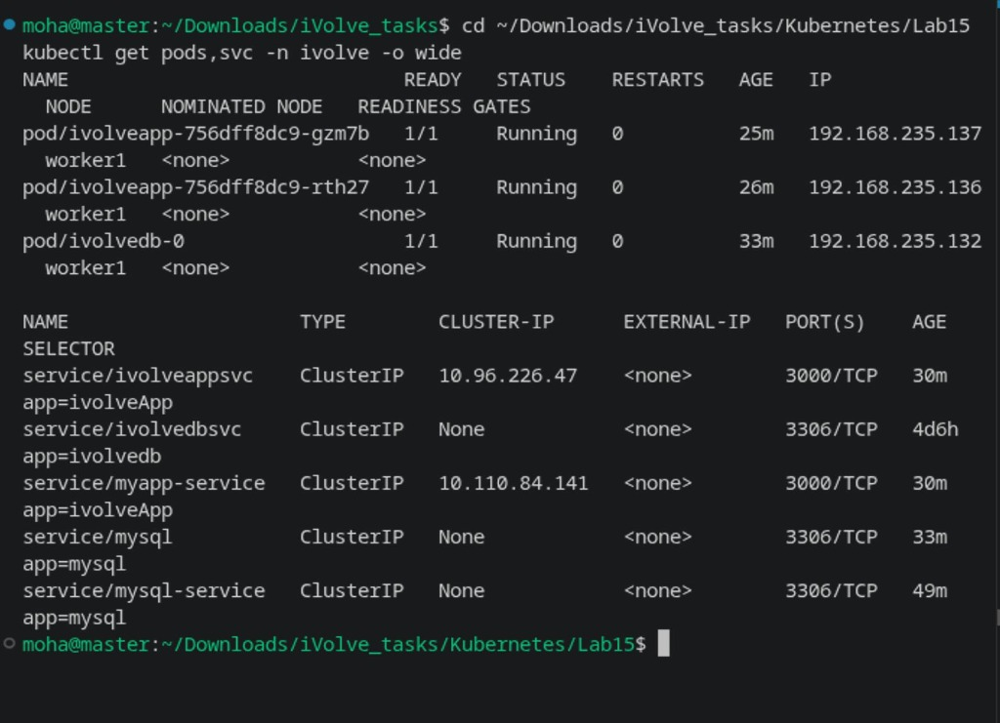
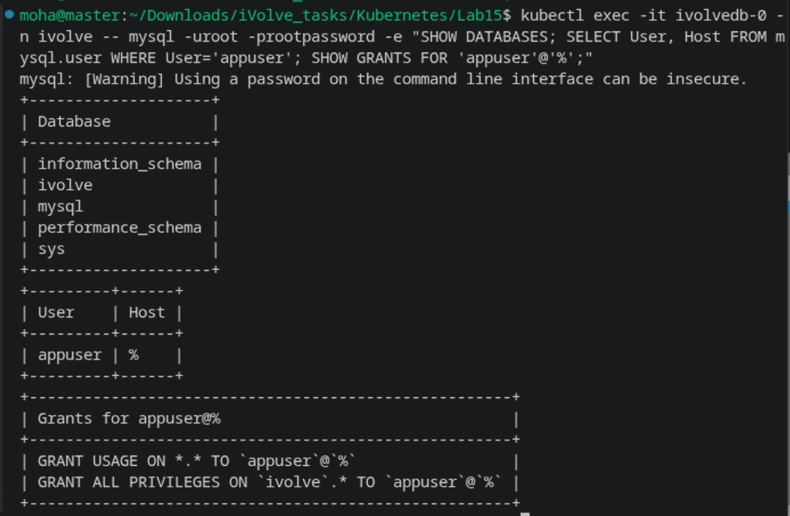
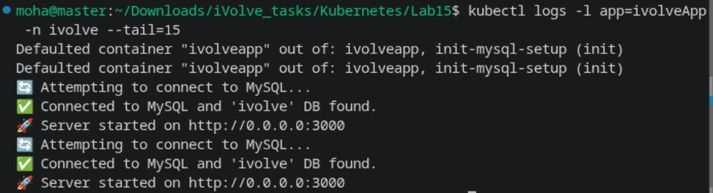
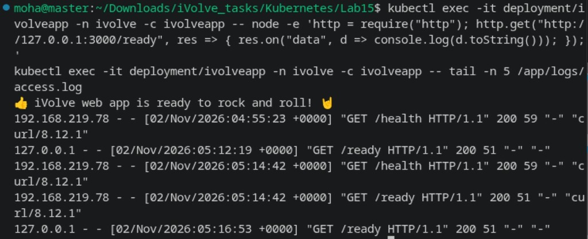

# Lab 15: Node.js Application Deployment with ClusterIP Service

Comprehensive guide, manifests, commands, and verification for **Lab 15 (Node.js Application Deployment, Private Registry Secret, InitContainer, and ClusterIP Service)** in Kubernetes.

---

## Lab Objectives

1. **Private Docker Registry Secret**:
   - Securely store Docker Hub credentials in Secret `dockerhub-cred` in namespace `ivolve` to pull from a private repository.
2. **Node.js Deployment (`ivolveapp`)**:
   - Deploy 2 replicas using custom image `mohadevv/nodejs:1` (or `mohadevv/ivolve-app:latest`).
   - Consume configuration from ConfigMap `db-config` (`DB_HOST`, `DB_USER`, `DB_NAME`, `DB_PORT`).
   - Consume credentials from Secret `db-secret` (`MYSQL_ROOT_PASSWORD`, `DB_PASSWORD`).
   - Target nodes labeled `project=ivolve`.
   - Tolerate node taints `workload=ivolveApp:NoSchedule` and `workload=ivolve:NoSchedule`.
   - Mount persistent volume `pvc-app-logs` at `/app/logs`.
3. **Database Initialization (`initContainers`)**:
   - Include an `initContainer` named `init-mysql-setup` using `mysql:8.0`.
   - Connect to MySQL as `root` using `MYSQL_ROOT_PASSWORD` and `DB_HOST`.
   - Create database `ivolve` if it does not exist, create application user `appuser`, and grant full privileges on `ivolve.*`.
   - Execute as a standard one-shot task (exiting `0`) before the main Node.js container starts.
4. **ClusterIP Service (`ivolveappsvc` / `myapp-service`)**:
   - Expose application pods internally on port `3000` (`targetPort: 3000`).
5. **Verification**:
   - Confirm database and user grants inside MySQL.
   - Verify application logs showing successful MySQL connection and server startup.
   - Verify application endpoints and persistent logging to `/app/logs/access.log`.

---

## Architecture Diagram

```
+-----------------------------------------------------------------------------------------+
|                                    NAMESPACE: ivolve                                    |
|                                                                                         |
|       +-------------------------------------------------------------------------+       |
|       |                     ClusterIP Service: ivolveappsvc                     |       |
|       |                     Port: 3000 | TargetPort: 3000                       |       |
|       +------------------------------------+------------------------------------+       |
|                                            |                                            |
|                                            v (Traffic Distribution)                     |
|                   +------------------------+------------------------+                   |
|                   |                                                 |                   |
|                   v                                                 v                   |
|       +-----------------------+                         +-----------------------+       |
|       |  Pod: ivolveapp-xxx   |                         |  Pod: ivolveapp-yyy   |       |
|       |  1. init-mysql-setup  |                         |  1. init-mysql-setup  |       |
|       |  2. ivolveapp (app)   |                         |  2. ivolveapp (app)   |       |
|       +-----------+-----------+                         +-----------+-----------+       |
|                   |                                                 |                   |
|                   +------------------------+------------------------+                   |
|                                            | (Persist Logs)                             |
|                                            v                                            |
|                               +-------------------------+                               |
|                               |   PVC: pvc-app-logs     |                               |
|                               |   Path: /app/logs       |                               |
|                               +-------------------------+                               |
|                                            |                                            |
|                                            v (TCP 3306)                                 |
|                               +-------------------------+                               |
|                               |   Service: mysql-service|                               |
|                               |   Pod: ivolvedb-0       |                               |
|                               +-------------------------+                               |
+-----------------------------------------------------------------------------------------+
```

---

## 1. Step 1: Create Docker Registry Secret & Deploy Application

1. Create the Docker registry pull secret in namespace `ivolve`:

```bash
kubectl create secret docker-registry dockerhub-cred \
  --docker-server=https://index.docker.io/v1/ \
  --docker-username=mohadevv \
  --docker-password='<YOUR_DOCKER_PASSWORD_OR_PAT>' \
  --docker-email=moha@example.com \
  -n ivolve
```

2. Apply the Deployment and ClusterIP Service manifests:

```yaml
# deployment.yaml
apiVersion: apps/v1
kind: Deployment
metadata:
  name: ivolveapp
  namespace: ivolve
  labels:
    app: ivolveApp
spec:
  replicas: 2
  strategy:
    type: RollingUpdate
    rollingUpdate:
      maxSurge: 0
      maxUnavailable: 1
  selector:
    matchLabels:
      app: ivolveApp
  template:
    metadata:
      labels:
        app: ivolveApp
    spec:
      imagePullSecrets:
        - name: dockerhub-cred
      nodeSelector:
        project: ivolve
      tolerations:
        - key: "workload"
          operator: "Equal"
          value: "ivolveApp"
          effect: "NoSchedule"
        - key: "workload"
          operator: "Equal"
          value: "ivolve"
          effect: "NoSchedule"
      initContainers:
        - name: init-mysql-setup
          image: mysql:8.0
          env:
            - name: MYSQL_ROOT_PASSWORD
              valueFrom:
                secretKeyRef:
                  name: db-secret
                  key: MYSQL_ROOT_PASSWORD
            - name: DB_HOST
              valueFrom:
                configMapKeyRef:
                  name: db-config
                  key: DB_HOST
            - name: DB_USER
              valueFrom:
                configMapKeyRef:
                  name: db-config
                  key: DB_USER
            - name: DB_NAME
              valueFrom:
                configMapKeyRef:
                  name: db-config
                  key: DB_NAME
            - name: DB_PASSWORD
              valueFrom:
                secretKeyRef:
                  name: db-secret
                  key: DB_PASSWORD
          command:
            - "/bin/sh"
            - "-c"
            - |
              mysql -h "$DB_HOST" -uroot -p"$MYSQL_ROOT_PASSWORD" <<-EOSQL
                CREATE DATABASE IF NOT EXISTS \`${DB_NAME}\`;
                CREATE USER IF NOT EXISTS '${DB_USER}'@'%' IDENTIFIED BY '${DB_PASSWORD}';
                GRANT ALL PRIVILEGES ON \`${DB_NAME}\`.* TO '${DB_USER}'@'%';
                FLUSH PRIVILEGES;
              EOSQL
      containers:
        - name: ivolveapp
          image: mohadevv/nodejs:1
          ports:
            - containerPort: 3000
          envFrom:
            - configMapRef:
                name: db-config
            - secretRef:
                name: db-secret
          volumeMounts:
            - name: app-logs
              mountPath: /app/logs
      volumes:
        - name: app-logs
          persistentVolumeClaim:
            claimName: pvc-app-logs
```

```yaml
# svc.yaml
apiVersion: v1
kind: Service
metadata:
  name: ivolveappsvc
  namespace: ivolve
spec:
  type: ClusterIP
  selector:
    app: ivolveApp
  ports:
    - protocol: TCP
      port: 3000
      targetPort: 3000
---
apiVersion: v1
kind: Service
metadata:
  name: myapp-service
  namespace: ivolve
spec:
  type: ClusterIP
  selector:
    app: ivolveApp
  ports:
    - protocol: TCP
      port: 3000
      targetPort: 3000
```

```bash
kubectl apply -f deployment.yaml
kubectl apply -f svc.yaml
kubectl get pods,svc -n ivolve -o wide
```



---

## 2. Step 2: Verify MySQL Database & User Grants

Connect to MySQL directly to verify that the `initContainer` successfully initialized database `ivolve` and granted all privileges to `appuser`:

```bash
kubectl exec -it ivolvedb-0 -n ivolve -- mysql -uroot -prootpassword -e "SHOW DATABASES; SELECT User, Host FROM mysql.user WHERE User='appuser'; SHOW GRANTS FOR 'appuser'@'%';"
```



---

## 3. Step 3: Verify Application Logs & Database Connection

Check the logs across the `ivolveapp` pods to confirm successful database connectivity and server startup on port `3000`:

```bash
kubectl logs -l app=ivolveApp -n ivolve --tail=15
```



---

## 4. Step 4: Verify Endpoints & Persistent Logging

Verify the `/ready` endpoint and inspect the persistent access logs at `/app/logs/access.log`:

```bash
kubectl exec -it deployment/ivolveapp -n ivolve -c ivolveapp -- node -e 'http = require("http"); http.get("http://127.0.0.1:3000/ready", res => { res.on("data", d => console.log(d.toString())); });'
kubectl exec -it deployment/ivolveapp -n ivolve -c ivolveapp -- tail -n 5 /app/logs/access.log
```



---

## Summary of Commands

| Action | Command |
| :--- | :--- |
| **Apply Secret** | `kubectl apply -f dockerhub_secret.yaml` |
| **Apply Deployment** | `kubectl apply -f deployment.yaml` |
| **Apply Service** | `kubectl apply -f svc.yaml` |
| **Check Pods & Service** | `kubectl get pods,svc -n ivolve -o wide` |
| **Check MySQL Grants** | `kubectl exec -it ivolvedb-0 -n ivolve -- mysql -uroot -prootpassword -e "SHOW DATABASES; SHOW GRANTS FOR 'appuser'@'%';"` |
| **Check App Logs** | `kubectl logs -l app=ivolveApp -n ivolve --tail=15` |
| **Check App Ready & Logs** | `kubectl exec -it deployment/ivolveapp -n ivolve -c ivolveapp -- tail -n 5 /app/logs/access.log` |
