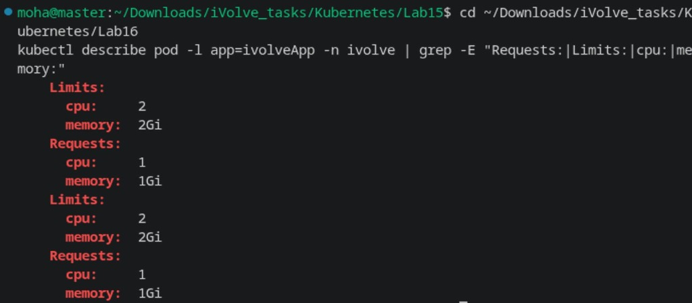
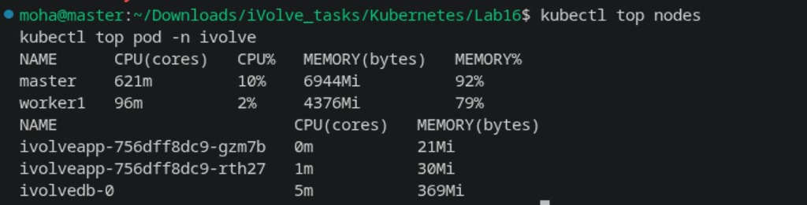

# Lab 16: Pod Resource Management with CPU & Memory Requests and Limits

Comprehensive guide, resource definitions, commands, and verification for **Lab 16 (Pod Resource Management with CPU and Memory Requests and Limits)** in Kubernetes.

---

## Lab Objectives

1. **Pod Resource Management**:
   - Update the `ivolveapp` Deployment specification to configure explicit resource requests and limits.
2. **Resource Requests**:
   - `cpu: "1"` (1 vCPU)
   - `memory: "1Gi"` (1 Gibibyte)
3. **Resource Limits**:
   - `cpu: "2"` (2 vCPUs)
   - `memory: "2Gi"` (2 Gibibytes)
4. **Verification**:
   - Inspect applied resources using `kubectl describe pod -l app=ivolveApp -n ivolve`.
   - Monitor real-time resource utilization using `kubectl top pod -n ivolve` and `kubectl top nodes` (powered by Metrics Server).

---

## Architecture & Resource Allocation

```
+-----------------------------------------------------------------------------+
|                             NODE ALLOCATION                                 |
|                                                                             |
|   Node: worker1 (Allocatable: 4 CPUs, 5.35 GiB Memory)                      |
|                                                                             |
|   +---------------------------------------------------------------------+   |
|   |                       POD: ivolveapp Replica 1                      |   |
|   |   Requests: CPU: 1 Core  | Memory: 1Gi                              |   |
|   |   Limits:   CPU: 2 Cores | Memory: 2Gi                              |   |
|   +---------------------------------------------------------------------+   |
|                                                                             |
|   +---------------------------------------------------------------------+   |
|   |                       POD: ivolveapp Replica 2                      |   |
|   |   Requests: CPU: 1 Core  | Memory: 1Gi                              |   |
|   |   Limits:   CPU: 2 Cores | Memory: 2Gi                              |   |
|   +---------------------------------------------------------------------+   |
|                                                                             |
|   Total Requested by myapp: 2 Cores CPU + 2 GiB Memory (Fits in Node)       |
+-----------------------------------------------------------------------------+
```

---

## 1. Step 1: Apply Resource Requests & Limits (`deployment.yaml`)

Update the deployment with resource requests and limits:

```yaml
apiVersion: apps/v1
kind: Deployment
metadata:
  name: ivolveapp
  namespace: ivolve
  labels:
    app: ivolveApp
spec:
  replicas: 2
  strategy:
    type: RollingUpdate
    rollingUpdate:
      maxSurge: 0
      maxUnavailable: 1
  selector:
    matchLabels:
      app: ivolveApp
  template:
    metadata:
      labels:
        app: ivolveApp
    spec:
      imagePullSecrets:
        - name: dockerhub-cred
      nodeSelector:
        project: ivolve
      tolerations:
        - key: "workload"
          operator: "Equal"
          value: "ivolveApp"
          effect: "NoSchedule"
        - key: "workload"
          operator: "Equal"
          value: "ivolve"
          effect: "NoSchedule"
      initContainers:
        - name: init-mysql-setup
          image: mysql:8.0
          env:
            - name: MYSQL_ROOT_PASSWORD
              valueFrom:
                secretKeyRef:
                  name: db-secret
                  key: MYSQL_ROOT_PASSWORD
            - name: DB_HOST
              valueFrom:
                configMapKeyRef:
                  name: db-config
                  key: DB_HOST
            - name: DB_USER
              valueFrom:
                configMapKeyRef:
                  name: db-config
                  key: DB_USER
            - name: DB_NAME
              valueFrom:
                configMapKeyRef:
                  name: db-config
                  key: DB_NAME
            - name: DB_PASSWORD
              valueFrom:
                secretKeyRef:
                  name: db-secret
                  key: DB_PASSWORD
          command:
            - "/bin/sh"
            - "-c"
            - |
              mysql -h "$DB_HOST" -uroot -p"$MYSQL_ROOT_PASSWORD" <<-EOSQL
                CREATE DATABASE IF NOT EXISTS \`${DB_NAME}\`;
                CREATE USER IF NOT EXISTS '${DB_USER}'@'%' IDENTIFIED BY '${DB_PASSWORD}';
                GRANT ALL PRIVILEGES ON \`${DB_NAME}\`.* TO '${DB_USER}'@'%';
                FLUSH PRIVILEGES;
              EOSQL
      containers:
        - name: ivolveapp
          image: mohadevv/nodejs:1
          ports:
            - containerPort: 3000
          envFrom:
            - configMapRef:
                name: db-config
            - secretRef:
                name: db-secret
          resources:
            requests:
              cpu: "1"
              memory: "1Gi"
            limits:
              cpu: "2"
              memory: "2Gi"
          volumeMounts:
            - name: app-logs
              mountPath: /app/logs
      volumes:
        - name: app-logs
          persistentVolumeClaim:
            claimName: pvc-app-logs
```

Apply and inspect the applied requests and limits:

```bash
kubectl apply -f deployment.yaml
kubectl describe pod -l app=ivolveApp -n ivolve | grep -E "Requests:|Limits:|cpu:|memory:"
```



---

## 2. Step 2: Monitor Real-Time Resource Utilization

Verify cluster-wide node utilization and per-pod resource consumption via Metrics Server:

```bash
kubectl top nodes
kubectl top pod -n ivolve
```



---

## Summary of Commands

| Action | Command |
| :--- | :--- |
| **Apply Deployment** | `kubectl apply -f deployment.yaml` |
| **Describe Pod Resources** | `kubectl describe pod -l app=ivolveApp -n ivolve \| grep -E "Requests:\|Limits:\|cpu:\|memory:"` |
| **Top Nodes** | `kubectl top nodes` |
| **Top Pods** | `kubectl top pod -n ivolve` |
