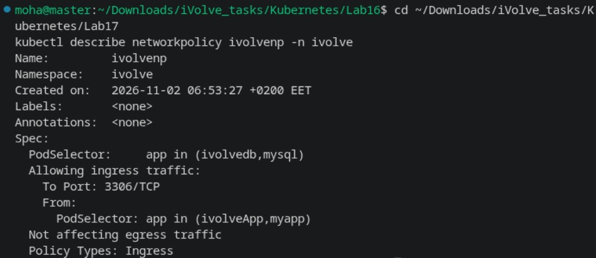
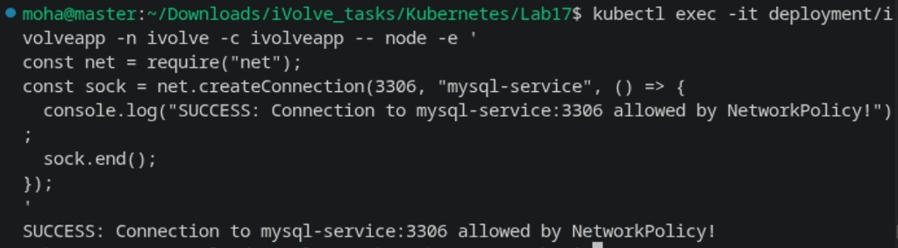
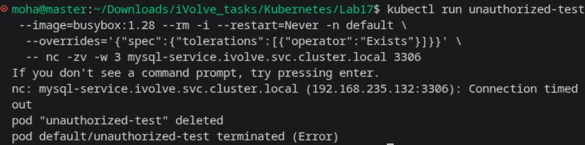

# Lab 17: Control Pod-to-Pod Traffic via NetworkPolicy

Comprehensive guide, policy definitions, commands, and security verification for **Lab 17 (Control Pod-to-Pod Traffic via NetworkPolicy)** in Kubernetes.

---

## Lab Objectives

1. **NetworkPolicy Definition**:
   - Define a NetworkPolicy named `ivolvenp` in namespace `ivolve`.
2. **Pod Selector**:
   - Target MySQL pods (`app: mysql` / `app: ivolvedb`).
3. **Policy Types**:
   - Set exclusively to `Ingress`.
   - *Security Note:* Do not specify `Egress`, so MySQL egress traffic (DNS, Calico, cluster networking) remains unimpeded while all non-whitelisted ingress traffic is blocked by default.
4. **Ingress Rule**:
   - Restrict incoming traffic strictly to application pods (`app: ivolveApp` / `app: myapp`).
   - Restrict port strictly to TCP `3306` (MySQL default port).
5. **Verification**:
   - Confirm application pods can connect to MySQL port 3306 successfully.
   - Verify that test pods without application labels are blocked from connecting to MySQL port 3306.

---

## Architecture Diagram

```
+-----------------------------------------------------------------------------+
|                               NAMESPACE: ivolve                             |
|                                                                             |
|      +------------------------+                                             |
|      |  Pod: ivolveapp        |                                             |
|      |  (Label: app=ivolveApp)|                                             |
|      +-----------+------------+                                             |
|                  |                                                          |
|                  | ALLOWED (Port 3306 TCP)                                  |
|                  v                                                          |
|      +---------------------------------------------------------------+      |
|      |                  NetworkPolicy: ivolvenp                      |      |
|      |                  Targets: app=mysql / app=ivolvedb            |      |
|      +-------------------------------+-------------------------------+      |
|                                      |                                      |
|                                      v                                      |
|                        +---------------------------+                        |
|                        |   Pod: ivolvedb-0         |                        |
|                        |   (MySQL listening: 3306) |                        |
|                        +---------------------------+                        |
|                                      ^                                      |
|                                      |                                      |
|                                      x BLOCKED (Connection Timed Out)       |
|                                      |                                      |
|                        +-------------+-------------+                        |
|                        |  Test Pod (app!=ivolveApp)|                        |
|                        +---------------------------+                        |
+-----------------------------------------------------------------------------+
```

---

## 1. Step 1: Apply & Describe NetworkPolicy (`network-policy.yaml`)

```yaml
apiVersion: networking.k8s.io/v1
kind: NetworkPolicy
metadata:
  name: ivolvenp
  namespace: ivolve
spec:
  podSelector:
    matchExpressions:
      - key: app
        operator: In
        values: ["mysql", "ivolvedb"]
  policyTypes:
    - Ingress
  ingress:
    - from:
        - podSelector:
            matchExpressions:
              - key: app
                operator: In
                values: ["ivolveApp", "myapp"]
      ports:
        - protocol: TCP
          port: 3306
---
apiVersion: networking.k8s.io/v1
kind: NetworkPolicy
metadata:
  name: allow-app-to-mysql
  namespace: ivolve
spec:
  podSelector:
    matchExpressions:
      - key: app
        operator: In
        values: ["mysql", "ivolvedb"]
  policyTypes:
    - Ingress
  ingress:
    - from:
        - podSelector:
            matchExpressions:
              - key: app
                operator: In
                values: ["ivolveApp", "myapp"]
      ports:
        - protocol: TCP
          port: 3306
```

Apply and inspect the NetworkPolicy:

```bash
kubectl apply -f network-policy.yaml
kubectl describe networkpolicy ivolvenp -n ivolve
```



---

## 2. Step 2: Verify Allowed Ingress from Application Pods

Verify that the `ivolveapp` container connects successfully to `mysql-service:3306`:

```bash
kubectl exec -it deployment/ivolveapp -n ivolve -c ivolveapp -- node -e '
const net = require("net");
const sock = net.createConnection(3306, "mysql-service", () => {
  console.log("SUCCESS: Connection to mysql-service:3306 allowed by NetworkPolicy!");
  sock.end();
});
'
```



---

## 3. Step 3: Verify Unauthorized Traffic Blocked

Verify that pods without the whitelisted application labels are denied access to MySQL port 3306:

```bash
kubectl run unauthorized-test --image=busybox:1.28 --rm -i --restart=Never -n default \
  --overrides='{"spec":{"tolerations":[{"operator":"Exists"}]}}' \
  -- nc -zv -w 3 mysql-service.ivolve.svc.cluster.local 3306
```



---

## Summary of Commands

| Action | Command |
| :--- | :--- |
| **Apply NetworkPolicy** | `kubectl apply -f network-policy.yaml` |
| **Describe Policy** | `kubectl describe networkpolicy ivolvenp -n ivolve` |
| **Verify Allowed Access** | `kubectl exec -it deployment/ivolveapp -n ivolve -c ivolveapp -- node -e '...'` |
| **Verify Blocked Access** | `kubectl run unauthorized-test --image=busybox:1.28 --rm -i --restart=Never -n default --overrides='{"spec":{"tolerations":[{"operator":"Exists"}]}}' -- nc -zv -w 3 mysql-service.ivolve.svc.cluster.local 3306` |
