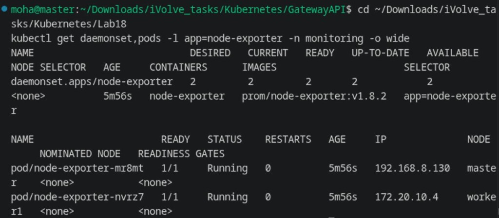
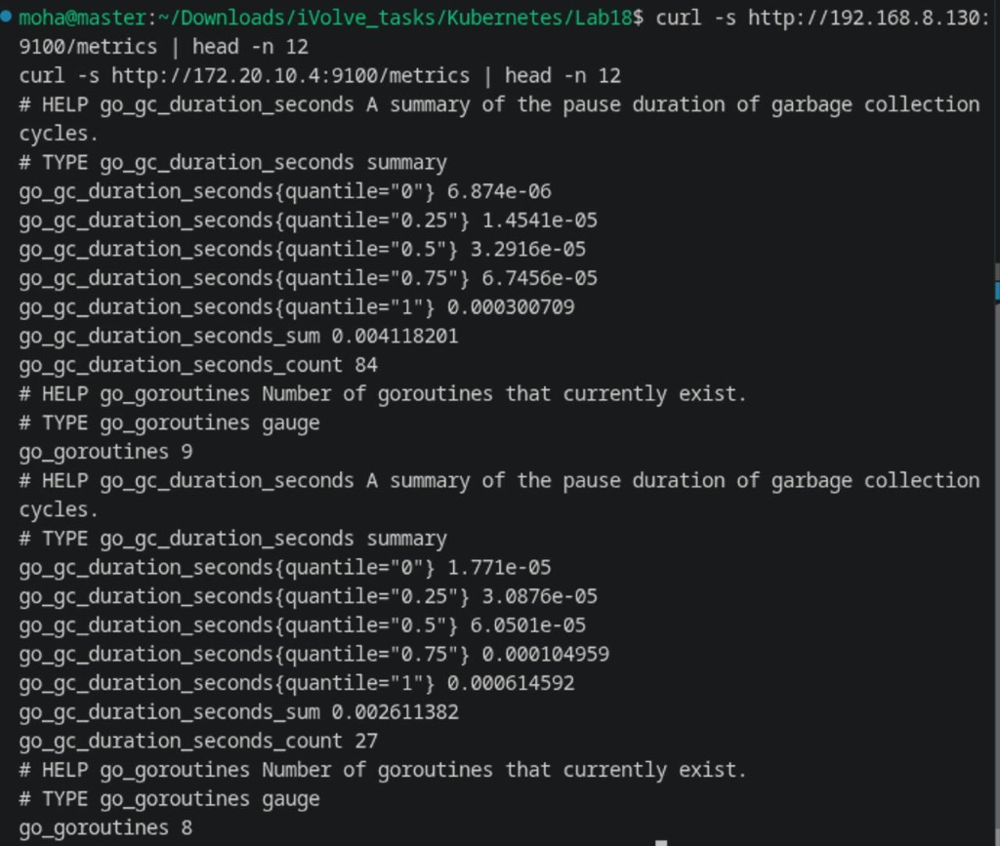
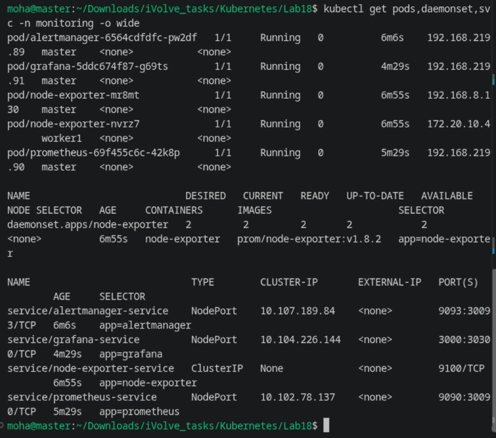
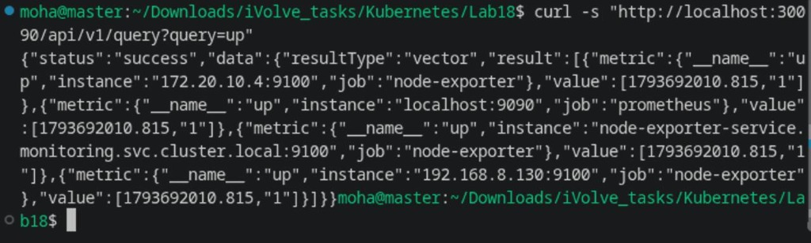
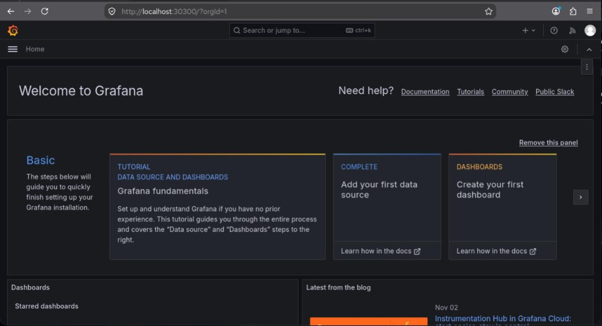

# Lab 18: Node-Wide Pod Management with DaemonSet & Cluster Monitoring

Comprehensive guide, manifests, commands, and verification for **Lab 18 (Node-Wide Pod Management with DaemonSet and Prometheus, Alertmanager, and Grafana Monitoring Stack)** in Kubernetes.

---

## Lab Objectives

1. **Monitoring Namespace Isolation**:
   - Create a dedicated namespace named `monitoring` for the entire observability stack.
2. **Prometheus Node-Exporter DaemonSet**:
   - Deploy `node-exporter` as a `DaemonSet` across all cluster nodes using `prom/node-exporter:v1.8.2`.
   - Configure tolerations (`operator: Exists`) so pods schedule onto both control-plane (`master`) and tainted worker nodes (`worker1`).
   - Enable `hostNetwork: true` and `hostPID: true` to collect host-level CPU, memory, filesystem, and network metrics on port `9100`.
   - Validate metrics exposure by querying `<node_IP>:9100/metrics`.
3. **Alertmanager Deployment**:
   - Deploy Prometheus `alertmanager` with configuration in namespace `monitoring`.
   - Expose via Service `alertmanager-service` on port `9093` (NodePort `30093`).
4. **Prometheus Server Deployment & Data Collection**:
   - Deploy `prometheus` (`prom/prometheus:v2.54.1`) configured with RBAC (`ClusterRole`, `ClusterRoleBinding`, `ServiceAccount`).
   - Configure Prometheus scrape jobs to dynamically collect metrics from `node-exporter` across all cluster nodes.
   - Expose Prometheus web UI and API via Service `prometheus-service` on port `9090` (NodePort `30090`).
5. **Grafana Visualization**:
   - Deploy `grafana` (`grafana/grafana:11.1.0`) with automated DataSource provisioning pointing to `http://prometheus-service:9090`.
   - Expose Grafana UI via Service `grafana-service` on port `3000` (NodePort `30300`).
6. **Verification**:
   - Verify that `node-exporter` pods are running on every cluster node.
   - Verify metrics endpoint `<node_IP>:9100/metrics` on each node.
   - Verify Prometheus targets are healthy (`up=1`).
   - Access Grafana and verify health and metrics integration.

---

## Architecture Diagram

```
+-----------------------------------------------------------------------------------------+
|                                    KUBERNETES CLUSTER                                   |
|                                                                                         |
|       +-------------------------------------------------------------------------+       |
|       |                           NAMESPACE: monitoring                         |       |
|       |                                                                         |       |
|       |   +-----------------------+                    +--------------------+   |       |
|       |   | Grafana (Port 3000)   |                    | Alertmanager (9093)|   |       |
|       |   | NodePort: 30300       |                    | NodePort: 30093    |   |       |
|       |   +-----------+-----------+                    +---------+----------+   |       |
|       |               | (Queries Data)                           ^              |       |
|       |               v                                          | (Alerts)     |       |
|       |   +------------------------------------------------------+----------+   |       |
|       |   |                    Prometheus Server (Port 9090)                |   |       |
|       |   |                    NodePort: 30090                              |   |       |
|       |   +-------------------+----------------------------------+----------+   |       |
|       |                       | (Scrapes :9100)                  |              |       |
|       +-----------------------|----------------------------------|--------------+       |
|                               |                                  |                      |
|             +-----------------+                                  +-----------------+    |
|             |                                                                      |    |
|             v                                                                      v    |
|   +------------------------------------+                 +------------------------------------+
|   |            NODE: master            |                 |           NODE: worker1            |
|   |   Pod: node-exporter-xxx           |                 |   Pod: node-exporter-yyy           |
|   |   (DaemonSet | Port 9100)          |                 |   (DaemonSet | Port 9100)          |
|   |   Host Metrics: CPU, RAM, Disk     |                 |   Host Metrics: CPU, RAM, Disk     |
|   +------------------------------------+                 +------------------------------------+
+-----------------------------------------------------------------------------------------+
```

---

## 1. Step 1: Create Monitoring Namespace (`namespace.yaml`)

```yaml
apiVersion: v1
kind: Namespace
metadata:
  name: monitoring
  labels:
    app.kubernetes.io/name: monitoring
```

```bash
kubectl apply -f namespace.yaml
```

---

## 2. Step 2: Deploy Prometheus Node-Exporter DaemonSet (`node-exporter-daemonset.yaml`)

```yaml
apiVersion: apps/v1
kind: DaemonSet
metadata:
  name: node-exporter
  namespace: monitoring
  labels:
    app.kubernetes.io/name: node-exporter
    app: node-exporter
spec:
  selector:
    matchLabels:
      app: node-exporter
  template:
    metadata:
      labels:
        app: node-exporter
    spec:
      hostNetwork: true
      hostPID: true
      tolerations:
        - operator: "Exists"
      containers:
        - name: node-exporter
          image: prom/node-exporter:v1.8.2
          args:
            - "--path.procfs=/host/proc"
            - "--path.sysfs=/host/sys"
            - "--path.rootfs=/host/root"
            - "--collector.filesystem.mount-points-exclude=^/(dev|proc|sys|var/lib/docker/.+|var/lib/kubelet/.+)($$|/)"
          ports:
            - name: metrics
              containerPort: 9100
              hostPort: 9100
          resources:
            requests:
              cpu: 50m
              memory: 50Mi
            limits:
              cpu: 200m
              memory: 150Mi
          volumeMounts:
            - name: proc
              mountPath: /host/proc
              readOnly: true
            - name: sys
              mountPath: /host/sys
              readOnly: true
            - name: root
              mountPath: /host/root
              readOnly: true
      volumes:
        - name: proc
          hostPath:
            path: /proc
        - name: sys
          hostPath:
            path: /sys
        - name: root
          hostPath:
            path: /
---
apiVersion: v1
kind: Service
metadata:
  name: node-exporter-service
  namespace: monitoring
  labels:
    app: node-exporter
spec:
  type: ClusterIP
  clusterIP: None
  ports:
    - name: metrics
      port: 9100
      targetPort: 9100
  selector:
    app: node-exporter
```

```bash
kubectl apply -f node-exporter-daemonset.yaml
kubectl get daemonset,pods -l app=node-exporter -n monitoring -o wide
```



---

## 3. Step 3: Verify Node-Exporter Metrics Exposure

Query the Prometheus metrics endpoint directly on both cluster nodes:

```bash
curl -s http://192.168.8.130:9100/metrics | head -n 12
curl -s http://172.20.10.4:9100/metrics | head -n 12
```



---

## 4. Step 4: Deploy Alertmanager (`alertmanager.yaml`)

```yaml
apiVersion: v1
kind: ConfigMap
metadata:
  name: alertmanager-config
  namespace: monitoring
data:
  alertmanager.yml: |
    global:
      resolve_timeout: 5m
    route:
      group_by: ['alertname', 'job']
      group_wait: 30s
      group_interval: 5m
      repeat_interval: 12h
      receiver: 'null'
    receivers:
      - name: 'null'
---
apiVersion: apps/v1
kind: Deployment
metadata:
  name: alertmanager
  namespace: monitoring
  labels:
    app: alertmanager
spec:
  replicas: 1
  selector:
    matchLabels:
      app: alertmanager
  template:
    metadata:
      labels:
        app: alertmanager
    spec:
      tolerations:
        - operator: "Exists"
      containers:
        - name: alertmanager
          image: prom/alertmanager:v0.27.0
          args:
            - "--config.file=/etc/alertmanager/alertmanager.yml"
            - "--storage.path=/alertmanager"
          ports:
            - containerPort: 9093
              name: http
          resources:
            requests:
              cpu: 50m
              memory: 50Mi
            limits:
              cpu: 200m
              memory: 150Mi
          volumeMounts:
            - name: config-volume
              mountPath: /etc/alertmanager
      volumes:
        - name: config-volume
          configMap:
            name: alertmanager-config
---
apiVersion: v1
kind: Service
metadata:
  name: alertmanager-service
  namespace: monitoring
  labels:
    app: alertmanager
spec:
  type: NodePort
  ports:
    - port: 9093
      targetPort: 9093
      nodePort: 30093
      name: http
  selector:
    app: alertmanager
```

```bash
kubectl apply -f alertmanager.yaml
```

---

## 5. Step 5: Deploy Prometheus Server (`prometheus.yaml`)

```yaml
apiVersion: v1
kind: ServiceAccount
metadata:
  name: prometheus
  namespace: monitoring
---
apiVersion: rbac.authorization.k8s.io/v1
kind: ClusterRole
metadata:
  name: prometheus
rules:
  - apiGroups: [""]
    resources: ["nodes", "nodes/proxy", "services", "endpoints", "pods"]
    verbs: ["get", "list", "watch"]
  - apiGroups: ["extensions", "networking.k8s.io"]
    resources: ["ingresses"]
    verbs: ["get", "list", "watch"]
  - nonResourceURLs: ["/metrics"]
    verbs: ["get"]
---
apiVersion: rbac.authorization.k8s.io/v1
kind: ClusterRoleBinding
metadata:
  name: prometheus
roleRef:
  apiGroup: rbac.authorization.k8s.io
  kind: ClusterRole
  name: prometheus
subjects:
  - kind: ServiceAccount
    name: prometheus
    namespace: monitoring
---
apiVersion: v1
kind: ConfigMap
metadata:
  name: prometheus-config
  namespace: monitoring
data:
  prometheus.yml: |
    global:
      scrape_interval: 15s
      evaluation_interval: 15s

    alerting:
      alertmanagers:
        - static_configs:
            - targets:
                - "alertmanager-service:9093"

    scrape_configs:
      - job_name: 'prometheus'
        static_configs:
          - targets: ['localhost:9090']

      - job_name: 'node-exporter'
        static_configs:
          - targets:
              - '192.168.8.130:9100'
              - '172.20.10.4:9100'
              - 'node-exporter-service.monitoring.svc.cluster.local:9100'
---
apiVersion: apps/v1
kind: Deployment
metadata:
  name: prometheus
  namespace: monitoring
  labels:
    app: prometheus
spec:
  replicas: 1
  selector:
    matchLabels:
      app: prometheus
  template:
    metadata:
      labels:
        app: prometheus
    spec:
      serviceAccountName: prometheus
      tolerations:
        - operator: "Exists"
      containers:
        - name: prometheus
          image: prom/prometheus:v2.54.1
          args:
            - "--config.file=/etc/prometheus/prometheus.yml"
            - "--storage.tsdb.path=/prometheus"
          ports:
            - containerPort: 9090
              name: web
          resources:
            requests:
              cpu: 100m
              memory: 150Mi
            limits:
              cpu: 500m
              memory: 500Mi
          volumeMounts:
            - name: config-volume
              mountPath: /etc/prometheus
            - name: storage-volume
              mountPath: /prometheus
      volumes:
        - name: config-volume
          configMap:
            name: prometheus-config
        - name: storage-volume
          emptyDir: {}
---
apiVersion: v1
kind: Service
metadata:
  name: prometheus-service
  namespace: monitoring
  labels:
    app: prometheus
spec:
  type: NodePort
  ports:
    - port: 9090
      targetPort: 9090
      nodePort: 30090
      name: web
  selector:
    app: prometheus
```

```bash
kubectl apply -f prometheus.yaml
kubectl get pods,svc -l app=prometheus -n monitoring
```

---

## 6. Step 6: Deploy Grafana (`grafana.yaml`)

```yaml
apiVersion: v1
kind: ConfigMap
metadata:
  name: grafana-datasources
  namespace: monitoring
data:
  prometheus.yaml: |
    apiVersion: 1
    datasources:
      - name: Prometheus
        type: prometheus
        access: proxy
        url: http://prometheus-service:9090
        isDefault: true
        editable: true
---
apiVersion: apps/v1
kind: Deployment
metadata:
  name: grafana
  namespace: monitoring
  labels:
    app: grafana
spec:
  replicas: 1
  selector:
    matchLabels:
      app: grafana
  template:
    metadata:
      labels:
        app: grafana
    spec:
      tolerations:
        - operator: "Exists"
      containers:
        - name: grafana
          image: grafana/grafana:11.1.0
          ports:
            - containerPort: 3000
              name: http
          env:
            - name: GF_SECURITY_ADMIN_USER
              value: "admin"
            - name: GF_SECURITY_ADMIN_PASSWORD
              value: "admin"
            - name: GF_USERS_ALLOW_SIGN_UP
              value: "false"
          resources:
            requests:
              cpu: 100m
              memory: 150Mi
            limits:
              cpu: 500m
              memory: 500Mi
          volumeMounts:
            - name: datasources
              mountPath: /etc/grafana/provisioning/datasources
            - name: storage
              mountPath: /var/lib/grafana
      volumes:
        - name: datasources
          configMap:
            name: grafana-datasources
        - name: storage
          emptyDir: {}
---
apiVersion: v1
kind: Service
metadata:
  name: grafana-service
  namespace: monitoring
  labels:
    app: grafana
spec:
  type: NodePort
  ports:
    - port: 3000
      targetPort: 3000
      nodePort: 30300
      name: http
  selector:
    app: grafana
```

```bash
kubectl apply -f grafana.yaml
```

---

## 7. Step 7: Stack Verification & Prometheus Targets

1. **Verify All Monitoring Resources**:
   ```bash
   kubectl get pods,daemonset,svc -n monitoring -o wide
   ```



2. **Verify Prometheus Targets Data Collection**:
   ```bash
   curl -s "http://localhost:30090/api/v1/query?query=up"
   ```



3. **Verify Grafana Health**:
   ```bash
   curl -s http://localhost:30300/api/health
   ```



---

## Summary of Commands

| Action | Command |
| :--- | :--- |
| **Apply Namespace** | `kubectl apply -f namespace.yaml` |
| **Apply Node-Exporter DaemonSet** | `kubectl apply -f node-exporter-daemonset.yaml` |
| **Verify Node-Exporter Pods** | `kubectl get daemonset,pods -l app=node-exporter -n monitoring -o wide` |
| **Check Metrics Exposure (Master)** | `curl -s http://192.168.8.130:9100/metrics \| head -n 12` |
| **Check Metrics Exposure (Worker1)** | `curl -s http://172.20.10.4:9100/metrics \| head -n 12` |
| **Apply Alertmanager** | `kubectl apply -f alertmanager.yaml` |
| **Apply Prometheus** | `kubectl apply -f prometheus.yaml` |
| **Apply Grafana** | `kubectl apply -f grafana.yaml` |
| **Check Entire Stack** | `kubectl get pods,daemonset,svc -n monitoring -o wide` |
| **Verify Prometheus Targets (up)** | `curl -s "http://localhost:30090/api/v1/query?query=up"` |
| **Verify Grafana API Health** | `curl -s http://localhost:30300/api/health` |
