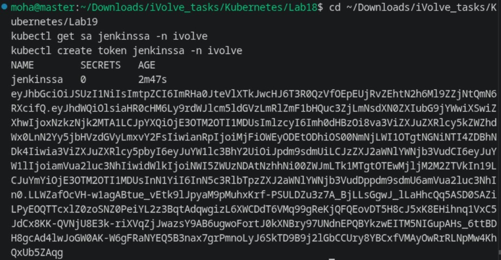
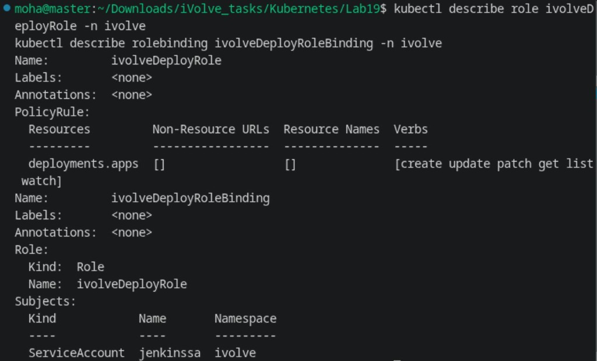
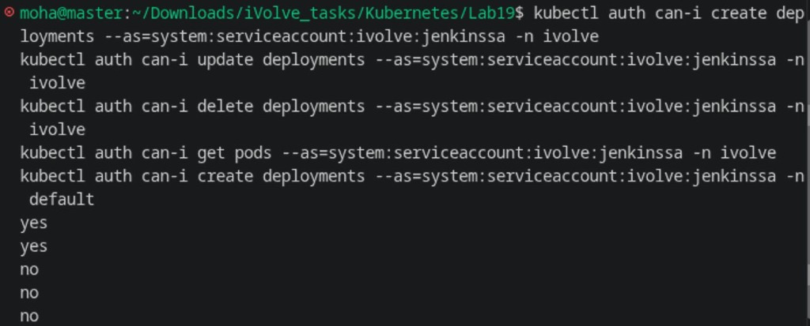

# Lab 19: Securing Kubernetes with RBAC and Service Accounts

Comprehensive guide, manifests, commands, and security verification for **Lab 19 (Securing Kubernetes with RBAC and Service Accounts)** in Kubernetes.

---

## Lab Objectives

1. **Service Account Creation**:
   - Create a dedicated Service Account named `jenkinssa` in namespace `ivolve`.
   - *Technical Note:* In Kubernetes, ServiceAccount resource names strictly adhere to RFC 1123 DNS subdomain specifications and must consist solely of lowercase alphanumeric characters, `.` or `-`.
2. **Authentication Token Generation**:
   - Generate an authentication bearer token for the Service Account using `kubectl create token jenkinssa -n ivolve`.
   - Provision a long-lived ServiceAccount token Secret (`jenkinssa-token`) for external CI/CD integrations.
3. **Least-Privilege Role Definition (`ivolveDeployRole`)**:
   - Define a Role named `ivolveDeployRole` in the `ivolve` namespace.
   - Restrict API permissions strictly to `apps` API group on `deployments` with `create`, `update`, `patch`, `get`, `list`, and `watch` verbs.
4. **RoleBinding (`ivolveDeployRoleBinding`)**:
   - Bind Role `ivolveDeployRole` to Service Account `jenkinssa` in namespace `ivolve`.
5. **Security & Permission Validation**:
   - Verify that `jenkinssa` is authorized to create and update deployments in `ivolve`.
   - Verify that `jenkinssa` is denied deleting deployments, accessing other resource types (such as pods), and accessing other namespaces (such as `default`).

---

## Architecture Diagram

```
+-----------------------------------------------------------------------------------------+
|                                    KUBERNETES RBAC                                      |
|                                                                                         |
|       +-------------------------------------------------------------------------+       |
|       |                           NAMESPACE: ivolve                             |       |
|       |                                                                         |       |
|       |   +------------------------------------+                                |       |
|       |   | ServiceAccount: jenkinssa          |                                |       |
|       |   | (Auth Bearer Token)                |                                |       |
|       |   +------------------+-----------------+                                |       |
|       |                      |                                                  |       |
|       |                      v (Bound via)                                      |       |
|       |   +------------------------------------+                                |       |
|       |   | RoleBinding:                       |                                |       |
|       |   | ivolveDeployRoleBinding            |                                |       |
|       |   +------------------+-----------------+                                |       |
|       |                      |                                                  |       |
|       |                      v (Grants Permissions of)                          |       |
|       |   +------------------------------------+                                |       |
|       |   | Role: ivolveDeployRole             |                                |       |
|       |   | apiGroups: ["apps"]                |                                |       |
|       |   | resources: ["deployments"]         |                                |       |
|       |   | verbs: ["create", "update", ...]   |                                |       |
|       |   +------------------+-----------------+                                |       |
|       |                      |                                                  |       |
|       |        +-------------+-------------+                                    |       |
|       |        | (ALLOWED)                 | (BLOCKED)                          |       |
|       |        v                           v                                    |       |
|       |   Deployments: create, update      Pods, Secrets, Deletions             |       |
|       +-------------------------------------------------------------------------+       |
+-----------------------------------------------------------------------------------------+
```

---

## 1. Step 1: Service Account & Token Generation (`rbac.yaml`)

```yaml
apiVersion: v1
kind: ServiceAccount
metadata:
  name: jenkinssa
  namespace: ivolve
---
apiVersion: v1
kind: Secret
metadata:
  name: jenkinssa-token
  namespace: ivolve
  annotations:
    kubernetes.io/service-account.name: jenkinssa
type: kubernetes.io/service-account-token
---
apiVersion: rbac.authorization.k8s.io/v1
kind: Role
metadata:
  name: ivolveDeployRole
  namespace: ivolve
rules:
  - apiGroups: ["apps"]
    resources: ["deployments"]
    verbs: ["create", "update", "patch", "get", "list", "watch"]
---
apiVersion: rbac.authorization.k8s.io/v1
kind: RoleBinding
metadata:
  name: ivolveDeployRoleBinding
  namespace: ivolve
subjects:
  - kind: ServiceAccount
    name: jenkinssa
    namespace: ivolve
roleRef:
  kind: Role
  name: ivolveDeployRole
  apiGroup: rbac.authorization.k8s.io
```

```bash
kubectl apply -f rbac.yaml
kubectl get sa jenkinssa -n ivolve
kubectl create token jenkinssa -n ivolve
```



---

## 2. Step 2: Verify Role and RoleBinding

Inspect the Role rules and RoleBinding subjects:

```bash
kubectl describe role ivolveDeployRole -n ivolve
kubectl describe rolebinding ivolveDeployRoleBinding -n ivolve
```



---

## 3. Step 3: Validate RBAC Authorization Rules

Verify authorized and restricted actions using `kubectl auth can-i`:

```bash
# 1. Verify ALLOWED actions (create & update deployments in ivolve)
kubectl auth can-i create deployments --as=system:serviceaccount:ivolve:jenkinssa -n ivolve
kubectl auth can-i update deployments --as=system:serviceaccount:ivolve:jenkinssa -n ivolve

# 2. Verify DENIED actions (delete deployments, read pods, or access default namespace)
kubectl auth can-i delete deployments --as=system:serviceaccount:ivolve:jenkinssa -n ivolve
kubectl auth can-i get pods --as=system:serviceaccount:ivolve:jenkinssa -n ivolve
kubectl auth can-i create deployments --as=system:serviceaccount:ivolve:jenkinssa -n default
```



---

## Summary of Commands

| Action | Command |
| :--- | :--- |
| **Apply RBAC Manifest** | `kubectl apply -f rbac.yaml` |
| **Check Service Account** | `kubectl get sa jenkinssa -n ivolve` |
| **Generate Service Account Token** | `kubectl create token jenkinssa -n ivolve` |
| **Describe Role** | `kubectl describe role ivolveDeployRole -n ivolve` |
| **Describe RoleBinding** | `kubectl describe rolebinding ivolveDeployRoleBinding -n ivolve` |
| **Test Create Deployment in ivolve** | `kubectl auth can-i create deployments --as=system:serviceaccount:ivolve:jenkinssa -n ivolve` |
| **Test Update Deployment in ivolve** | `kubectl auth can-i update deployments --as=system:serviceaccount:ivolve:jenkinssa -n ivolve` |
| **Test Delete Deployment in ivolve** | `kubectl auth can-i delete deployments --as=system:serviceaccount:ivolve:jenkinssa -n ivolve` |
| **Test Access Pods in ivolve** | `kubectl auth can-i get pods --as=system:serviceaccount:ivolve:jenkinssa -n ivolve` |
| **Test Access Other Namespace** | `kubectl auth can-i create deployments --as=system:serviceaccount:ivolve:jenkinssa -n default` |
