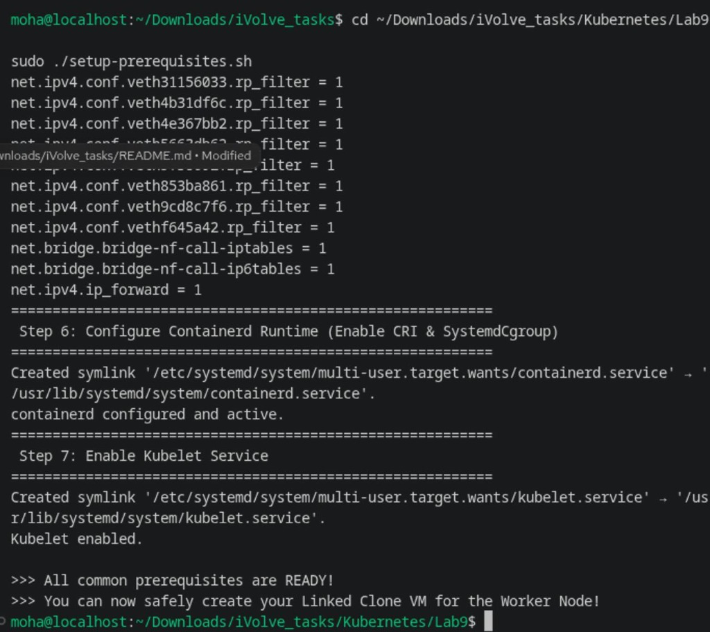
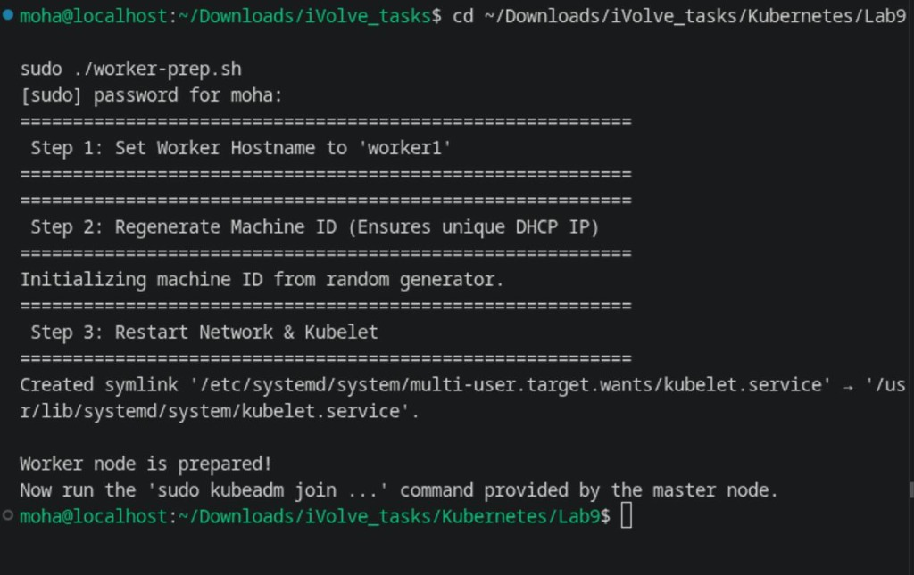
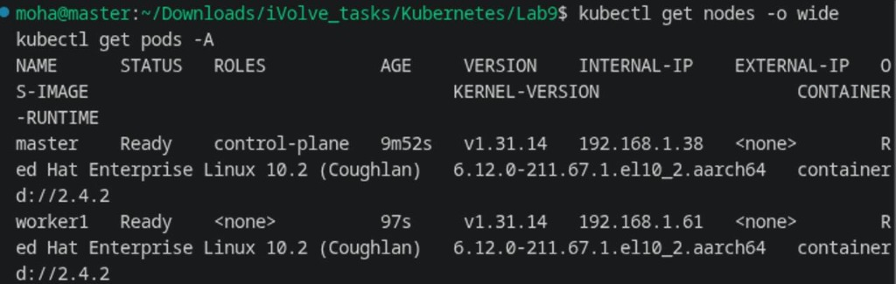
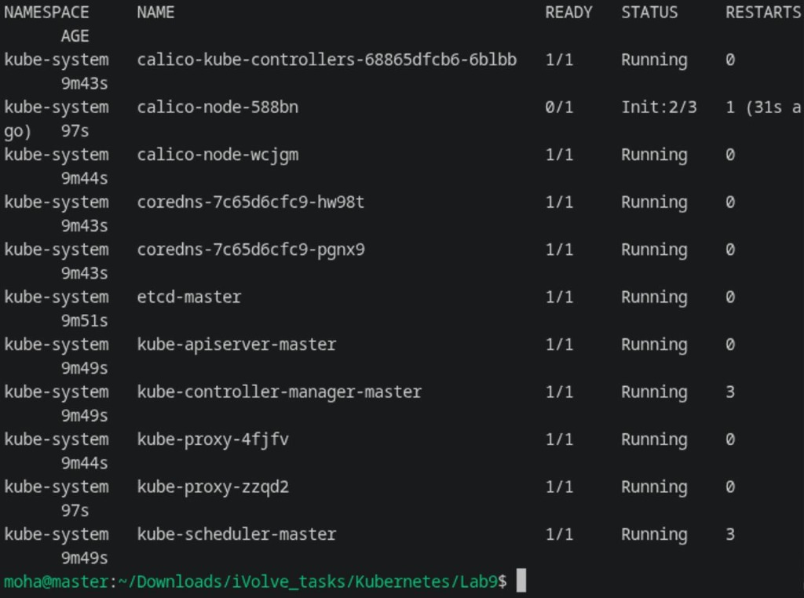

# Lab 9: Deploy Kubernetes Cluster using Kubeadm

Comprehensive guide, step-by-step instructions, and verification for deploying a multi-node Kubernetes cluster with **Kubeadm** and **Calico CNI** across two Virtual Machines (Master Control Plane & Worker Node).

---

## Lab Objectives

1. **Container Runtime Configuration**: Install and configure `containerd` with CRI and `SystemdCgroup` enabled across all nodes.
2. **Kubernetes Tooling**: Install and enable `kubeadm`, `kubelet`, and `kubectl`.
3. **OS & Kernel Tuning**: Disable swap, set SELinux to permissive, load `overlay` and `br_netfilter`, and tune sysctl for bridged network traffic.
4. **Control Plane Initialization**: Initialize the master node using `kubeadm init` with Pod CIDR `192.168.0.0/16`.
5. **kubectl Configuration**: Set up administrative cluster access (`$HOME/.kube/config`).
6. **Pod Networking (CNI)**: Install the **Calico CNI** plugin to manage cluster-wide pod networking and cross-node communication.
7. **Worker Node Join**: Join the worker node to the cluster using the generated `kubeadm join` command.
8. **Cluster Health Verification**: Verify that both master and worker nodes are in the `Ready` state and that all control plane and Calico pods are active.

---

## Architecture Diagram

```
+---------------------------------------------------------------------------------+
|                               KUBERNETES CLUSTER                                |
|                                                                                 |
|   +------------------------------------+   +--------------------------------+   |
|   |         MASTER NODE                |   |          WORKER NODE           |   |
|   |         (Control Plane)            |   |          (Worker Node)         |   |
|   |   Hostname: master                 |   |   Hostname: worker1            |   |
|   |   IP: 192.168.1.38                 |   |   IP: 192.168.1.61             |   |
|   +------------------------------------+   +--------------------------------+   |
|   | - kube-apiserver (Port 6443)       |   | - kubelet                      |   |
|   | - etcd, kube-scheduler             |   | - kube-proxy                   |   |
|   | - kube-controller-manager          |   | - containerd runtime           |   |
|   | - kube-proxy, kubelet              |   | - calico-node (Pod networking) |   |
|   | - containerd runtime               |   |                                |   |
|   | - calico-node / calico-kube-ctrl   |   |                                |   |
|   +-----------------+------------------+   +----------------+---------------+   |
|                     |                                       |                   |
|                     =========================================                   |
|                                Pod Network CIDR:                                |
|                                 192.168.0.0/16                                  |
|                               (Calico Overlay)                                  |
+---------------------------------------------------------------------------------+
```

---

## 1. Step 1: Prepare Master VM (Before Cloning)

Run the automated preparation script on this VM to configure all prerequisites:

```bash
cd ~/Downloads/iVolve_tasks/Kubernetes/Lab9
sudo ./setup-prerequisites.sh
```

This performs:
- Installs `conntrack-tools`
- Stops & disables old `k3s` service to release port `6443`
- Disables Swap (`swapoff -a` & `/etc/fstab`)
- Sets SELinux to permissive (`setenforce 0`)
- Disables Firewalld to avoid CNI port conflicts
- Loads kernel modules `overlay` and `br_netfilter`
- Sets sysctl `net.bridge.bridge-nf-call-iptables = 1` and `net.ipv4.ip_forward = 1`
- Configures `containerd` with `SystemdCgroup = true` and restarts the service
- Enables `kubelet`



---

## 2. Step 2: Create Linked Clone VM & Prepare Worker Node

1. Create a **Linked Clone** from the prepared Master VM.
2. Start both VMs (Master and Worker).
3. On the **Worker VM**, execute the preparation script:
```bash
cd ~/Downloads/iVolve_tasks/Kubernetes/Lab9
sudo ./worker-prep.sh
```
This sets the worker hostname to `worker1`, regenerates the machine ID (for unique DHCP networking), and enables the `kubelet` service.



---

## 3. Step 3: Initialize Master Node & Deploy Calico CNI

On the **Master VM**, run:

```bash
cd ~/Downloads/iVolve_tasks/Kubernetes/Lab9
./init-master.sh
```

This runs:
```bash
# 1. Initialize control plane
sudo kubeadm init \
  --apiserver-advertise-address=192.168.1.38 \
  --pod-network-cidr=192.168.0.0/16 \
  --node-name=master

# 2. Configure kubectl for user
mkdir -p $HOME/.kube
sudo cp -i /etc/kubernetes/admin.conf $HOME/.kube/config
sudo chown $(id -u):$(id -g) $HOME/.kube/config

# 3. Apply Calico CNI
kubectl apply -f https://raw.githubusercontent.com/projectcalico/calico/v3.28.0/manifests/calico.yaml
```

---

## 4. Step 4: Join Worker Node to the Cluster

From the output of `kubeadm init`, execute the join command on the **Worker VM** with `sudo`:

```bash
sudo kubeadm join 192.168.1.38:6443 --token ibsqg9.6y7twcc57fpfm6nx \
    --discovery-token-ca-cert-hash sha256:896bbecabe5f7e7647ba675fac06981e3af1726c916c2fc3f4ba41732cd47f93
```

---

## 5. Step 5: Cluster Health Verification

On the **Master VM**, verify that both nodes have joined and reached the `Ready` status:

```bash
kubectl get nodes -o wide
```

```text
NAME      STATUS   ROLES           AGE     VERSION    INTERNAL-IP    EXTERNAL-IP   OS-IMAGE                                   KERNEL-VERSION                   CONTAINER-RUNTIME
master    Ready    control-plane   9m52s   v1.31.14   192.168.1.38   <none>        Red Hat Enterprise Linux 10.2 (Coughlan)   6.12.0-211.67.1.el10_2.aarch64   containerd://2.4.2
worker1   Ready    <none>          97s     v1.31.14   192.168.1.61   <none>        Red Hat Enterprise Linux 10.2 (Coughlan)   6.12.0-211.67.1.el10_2.aarch64   containerd://2.4.2
```



Verify that all system and Calico CNI pods are running:

```bash
kubectl get pods -A
```

```text
NAMESPACE     NAME                                       READY   STATUS    RESTARTS   AGE
kube-system   calico-kube-controllers-68865dfcb6-6blbb   1/1     Running   0          13m
kube-system   calico-node-588bn                          1/1     Running   0          5m
kube-system   calico-node-wcjgm                          1/1     Running   0          13m
kube-system   coredns-7c65d6cfc9-hw98t                   1/1     Running   0          13m
kube-system   coredns-7c65d6cfc9-pgnx9                   1/1     Running   0          13m
kube-system   etcd-master                                1/1     Running   0          13m
kube-system   kube-apiserver-master                      1/1     Running   0          13m
kube-system   kube-controller-manager-master             1/1     Running   3          13m
kube-system   kube-proxy-4fjfv                           1/1     Running   0          13m
kube-system   kube-proxy-zzqd2                           1/1     Running   0          5m
kube-system   kube-scheduler-master                      1/1     Running   3          13m
```



---

## Summary of Cluster State

| Node | Role | Status | Kubernetes Version | Internal IP | Runtime |
| :--- | :--- | :---: | :---: | :---: | :---: |
| **master** | control-plane | Ready | v1.31.14 | 192.168.1.38 | containerd://2.4.2 |
| **worker1** | worker | Ready | v1.31.14 | 192.168.1.61 | containerd://2.4.2 |
